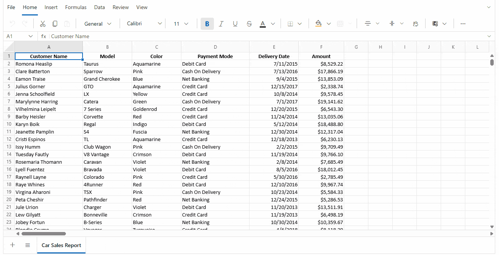

# Frozen Panes in Blazor Spreadsheet

Freezing panes in the [Blazor Spreadsheet Editor](https://www.syncfusion.com/spreadsheet-editor-sdk/blazor-spreadsheet-editor) component allows you to keep specific rows or columns visible while scrolling through large worksheets. This is useful for preserving headers, labels, or key reference columns so users can continue reading contextual information as they navigate the sheet.

To control this functionality, use the [FrozenRows](https://help.syncfusion.com/cr/blazor/Syncfusion.Blazor.Spreadsheet.SfSpreadsheet.html) and [FrozenColumns](https://help.syncfusion.com/cr/blazor/Syncfusion.Blazor.Spreadsheet.SfSpreadsheet.html) properties. These properties define how many rows and columns are frozen when the spreadsheet loads. You can also change frozen panes programmatically using [FreezePanesAsync()](https://help.syncfusion.com/cr/blazor/Syncfusion.Blazor.Spreadsheet.SfSpreadsheet.html#Syncfusion_Blazor_Spreadsheet_SfSpreadsheet_FreezePanesAsync_System_Int32_System_Int32_System_Nullable_System_Int32__). To remove frozen panes, use [UnfreezePanesAsync()](https://help.syncfusion.com/cr/blazor/Syncfusion.Blazor.Spreadsheet.SfSpreadsheet.html#Syncfusion_Blazor_Spreadsheet_SfSpreadsheet_UnfreezePanesAsync_System_Nullable_System_Int32__).

## Freezing panes




@page "/"
@using Syncfusion.Blazor.Spreadsheet

<SfSpreadsheet FrozenRows="1" FrozenColumns="1">
    <SpreadsheetRibbon></SpreadsheetRibbon>
</SfSpreadsheet>




N> When frozen panes are applied, the specified rows and columns remain fixed in place while the rest of the worksheet scrolls. For imported workbooks, any freeze settings already saved in the workbook are used instead. You can change them after load by calling [FreezePanesAsync()](https://help.syncfusion.com/cr/blazor/Syncfusion.Blazor.Spreadsheet.SfSpreadsheet.html#Syncfusion_Blazor_Spreadsheet_SfSpreadsheet_FreezePanesAsync_System_Int32_System_Int32_System_Nullable_System_Int32__).

## Frozen panes options

The Blazor Spreadsheet supports the following frozen pane configurations:

| Operation | Description |
| -- | -- |
| Freeze panes | Freezes both rows and columns at the current viewport boundary. |
| Freeze rows | Keeps the top rows visible while scrolling vertically. |
| Freeze columns | Keeps the left columns visible while scrolling horizontally. |
| Unfreeze panes | Removes all frozen rows and columns from the worksheet. |
| Unfreeze rows | Removes the frozen rows from the worksheet. |
| UnFreeze columns | Removes the frozen columns from the worksheet. |

## Freeze panes

### Freeze panes via UI

To freeze panes through the Ribbon UI, follow these steps:

1. Select the worksheet area where you want the freeze boundary to begin.
2. In the **View** tab of the Ribbon, click the **Freeze Panes**.

When freezing panes through the user interface, the worksheet is split so the selected rows and/or columns remain visible while the rest of the sheet scrolls.

### Freeze panes programmatically

The [FreezePanesAsync()](https://help.syncfusion.com/cr/blazor/Syncfusion.Blazor.Spreadsheet.SfSpreadsheet.html#Syncfusion_Blazor_Spreadsheet_SfSpreadsheet_FreezePanesAsync_System_Int32_System_Int32_System_Nullable_System_Int32__) method freezes the specified number of rows and columns. This provides a programmatic way to freeze panes without using the UI.

The available parameters are:

| Parameter | Type | Description |
| -- | -- | -- |
| row | int | Specifies the number of rows to freeze. A non-positive value leaves rows unfrozen. |
| column | int | Specifies the number of columns to freeze. A non-positive value leaves columns unfrozen. |
| sheetIndex | int? (optional) | Specifies the zero-based worksheet index. If not provided, the active worksheet is used. |




@page "/"
@using Syncfusion.Blazor.Spreadsheet

<button class="e-btn" @onclick="FreezeRowsAndColumns">Freeze panes</button>
<button class="e-btn" @onclick="FreezeOnlyRows">Freeze rows</button>
<button class="e-btn" @onclick="FreezeOnlyColumns">Freeze columns</button>

<SfSpreadsheet @ref="SpreadsheetInstance" DataSource="DataSourceBytes">
    <SpreadsheetRibbon></SpreadsheetRibbon>
</SfSpreadsheet>

@code {
    public byte[] DataSourceBytes { get; set; }
    public SfSpreadsheet SpreadsheetInstance;

    protected override void OnInitialized()
    {
        string filePath = "wwwroot/Sample.xlsx";
        DataSourceBytes = File.ReadAllBytes(filePath);
    }

    private async Task FreezeRowsAndColumns()
    {
        await SpreadsheetInstance.FreezePanesAsync(3, 2);
    }

    private async Task FreezeOnlyRows()
    {
        await SpreadsheetInstance.FreezePanesAsync(2, 0);
    }

    private async Task FreezeOnlyColumns()
    {
        await SpreadsheetInstance.FreezePanesAsync(0, 2);
    }
}




## Freeze rows

### Freeze rows via UI

To freeze rows through the Ribbon UI, follow these steps:

1. Select the worksheet area near the row boundary you want to keep visible.
2. In the **View** tab of the Ribbon, click the **Freeze Rows**.

This keeps the row visible while scrolling down the worksheet.

### Freeze rows programmatically

To freeze only rows, call [FreezePanesAsync()](https://help.syncfusion.com/cr/blazor/Syncfusion.Blazor.Spreadsheet.SfSpreadsheet.html#Syncfusion_Blazor_Spreadsheet_SfSpreadsheet_FreezePanesAsync_System_Int32_System_Int32_System_Nullable_System_Int32__) with the `column` parameter set to `0`.




@page "/"
@using Syncfusion.Blazor.Spreadsheet

<button class="e-btn" @onclick="FreezeTopRows">Freeze top rows</button>

<SfSpreadsheet @ref="SpreadsheetInstance" DataSource="DataSourceBytes">
    <SpreadsheetRibbon></SpreadsheetRibbon>
</SfSpreadsheet>

@code {
    public byte[] DataSourceBytes { get; set; }
    public SfSpreadsheet SpreadsheetInstance;

    protected override void OnInitialized()
    {
        string filePath = "wwwroot/Sample.xlsx";
        DataSourceBytes = File.ReadAllBytes(filePath);
    }

    private async Task FreezeTopRows()
    {
        await SpreadsheetInstance.FreezePanesAsync(1, 0);
    }
}




## Freeze columns

### Freeze columns via UI

To freeze columns through the Ribbon UI, follow these steps:

1. Select the worksheet area near the column boundary you want to keep visible.
2. In the **View** tab of the Ribbon, click the **Freeze Columns**.

This keeps the leftmost column visible while scrolling horizontally.

### Freeze columns programmatically

To freeze only columns, call [FreezePanesAsync()](https://help.syncfusion.com/cr/blazor/Syncfusion.Blazor.Spreadsheet.SfSpreadsheet.html#Syncfusion_Blazor_Spreadsheet_SfSpreadsheet_FreezePanesAsync_System_Int32_System_Int32_System_Nullable_System_Int32__) with the `row` parameter set to `0`.




@page "/"
@using Syncfusion.Blazor.Spreadsheet

<button class="e-btn" @onclick="FreezeFirstColumn">Freeze first column</button>

<SfSpreadsheet @ref="SpreadsheetInstance" DataSource="DataSourceBytes">
    <SpreadsheetRibbon></SpreadsheetRibbon>
</SfSpreadsheet>

@code {
    public byte[] DataSourceBytes { get; set; }
    public SfSpreadsheet SpreadsheetInstance;

    protected override void OnInitialized()
    {
        string filePath = "wwwroot/Sample.xlsx";
        DataSourceBytes = File.ReadAllBytes(filePath);
    }

    private async Task FreezeFirstColumn()
    {
        await SpreadsheetInstance.FreezePanesAsync(0, 1);
    }
}




## Unfreeze panes

### Unfreeze panes via UI

To remove frozen panes through the Ribbon UI, follow these steps:

1. In the **View** tab of the Ribbon, click the **UnFreeze Panes** or you only want to unfreeze row or column means click the **UnFreeze Rows** or **UnFreeze Columns**.

### Unfreeze panes programmatically

The [UnfreezePanesAsync()](https://help.syncfusion.com/cr/blazor/Syncfusion.Blazor.Spreadsheet.SfSpreadsheet.html#Syncfusion_Blazor_Spreadsheet_SfSpreadsheet_UnfreezePanesAsync_System_Nullable_System_Int32__) method removes all frozen rows and columns from the worksheet.




@page "/"
@using Syncfusion.Blazor.Spreadsheet

<button class="e-btn" @onclick="UnfreezePanes">Unfreeze panes</button>

<SfSpreadsheet @ref="SpreadsheetInstance" DataSource="DataSourceBytes">
    <SpreadsheetRibbon></SpreadsheetRibbon>
</SfSpreadsheet>

@code {
    public byte[] DataSourceBytes { get; set; }
    public SfSpreadsheet SpreadsheetInstance;

    protected override void OnInitialized()
    {
        string filePath = "wwwroot/Sample.xlsx";
        DataSourceBytes = File.ReadAllBytes(filePath);
    }

    private async Task UnfreezePanes()
    {
        await SpreadsheetInstance.UnfreezePanesAsync();
    }
}




## Limitations of frozen panes

The [Blazor Spreadsheet Editor](https://www.syncfusion.com/spreadsheet-editor-sdk/blazor-spreadsheet-editor) enforces these freeze constraints to ensure a consistent viewing experience:

- If images and charts are added inside the freeze area cells, their portion in the unfreeze area will not move when scrolling.
