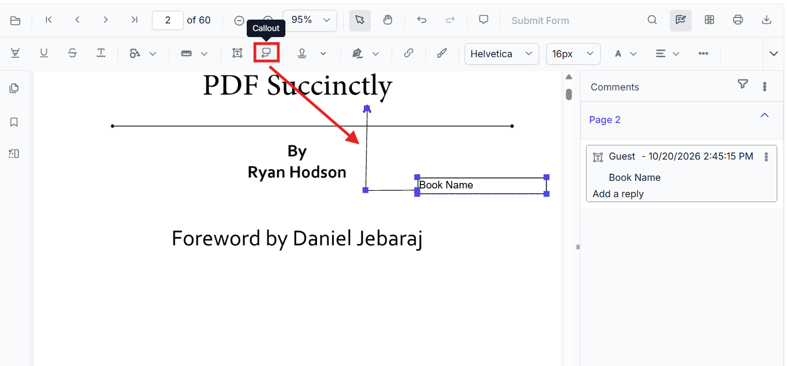
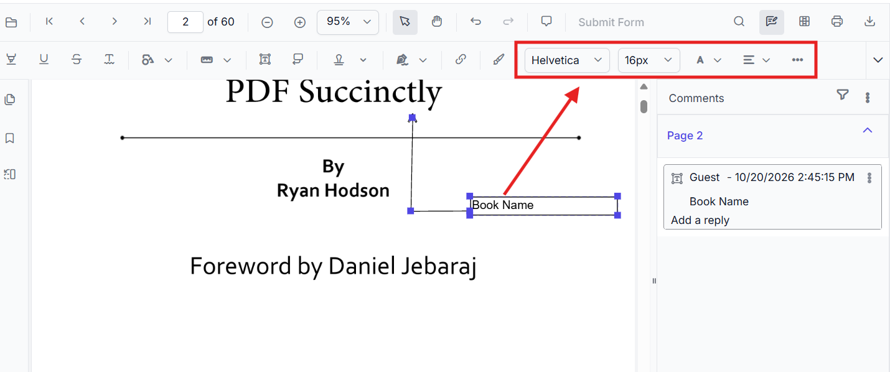
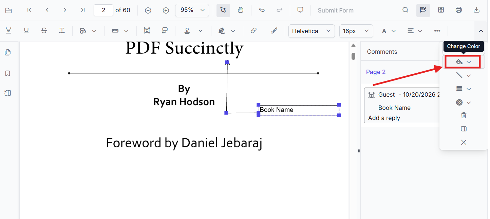
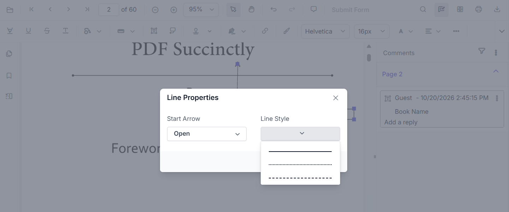

# Callout Annotation in Angular PDF Viewer

Callout annotations let users place an editable text box on a PDF page and connect it to a target point with one or more callout leader lines. They combine the inline commenting experience of a Free Text annotation with a connector that visually points to the content being annotated, making them ideal for review notes, labels, and call-outs that reference specific areas of a document without altering the original content.

## Enable Callout Annotation in the Viewer

To enable Callout annotations, inject the following modules into the Angular PDF Viewer:

- [**Annotation**](https://ej2.syncfusion.com/angular/documentation/api/pdfviewer/index-default#annotation)
- [**Toolbar**](https://ej2.syncfusion.com/angular/documentation/api/pdfviewer/index-default#toolbar)




import { Component } from '@angular/core';
import {
  PdfViewerModule,
  ToolbarService,
  AnnotationService
} from '@syncfusion/ej2-angular-pdfviewer';

@Component({
  selector: 'app-root',
  template: `
    

      <ejs-pdfviewer
        id="pdfViewer"
        [documentPath]="document"
        [resourceUrl]="resource"
        style="height:650px;display:block">
      </ejs-pdfviewer>
    

  `,
  imports: [PdfViewerModule],
  providers: [ToolbarService, AnnotationService]
})
export class AppComponent {

  public document: string =
    'https://cdn.syncfusion.com/content/pdf/pdf-succinctly.pdf';

  public resource: string =
    'https://cdn.syncfusion.com/ej2/31.2.2/dist/ej2-pdfviewer-lib';
}




## Add Callout Annotation

### Add Callout Annotation Using the Toolbar

1. Open the **Annotation Toolbar**.
2. Select the **Callout Annotation** tool.

   

3. Click on the PDF page to place the text box.
4. Type the annotation text into the box.
5. Drag or resize the text box as needed.
6. Adjust the callout line position so the leader line points to the desired content on the page.

N> When Pan mode is active, choosing the Callout Annotation tool switches the viewer into the appropriate selection/edit workflow for a smoother experience.

### Enable Callout Annotation Mode

Programmatically switch to Callout Annotation mode.




enableCalloutMode(): void {
  const pdfViewer = (document.getElementById('pdfViewer') as any).ej2_instances[0];
  pdfViewer.annotationModule.setAnnotationMode('Callout');
}




#### Exit Callout Annotation Mode




exitCalloutMode(): void {
  const pdfViewer = (document.getElementById('pdfViewer') as any).ej2_instances[0];
  pdfViewer.annotationModule.setAnnotationMode('None');
}




### Add Callout Annotation Programmatically

Use the [`addAnnotation`](https://ej2.syncfusion.com/angular/documentation/api/pdfviewer/index-default#addannotation) API to create a Callout Annotation at a specific location and connect it to a target point on the page using `calloutLines`.




addCalloutProgrammatically(): void {
  const pdfViewer = (document.getElementById('pdfViewer') as any).ej2_instances[0];
  pdfViewer.annotation.addAnnotation('Callout', {
    offset: { x: 200, y: 200 },
    pageNumber: 1,
    opacity: 1,
    borderColor: '#000000',
    borderWidth: 1,
    borderStyle: 'solid',
    author: 'Guest',
    calloutLines: [
      { x: 50, y: 50 },
      { x: 100, y: 100 },
      { x: 200, y: 250 }
    ],
    lineEndingStyle: 'Open'
  });
}




#### Key Callout Properties

- **offset**: Location of the Callout Annotation text box on the page, in page coordinates.
- **pageNumber**: The page on which the Callout Annotation is placed.
- **calloutLines**: An ordered array of `{ x, y }` points that define the path of the callout leader line, connecting the text box to the target area on the page. The first point starts near the text box and the last point anchors the line to the content being called out.
- **lineEndingStyle**: Style applied to the end of the callout leader line (for example, `Open`).

## Customize Callout Annotation Appearance

Customize the appearance of a Callout Annotation when adding it programmatically by passing values such as `borderColor`, `borderWidth`, `borderStyle`, `opacity`, `lineEndingStyle`, and `calloutLines` to [`addAnnotation`](https://ej2.syncfusion.com/angular/documentation/api/pdfviewer/index-default#addannotation). These values control the leader line and text box rendered on the page.

To edit a callout after placing it, select the annotation and use the annotation toolbar to change its text formatting and appearance.

Use the color controls to change the selected callout's color.

To change the leader line's arrowhead or line style, open its line properties.

N> To tailor right‑click options, see [**Customize Context Menu**](../../context-menu/custom-context-menu).

## Modify, Edit, Delete Callout Annotation

- **Move/Resize**: Drag the text box or use the resize handles.
- **Edit Text**: Click inside the box and type.
- **Adjust Leader Line**: Drag the endpoints of the callout line to point to the desired content.
- **Delete**: Use the toolbar or context menu options. For deletion workflows and API details, see [**Delete Annotation**](../delete-annotation).

N> Callout annotations do **not** modify the original PDF text; they overlay an editable text box connected by a leader line on top of the page content.

### Delete Callout Annotation

Delete Callout Annotation via UI (toolbar/context menu) or programmatically. For supported workflows and APIs, see [**Delete Annotation**](../delete-annotation).

## Callout Annotation Events

Listen to add/modify/select/remove events for Callout annotations and handle them as needed. For the full list and parameters, see [**Annotation Events**](../annotation-event).

## Export and Import

Callout annotations can be exported or imported just like other annotations. For supported formats and steps, see [**Export and Import annotations**](../export-import/export-annotation).

## See Also

- [Annotation Toolbar](../../toolbar-customization/annotation-toolbar)
- [Customize Context Menu](../../context-menu/custom-context-menu)
- [Comments Panel](../comments)
- [Annotation Events](../annotation-event)
- [Export and Import annotations](../export-import/export-annotation)
- [Delete Annotations](../delete-annotation)