# Create Form Fields in Angular PDF Viewer

Create or add new form fields visually with the Form Designer UI or programmatically using the Angular PDF Viewer API. This guide explains both methods and shows field-specific examples and a complete runnable example.

This guide covers the following:
- How to add fields with the Form Designer UI.
- How to add and edit fields programmatically (API).
- How to add common field types: Textbox, Password, CheckBox, RadioButton, ListBox, DropDown, Signature, Initial, DateTime picker, Button, Barcode.

## Steps

### 1. Create form fields using Form Designer UI

- Enable the Form Designer mode in the PDF Viewer. See [Form Designer overview](../overview).
- Select a field type from the toolbar and click the PDF page to place it.
- Move/resize the field and configure properties in the **Properties** panel.

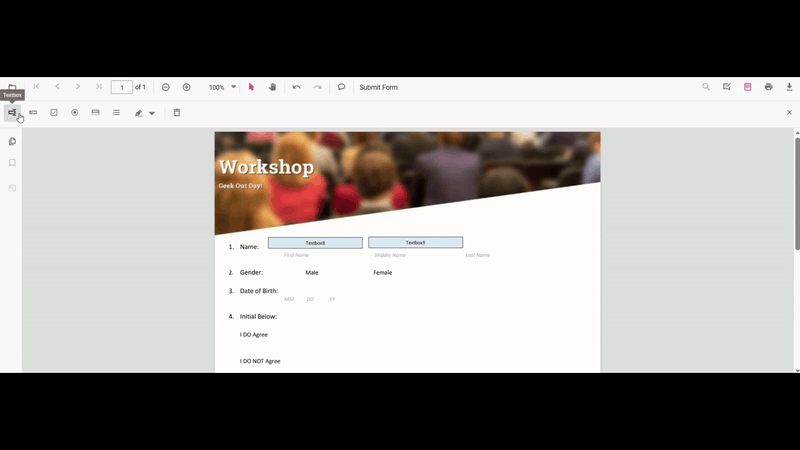

### 2. Create Form fields programmatically

Use [`addFormField`](https://ej2.syncfusion.com/angular/documentation/api/pdfviewer/formdesigner#addformfield) method of the [formDesigner](https://ej2.syncfusion.com/angular/documentation/api/pdfviewer/formdesigner) module inside the viewer's [`documentLoad`](https://ej2.syncfusion.com/angular/documentation/api/pdfviewer#documentload) handler or in response to user actions.

Use this approach to generate form fields dynamically based on data or application logic.



import { Component, ViewChild } from '@angular/core';
import {
  ToolbarService,
  MagnificationService,
  NavigationService,
  AnnotationService,
  TextSelectionService,
  TextSearchService,
  FormFieldsService,
  FormDesignerService,
  PdfViewerModule,
  PdfViewerComponent,
} from '@syncfusion/ej2-angular-pdfviewer';

@Component({
  selector: 'app-root',
  standalone: true,
  imports: [PdfViewerModule],
  template: `
    

      <ejs-pdfviewer #pdfViewer id="pdfViewer" (documentLoad)="onDocumentLoad()"
        [resourceUrl]="resourceUrl"
        [documentPath]="document"
        style="height: 640px; display: block;">
      </ejs-pdfviewer>
    

  `,
  providers: [
    ToolbarService,
    MagnificationService,
    NavigationService,
    AnnotationService,
    TextSelectionService,
    TextSearchService,
    FormFieldsService,
    FormDesignerService,
  ],
})
export class AppComponent {
  public document: string = 'https://cdn.syncfusion.com/content/pdf/form-filling-document.pdf';
  public resourceUrl: string = 'https://cdn.syncfusion.com/ej2/31.1.23/dist/ej2-pdfviewer-lib';

  @ViewChild('pdfViewer') public pdfviewer!: PdfViewerComponent;

  onDocumentLoad(): void {
    this.pdfviewer.formDesignerModule.addFormField('Textbox', {
      name: 'First Name',
      bounds: { X: 146, Y: 229, Width: 150, Height: 24 },
      pageNumber: 1,
      isRequired: true,
      tooltip: 'Enter your first name'
    } as any);
  }
}



**Use programmatic creation when:**

- Building dynamic forms
- Pre-filling forms from databases
- Automating form creation workflows

## Field‑specific instructions

Below are concise UI steps and the programmatic examples for each common field type.

### Textbox

**Add via UI**: Open Form Designer toolbar → select Textbox → click page → configure properties

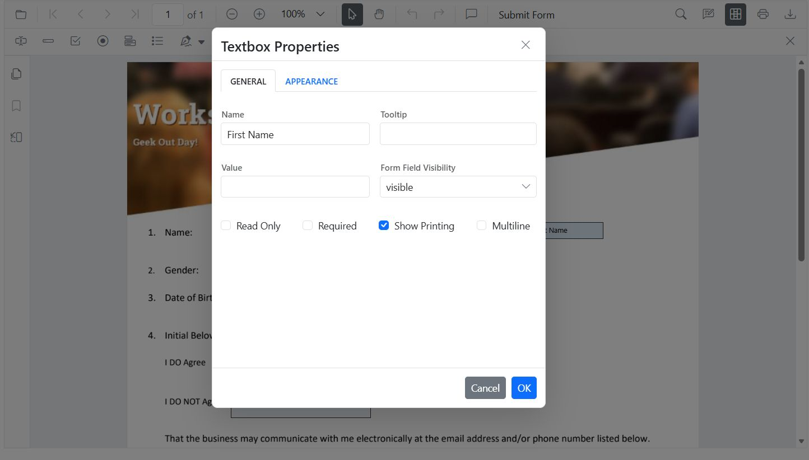

**Add Programmatically (API)**



import { Component, ViewChild } from '@angular/core';
import {
  ToolbarService,
  MagnificationService,
  NavigationService,
  AnnotationService,
  TextSelectionService,
  TextSearchService,
  FormFieldsService,
  FormDesignerService,
  PdfViewerModule,
  PdfViewerComponent,
} from '@syncfusion/ej2-angular-pdfviewer';

@Component({
  selector: 'app-root',
  standalone: true,
  imports: [PdfViewerModule],
  template: `
    

      <ejs-pdfviewer #pdfViewer id="pdfViewer" (documentLoad)="onDocumentLoad()"
        [resourceUrl]="resourceUrl"
        [documentPath]="document"
        style="height: 640px; display: block;">
      </ejs-pdfviewer>
    

  `,
  providers: [
    ToolbarService,
    MagnificationService,
    NavigationService,
    AnnotationService,
    TextSelectionService,
    TextSearchService,
    FormFieldsService,
    FormDesignerService,
  ],
})
export class AppComponent {
  public document: string = 'https://cdn.syncfusion.com/content/pdf/form-filling-document.pdf';
  public resourceUrl: string = 'https://cdn.syncfusion.com/ej2/31.1.23/dist/ej2-pdfviewer-lib';

  @ViewChild('pdfViewer') public pdfviewer!: PdfViewerComponent;

  onDocumentLoad(): void {
    this.pdfviewer.formDesignerModule.addFormField('Textbox', {
      name: 'FirstName',
      pageNumber: 1,
      bounds: { X: 100, Y: 150, Width: 200, Height: 24 },
      isRequired: true,
      tooltip: 'Enter your first name',
      maxLength: 40
    } as any);
  }
}



### Password

**Add via UI**: Open form designer toolbar → Select Password → place → configure properties
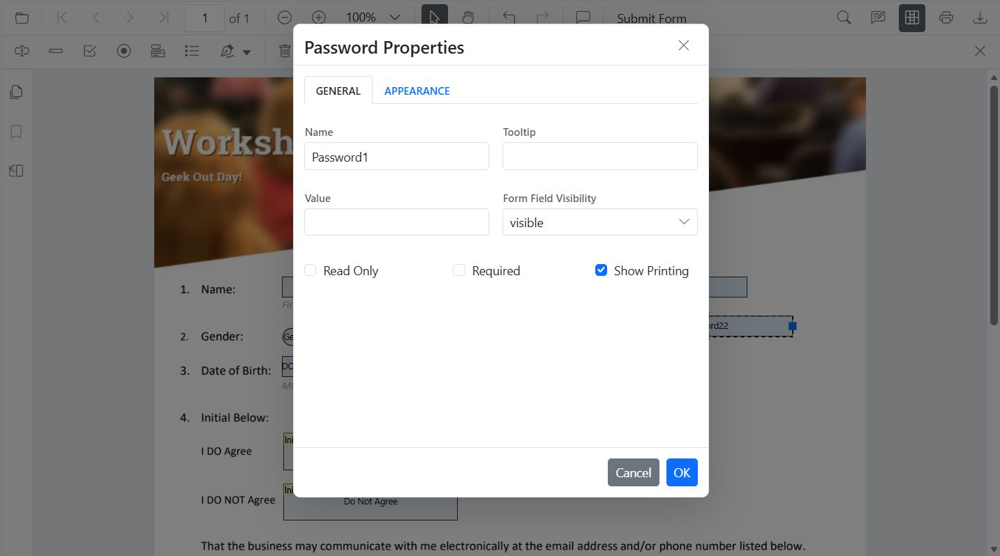

**Add Programmatically (API)**



import { Component, ViewChild } from '@angular/core';
import {
  ToolbarService,
  MagnificationService,
  NavigationService,
  AnnotationService,
  TextSelectionService,
  TextSearchService,
  FormFieldsService,
  FormDesignerService,
  PdfViewerModule,
  PdfViewerComponent,
} from '@syncfusion/ej2-angular-pdfviewer';

@Component({
  selector: 'app-root',
  standalone: true,
  imports: [PdfViewerModule],
  template: `
    

      <ejs-pdfviewer #pdfViewer id="pdfViewer" (documentLoad)="onDocumentLoad()"
        [resourceUrl]="resourceUrl"
        [documentPath]="document"
        style="height: 640px; display: block;">
      </ejs-pdfviewer>
    

  `,
  providers: [
    ToolbarService,
    MagnificationService,
    NavigationService,
    AnnotationService,
    TextSelectionService,
    TextSearchService,
    FormFieldsService,
    FormDesignerService,
  ],
})
export class AppComponent {
  public document: string = 'https://cdn.syncfusion.com/content/pdf/form-filling-document.pdf';
  public resourceUrl: string = 'https://cdn.syncfusion.com/ej2/31.1.23/dist/ej2-pdfviewer-lib';

  @ViewChild('pdfViewer') public pdfviewer!: PdfViewerComponent;

  onDocumentLoad(): void {
    this.pdfviewer.formDesignerModule.addFormField('Password', {
      name: 'AccountPassword',
      pageNumber: 1,
      bounds: { X: 100, Y: 190, Width: 200, Height: 24 },
      isRequired: true,
      maxLength: 32,
      tooltip: 'Enter a secure password',
    } as any);
  }
}



### CheckBox
**Add via UI**: Open form designer toolbar → Select CheckBox → click to place → duplicate for options.
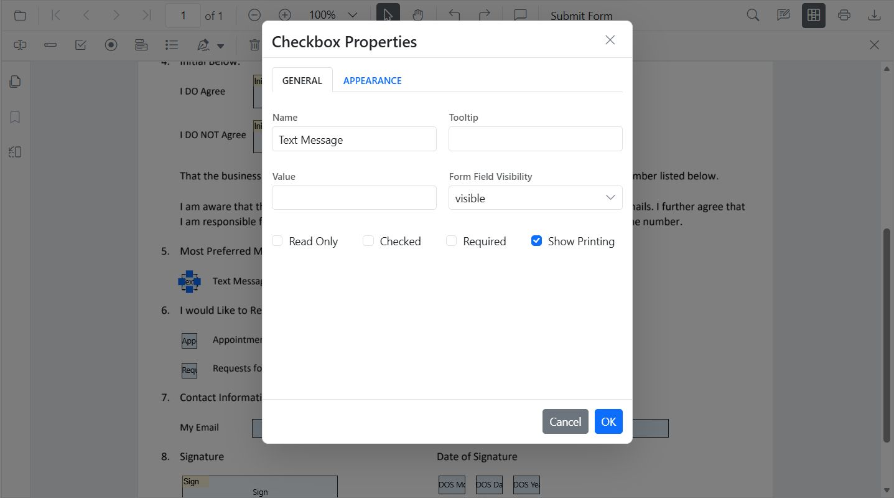

**Add Programmatically (API)**



import { Component, ViewChild } from '@angular/core';
import {
  ToolbarService,
  MagnificationService,
  NavigationService,
  AnnotationService,
  TextSelectionService,
  TextSearchService,
  FormFieldsService,
  FormDesignerService,
  PdfViewerModule,
  PdfViewerComponent,
} from '@syncfusion/ej2-angular-pdfviewer';

@Component({
  selector: 'app-root',
  standalone: true,
  imports: [PdfViewerModule],
  template: `
    

      <ejs-pdfviewer #pdfViewer id="pdfViewer" (documentLoad)="onDocumentLoad()"
        [resourceUrl]="resourceUrl"
        [documentPath]="document"
        style="height: 640px; display: block;">
      </ejs-pdfviewer>
    

  `,
  providers: [
    ToolbarService,
    MagnificationService,
    NavigationService,
    AnnotationService,
    TextSelectionService,
    TextSearchService,
    FormFieldsService,
    FormDesignerService,
  ],
})
export class AppComponent {
  public document: string = 'https://cdn.syncfusion.com/content/pdf/form-filling-document.pdf';
  public resourceUrl: string = 'https://cdn.syncfusion.com/ej2/31.1.23/dist/ej2-pdfviewer-lib';

  @ViewChild('pdfViewer') public pdfviewer!: PdfViewerComponent;

  onDocumentLoad(): void {
    this.pdfviewer.formDesignerModule.addFormField('CheckBox', {
      name: 'AgreeTerms',
      pageNumber: 1,
      bounds: { X: 100, Y: 230, Width: 18, Height: 18 },
      isChecked: false,
      tooltip: 'I agree to the terms',
    } as any);
  }
}



### RadioButton

**Add via UI**: Open form designer toolbar → Select RadioButton → place buttons using the same `name` to group them.
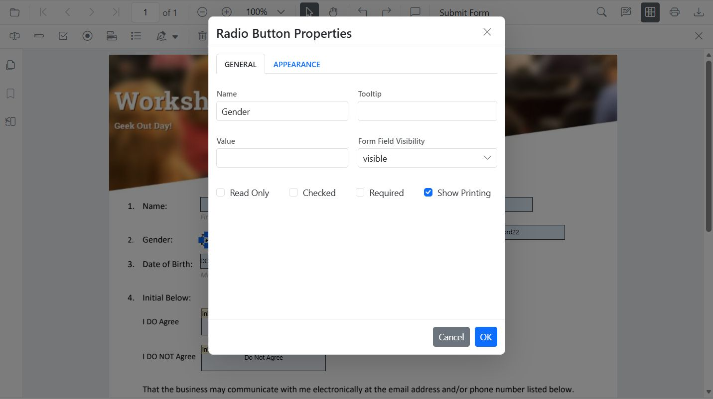

**Add Programmatically (API)**



import { Component, ViewChild } from '@angular/core';
import {
  ToolbarService,
  MagnificationService,
  NavigationService,
  AnnotationService,
  TextSelectionService,
  TextSearchService,
  FormFieldsService,
  FormDesignerService,
  PdfViewerModule,
  PdfViewerComponent,
} from '@syncfusion/ej2-angular-pdfviewer';

@Component({
  selector: 'app-root',
  standalone: true,
  imports: [PdfViewerModule],
  template: `
    

      <ejs-pdfviewer #pdfViewer id="pdfViewer" (documentLoad)="onDocumentLoad()"
        [resourceUrl]="resourceUrl"
        [documentPath]="document"
        style="height: 640px; display: block;">
      </ejs-pdfviewer>
    

  `,
  providers: [
    ToolbarService,
    MagnificationService,
    NavigationService,
    AnnotationService,
    TextSelectionService,
    TextSearchService,
    FormFieldsService,
    FormDesignerService,
  ],
})
export class AppComponent {
  public document: string = 'https://cdn.syncfusion.com/content/pdf/form-filling-document.pdf';
  public resourceUrl: string = 'https://cdn.syncfusion.com/ej2/31.1.23/dist/ej2-pdfviewer-lib';

  @ViewChild('pdfViewer') public pdfviewer!: PdfViewerComponent;

  onDocumentLoad(): void {
    this.pdfviewer.formDesignerModule.addFormField('RadioButton', {
      name: 'Gender',
      value: 'Male',
      pageNumber: 1,
      bounds: { X: 100, Y: 270, Width: 16, Height: 16 }
    } as any);
    this.pdfviewer.formDesignerModule.addFormField('RadioButton', {
      name: 'Gender',
      value: 'Female',
      pageNumber: 1,
      bounds: { X: 160, Y: 270, Width: 16, Height: 16 }
    } as any);
  }
}



### ListBox

**Add via UI**: Open form designer toolbar → Select ListBox → place → add items in Properties.
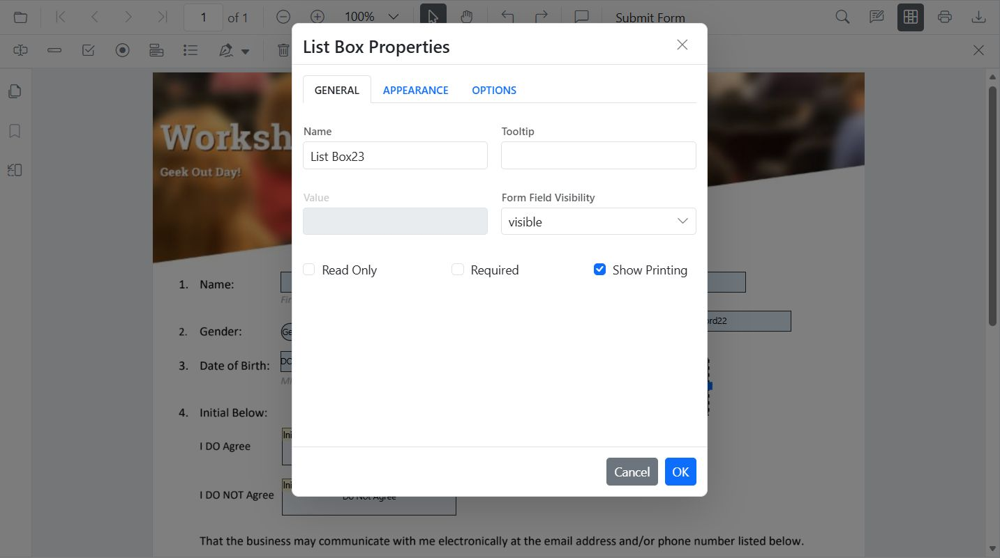

**Add Programmatically (API)**



import { Component, ViewChild } from '@angular/core';
import {
  ToolbarService,
  MagnificationService,
  NavigationService,
  AnnotationService,
  TextSelectionService,
  TextSearchService,
  FormFieldsService,
  FormDesignerService,
  PdfViewerModule,
  PdfViewerComponent,
} from '@syncfusion/ej2-angular-pdfviewer';

@Component({
  selector: 'app-root',
  standalone: true,
  imports: [PdfViewerModule],
  template: `
    

      <ejs-pdfviewer #pdfViewer id="pdfViewer" (documentLoad)="onDocumentLoad()"
        [resourceUrl]="resourceUrl"
        [documentPath]="document"
        style="height: 640px; display: block;">
      </ejs-pdfviewer>
    

  `,
  providers: [
    ToolbarService,
    MagnificationService,
    NavigationService,
    AnnotationService,
    TextSelectionService,
    TextSearchService,
    FormFieldsService,
    FormDesignerService,
  ],
})
export class AppComponent {
  public document: string = 'https://cdn.syncfusion.com/content/pdf/form-filling-document.pdf';
  public resourceUrl: string = 'https://cdn.syncfusion.com/ej2/31.1.23/dist/ej2-pdfviewer-lib';

  @ViewChild('pdfViewer') public pdfviewer!: PdfViewerComponent;

  onDocumentLoad(): void {
    const option = [
      { itemName: 'Item 1', itemValue: 'item1' },
      { itemName: 'Item 2', itemValue: 'item2' },
      { itemName: 'Item 3', itemValue: 'item3' }
    ];
    this.pdfviewer.formDesignerModule.addFormField('ListBox', {
      name: 'States',
      pageNumber: 1,
      bounds: { X: 100, Y: 310, Width: 220, Height: 70 },
      options: option,
    } as any);
  }
}



### DropDown

**Add via UI**: Open form designer toolbar → Select DropDown → place → add items → set default value.
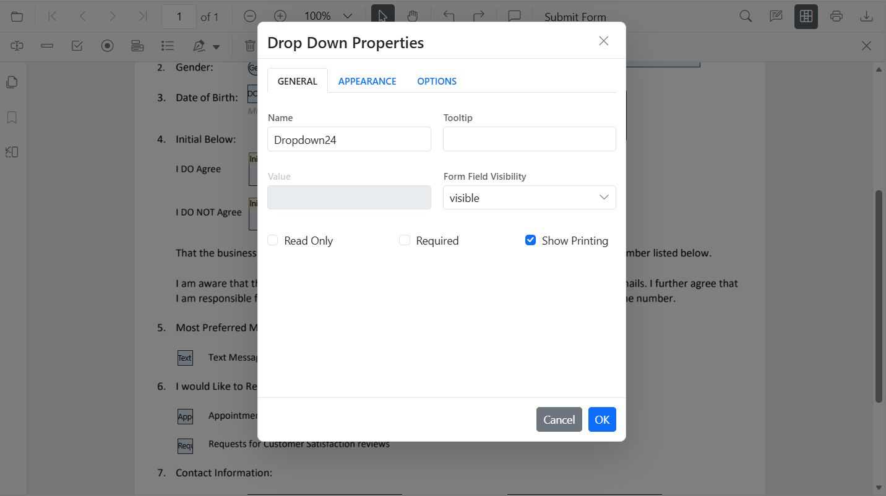

**Add Programmatically (API)**



import { Component, ViewChild } from '@angular/core';
import {
  ToolbarService,
  MagnificationService,
  NavigationService,
  AnnotationService,
  TextSelectionService,
  TextSearchService,
  FormFieldsService,
  FormDesignerService,
  PdfViewerModule,
  PdfViewerComponent,
} from '@syncfusion/ej2-angular-pdfviewer';

@Component({
  selector: 'app-root',
  standalone: true,
  imports: [PdfViewerModule],
  template: `
    

      <ejs-pdfviewer #pdfViewer id="pdfViewer" (documentLoad)="onDocumentLoad()"
        [resourceUrl]="resourceUrl"
        [documentPath]="document"
        style="height: 640px; display: block;">
      </ejs-pdfviewer>
    

  `,
  providers: [
    ToolbarService,
    MagnificationService,
    NavigationService,
    AnnotationService,
    TextSelectionService,
    TextSearchService,
    FormFieldsService,
    FormDesignerService,
  ],
})
export class AppComponent {
  public document: string = 'https://cdn.syncfusion.com/content/pdf/form-filling-document.pdf';
  public resourceUrl: string = 'https://cdn.syncfusion.com/ej2/31.1.23/dist/ej2-pdfviewer-lib';

  @ViewChild('pdfViewer') public pdfviewer!: PdfViewerComponent;

  onDocumentLoad(): void {
    const options = [
      { itemName: 'Item 1', itemValue: 'item1' },
      { itemName: 'Item 2', itemValue: 'item2' },
      { itemName: 'Item 3', itemValue: 'item3' },
    ];

    this.pdfviewer.formDesignerModule.addFormField('DropDown', {
      name: 'Country',
      options,
      bounds: { X: 560, Y: 320, Width: 150, Height: 24 },
    } as any);
  }
}



### Signature Field

**Add via UI**: Open form designer toolbar → select Signature Field → place where signing is required → configure indicator text/thickness/tooltip/isRequired.
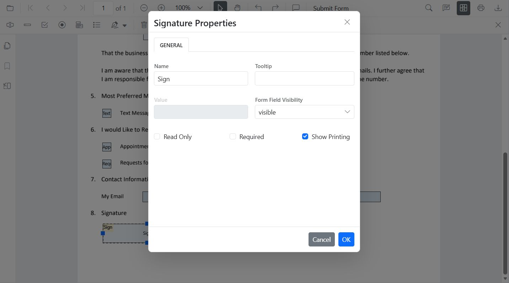

**Add Programmatically (API)**



import { Component, ViewChild } from '@angular/core';
import {
  ToolbarService,
  MagnificationService,
  NavigationService,
  AnnotationService,
  TextSelectionService,
  TextSearchService,
  FormFieldsService,
  FormDesignerService,
  PdfViewerModule,
  PdfViewerComponent,
} from '@syncfusion/ej2-angular-pdfviewer';

@Component({
  selector: 'app-root',
  standalone: true,
  imports: [PdfViewerModule],
  template: `
    

      <ejs-pdfviewer #pdfViewer id="pdfViewer" (documentLoad)="onDocumentLoad()"
        [resourceUrl]="resourceUrl"
        [documentPath]="document"
        style="height: 640px; display: block;">
      </ejs-pdfviewer>
    

  `,
  providers: [
    ToolbarService,
    MagnificationService,
    NavigationService,
    AnnotationService,
    TextSelectionService,
    TextSearchService,
    FormFieldsService,
    FormDesignerService,
  ],
})
export class AppComponent {
  public document: string = 'https://cdn.syncfusion.com/content/pdf/form-filling-document.pdf';
  public resourceUrl: string = 'https://cdn.syncfusion.com/ej2/31.1.23/dist/ej2-pdfviewer-lib';

  @ViewChild('pdfViewer') public pdfviewer!: PdfViewerComponent;

  onDocumentLoad(): void {
    this.pdfviewer.formDesignerModule.addFormField('SignatureField', {
      name: 'Sign',
      pageNumber: 1,
      bounds: { X: 57, Y: 923, Width: 200, Height: 43 },
      tooltip: 'Sign here',
      isRequired: true,
    } as any);
  }
}



### Initial Field

**Add via UI**: Open form designer toolbar → select Initial Field → place where initials are needed → configure text/isRequired.

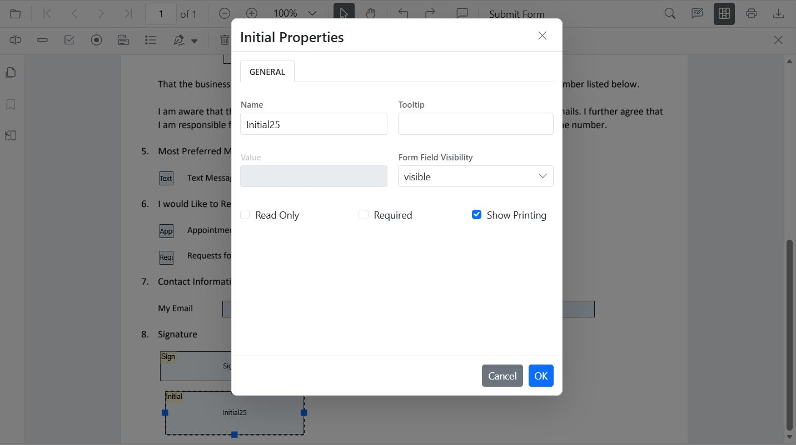

**Add Programmatically (API)**



import { Component, ViewChild } from '@angular/core';
import {
  ToolbarService,
  MagnificationService,
  NavigationService,
  AnnotationService,
  TextSelectionService,
  TextSearchService,
  FormFieldsService,
  FormDesignerService,
  PdfViewerModule,
  PdfViewerComponent,
} from '@syncfusion/ej2-angular-pdfviewer';

@Component({
  selector: 'app-root',
  standalone: true,
  imports: [PdfViewerModule],
  template: `
    

      <ejs-pdfviewer #pdfViewer id="pdfViewer" (documentLoad)="onDocumentLoad()"
        [resourceUrl]="resourceUrl"
        [documentPath]="document"
        style="height: 640px; display: block;">
      </ejs-pdfviewer>
    

  `,
  providers: [
    ToolbarService,
    MagnificationService,
    NavigationService,
    AnnotationService,
    TextSelectionService,
    TextSearchService,
    FormFieldsService,
    FormDesignerService,
  ],
})
export class AppComponent {
  public document: string = 'https://cdn.syncfusion.com/content/pdf/form-filling-document.pdf';
  public resourceUrl: string = 'https://cdn.syncfusion.com/ej2/31.1.23/dist/ej2-pdfviewer-lib';

  @ViewChild('pdfViewer') public pdfviewer!: PdfViewerComponent;

  onDocumentLoad(): void {
    this.pdfviewer.formDesignerModule.addFormField('InitialField', {
      name: 'Sign',
      pageNumber: 1,
      bounds: { X: 57, Y: 923, Width: 200, Height: 43 },
      tooltip: 'Sign here',
      isRequired: true,
    } as any);
  }
}



### DateTime Picker

**Add via UI**: Open the Form Designer toolbar, select **DateTime Picker**, and click on a PDF page to place the field. The DateTime Picker tool adds date and time fields in Form Designer mode.

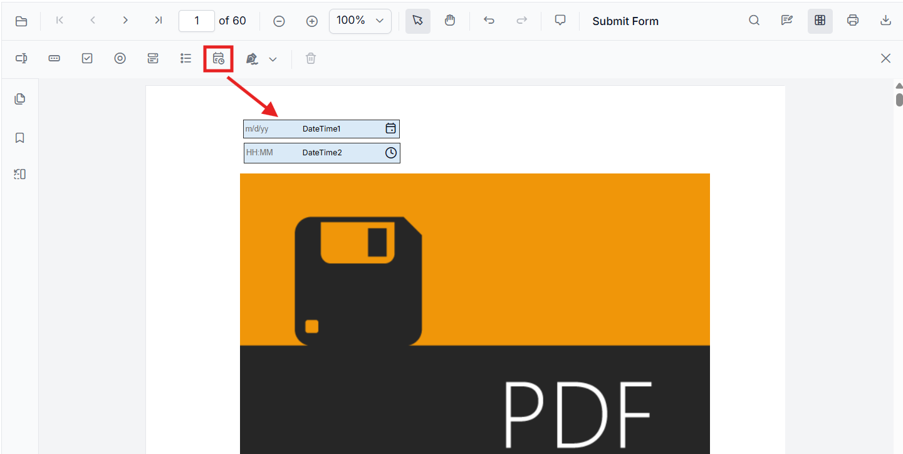

Select the field to configure its general properties, such as its name, value, visibility, and whether it is read-only or required.

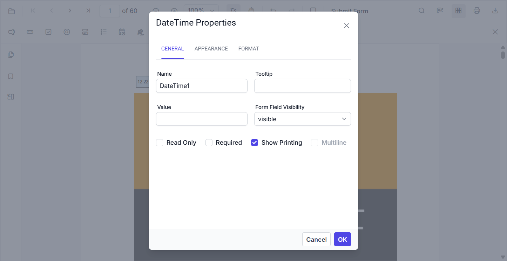

#### Manual Entry and Picker

The field accepts values either by direct typing or through the integrated picker UI:

- **Date Field** – Enter a date manually, or open the calendar dropdown to pick a date.

  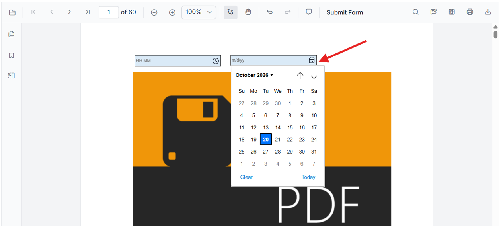

- **Time Field** – Enter a time manually, or open the time dropdown to pick a time.

  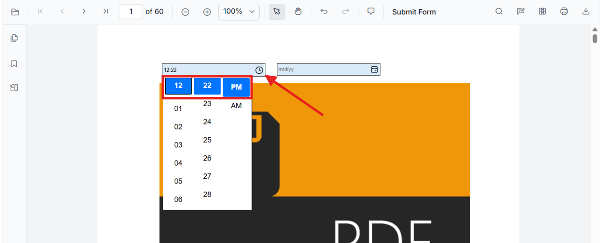

#### Strict Format Validation

Invalid values are rejected and a validation popup is displayed. The invalid value is not applied to the field.

For example, with the format `m/d/yy`:

| Input | Result |
|---|---|
| `10/19/2026` | Accepted |
| `19/10/26` | Rejected |
| `not-a-date` | Rejected |

#### Date / Time Toggle and Format Editing

The **Format** tab in the Properties panel lets you:

- Switch between Date Picker and Time Picker modes.
- Edit the display format string.
- Preview formatting changes before saving.

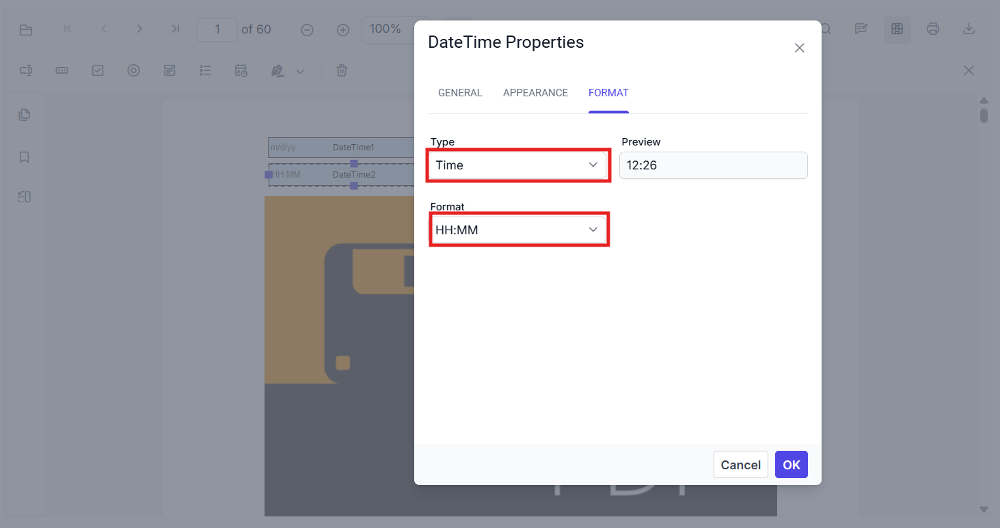

**Common Formats**

| Format String | Example Output |
|---|---|
| `m/d/yy` | `10/19/26` |
| `mm/dd/yyyy` | `10/19/2026` |
| `HH:MM` | `14:30` |
| `HH:MM:ss` | `14:30:45` |

#### Form Designer Appearance

Placed DateTime pickers have a distinct visual appearance in Form Designer mode, including:

- Colored background
- Visible border
- Field-type indicator

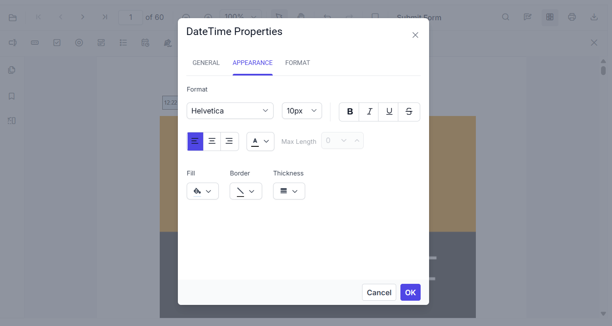

**Add Programmatically (API)**



import { Component, ViewChild } from '@angular/core';
import {
  ToolbarService,
  MagnificationService,
  NavigationService,
  AnnotationService,
  TextSelectionService,
  TextSearchService,
  FormFieldsService,
  FormDesignerService,
  PdfViewerModule,
  PdfViewerComponent,
} from '@syncfusion/ej2-angular-pdfviewer';

@Component({
  selector: 'app-root',
  standalone: true,
  imports: [PdfViewerModule],
  template: `
    

      <ejs-pdfviewer #pdfViewer id="pdfViewer" (documentLoad)="onDocumentLoad()"
        [resourceUrl]="resourceUrl"
        [documentPath]="document"
        style="height: 640px; display: block;">
      </ejs-pdfviewer>
    

  `,
  providers: [
    ToolbarService,
    MagnificationService,
    NavigationService,
    AnnotationService,
    TextSelectionService,
    TextSearchService,
    FormFieldsService,
    FormDesignerService,
  ],
})
export class AppComponent {
  public document: string = 'https://cdn.syncfusion.com/content/pdf/form-filling-document.pdf';
  public resourceUrl: string = 'https://cdn.syncfusion.com/ej2/31.1.23/dist/ej2-pdfviewer-lib';

  @ViewChild('pdfViewer') public pdfviewer!: PdfViewerComponent;

  onDocumentLoad(): void {
    // Add Date field
    this.pdfviewer.formDesignerModule.addFormField('Textbox', {
      name: 'DateField1',
      bounds: { X: 146, Y: 200, Width: 200, Height: 24 },
      pageNumber: 1,
      isDateField: true,
      fontSize: 10,
      color: 'black',
      fontFamily: 'Helvetica',
      backgroundColor: '#daeaf7ff',
      borderColor: '#303030',
      alignment: 'Left',
      isReadOnly: false,
      visibility: 'visible',
      isRequired: false,
      isPrint: true,
      tooltip: '',
      thickness: 1,
      actions: {
        format: { script: 'AFDate_FormatEx("m/d/yy")' }
      }
    } as any);

    // Add Time field
    this.pdfviewer.formDesignerModule.addFormField('Textbox', {
      name: 'TimeField1',
      bounds: { X: 146, Y: 250, Width: 200, Height: 24 },
      pageNumber: 1,
      isDateField: true,
      fontSize: 10,
      color: 'black',
      fontFamily: 'Helvetica',
      backgroundColor: '#daeaf7ff',
      borderColor: '#303030',
      alignment: 'Left',
      isReadOnly: false,
      visibility: 'visible',
      isRequired: false,
      isPrint: true,
      tooltip: '',
      thickness: 1,
      actions: {
        format: { script: 'AFTime_FormatEx("HH:MM")' }
      }
    } as any);
  }
}



### Button

A button field is an interactive form field displayed on a PDF page that allows users to perform various actions, such as navigating to a specific page or location within the document. Users can configure actions to be triggered through mouse and keyboard interactions. Button fields can be added and edited using both the Form Designer UI and programmatically.

#### Button Text and Value

The text displayed on the button is defined using the **text** property, while the data value associated with the button field is defined using the **value** property. If the **text** property is not specified, the **value** property is used as the displayed button text.

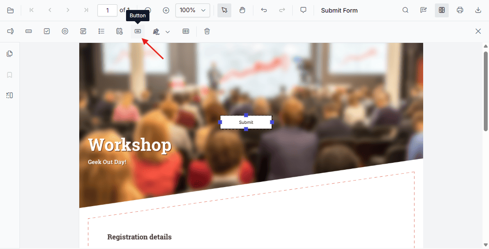

#### Button Actions

An action can be associated with a button field, and the action is executed when the corresponding event occurs. The action is configured for the required event in the **Actions** tab of the Button Properties dialog.

| Action | Description |
|---|---|
| `mouseUp` | Executes the action when the mouse button is released over the button field. |
| `mouseDown` | Executes the action when the mouse button is pressed over the button field. |
| `mouseEnter` | Executes the action when the pointer enters the button field area. |
| `mouseLeave` | Executes the action when the pointer leaves the button field area. |
| `gotFocus` | Executes the action when the button field receives focus. |
| `lostFocus` | Executes the action when the button field loses focus. |

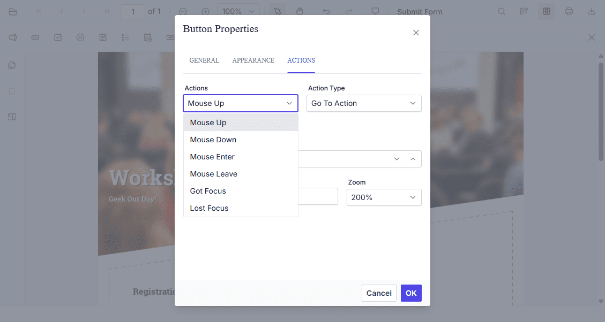

The **Go To Action** navigates the viewer to a specific page, position, and zoom level in the document when the action is triggered.

| Property | Description |
|---|---|
| `destinationPageNumber` | The page number to navigate to. |
| `destinationLocation` | The position (`x` and `y`) within the destination page. |
| `zoomValue` | The zoom level applied when navigating to the destination. A value of `0` retains the current zoom level. |

**Add via UI**: Open the Form Designer toolbar, select **Button**, and click on a PDF page to place the field. Select the placed field to review or change its general properties, such as its name, value, tooltip, visibility, and whether it is read-only or required.

**Add Programmatically (API)**:



import { Component, ViewChild } from '@angular/core';
import {
  ToolbarService,
  MagnificationService,
  NavigationService,
  AnnotationService,
  TextSelectionService,
  TextSearchService,
  FormFieldsService,
  FormDesignerService,
  PdfViewerModule,
  PdfViewerComponent,
} from '@syncfusion/ej2-angular-pdfviewer';
import { ActionType } from '@syncfusion/ej2-pdfviewer';

@Component({
  selector: 'app-root',
  standalone: true,
  imports: [PdfViewerModule],
  template: `
    

      <ejs-pdfviewer #pdfViewer id="pdfViewer" (documentLoad)="onDocumentLoad()"
        [resourceUrl]="resourceUrl"
        [documentPath]="document"
        style="height: 640px; display: block;">
      </ejs-pdfviewer>
    

  `,
  providers: [
    ToolbarService,
    MagnificationService,
    NavigationService,
    AnnotationService,
    TextSelectionService,
    TextSearchService,
    FormFieldsService,
    FormDesignerService,
  ],
})
export class AppComponent {
  public document: string = 'https://cdn.syncfusion.com/content/pdf/form-filling-document.pdf';
  public resourceUrl: string = 'https://cdn.syncfusion.com/ej2/31.1.23/dist/ej2-pdfviewer-lib';

  @ViewChild('pdfViewer') public pdfviewer!: PdfViewerComponent;

  onDocumentLoad(): void {
    // Add a button field that navigates to page 5 when it is clicked
    this.pdfviewer.formDesignerModule.addFormField('ButtonField', {
      name: 'Submit1',
      pageNumber: 1,
      bounds: { X: 100, Y: 350, Width: 120, Height: 32 },
      value: 'Submit',
      text: 'Submit',
      tooltip: 'Click to submit',
      actions: {
        mouseUp: {
          action: ActionType.GoTo,
          destinationPageNumber: 5,
          destinationLocation: { x: 100, y: 100 },
          zoomValue: 2
        }
      }
    } as any);
  }
}



**Place a button field interactively**:

Use [`setFormFieldMode()`](https://ej2.syncfusion.com/angular/documentation/api/pdfviewer/formdesigner#setformfieldmode) to switch the form designer into the button placement mode, and then click on the PDF page to place the button field. The existing button fields can be removed using [`deleteFormField()`](https://ej2.syncfusion.com/angular/documentation/api/pdfviewer/formdesigner#deleteformfield).



import { Component, ViewChild } from '@angular/core';
import { FormsModule } from '@angular/forms';
import {
  ToolbarService,
  MagnificationService,
  NavigationService,
  AnnotationService,
  TextSelectionService,
  TextSearchService,
  FormFieldsService,
  FormDesignerService,
  PdfViewerModule,
  PdfViewerComponent,
} from '@syncfusion/ej2-angular-pdfviewer';
import { ActionType } from '@syncfusion/ej2-pdfviewer';

interface IButtonFieldInfo {
  id: string;
  name: string;
}

@Component({
  selector: 'app-root',
  standalone: true,
  imports: [PdfViewerModule, FormsModule],
  template: `
    

      <button (click)="addButtonField()">Add Button Field</button>
      <button (click)="enableButtonMode()">Enable Button Designer Mode</button>
      <select [(ngModel)]="selectedFieldId">
        <option *ngFor="let field of buttonFields" [value]="field.id">{{ field.name }}</option>
        <option *ngIf="!buttonFields.length" value="">No Button Fields Available</option>
      </select>
      <button (click)="editButtonField()" [disabled]="!selectedFieldId">Edit Button Field</button>
      <button (click)="deleteButtonField()" [disabled]="!selectedFieldId">Delete Button Field</button>
      <ejs-pdfviewer #pdfViewer id="pdfViewer"
        (documentLoad)="refreshButtonFields()"
        (formFieldAdd)="refreshButtonFields()"
        (formFieldRemove)="refreshButtonFields()"
        [resourceUrl]="resourceUrl"
        [documentPath]="document"
        style="height: 640px; display: block;">
      </ejs-pdfviewer>
    

  `,
  providers: [
    ToolbarService,
    MagnificationService,
    NavigationService,
    AnnotationService,
    TextSelectionService,
    TextSearchService,
    FormFieldsService,
    FormDesignerService,
  ],
})
export class AppComponent {
  public document: string = 'https://cdn.syncfusion.com/content/pdf/form-filling-document.pdf';
  public resourceUrl: string = 'https://cdn.syncfusion.com/ej2/31.1.23/dist/ej2-pdfviewer-lib';

  @ViewChild('pdfViewer') public pdfviewer!: PdfViewerComponent;

  public buttonFields: IButtonFieldInfo[] = [];
  public selectedFieldId: string = '';

  // Add a button field programmatically
  public addButtonField(): void {
    this.pdfviewer.formDesignerModule.addFormField('ButtonField', {
      name: `Submit${this.buttonFields.length + 1}`,
      pageNumber: 1,
      bounds: { X: 100, Y: 350, Width: 120, Height: 32 },
      value: 'Submit',
      text: 'Submit',
      tooltip: 'Click to submit',
      actions: {
        mouseUp: {
          action: ActionType.GoTo,
          destinationPageNumber: 5,
          destinationLocation: { x: 100, y: 100 },
          zoomValue: 2
        }
      }
    } as any);
    this.refreshButtonFields();
  }

  // Switch the form designer into the button placement mode
  public enableButtonMode(): void {
    this.pdfviewer.formDesignerModule.setFormFieldMode('ButtonField');
  }

  // Update the properties and actions of the selected button field
  public editButtonField(): void {
    const field = this.getSelectedField();
    if (!field) {
      return;
    }
    this.pdfviewer.formDesignerModule.updateFormField(field, {
      value: 'Submit Button',
      text: 'Submit Button',
      alignment: 'Left',
      tooltip: 'Updated Submit Button',
      actions: {
        mouseUp: {
          action: ActionType.GoTo,
          destinationPageNumber: 7,
          destinationLocation: { x: 100, y: 100 },
          zoomValue: 1
        }
      }
    } as any);
    this.refreshButtonFields();
  }

  // Delete the selected button field
  public deleteButtonField(): void {
    const field = this.getSelectedField();
    if (!field) {
      return;
    }
    this.pdfviewer.formDesignerModule.deleteFormField(field);
    this.selectedFieldId = '';
    this.refreshButtonFields();
  }

  // Refresh the button fields available in the document
  public refreshButtonFields(): void {
    const fields: any[] = this.pdfviewer.formFieldCollections ?? [];
    this.buttonFields = fields
      .filter((field: any) => field.type === 'ButtonField')
      .map((field: any) => ({
        id: field.id,
        name: field.name || field.value || field.id
      }));

    if (!this.buttonFields.some((field) => field.id === this.selectedFieldId)) {
      this.selectedFieldId = this.buttonFields.length ? this.buttonFields[0].id : '';
    }
  }

  private getSelectedField(): any {
    if (!this.selectedFieldId) {
      return null;
    }
    const fields: any[] = this.pdfviewer.formFieldCollections ?? [];
    return fields.find((field: any) => field.id === this.selectedFieldId) || null;
  }
}



[View Sample on GitHub](https://github.com/SyncfusionExamples/angular-pdf-viewer-examples/tree/master/Form%20fields/Button%20field)

### Barcode

A barcode field is a form field that displays the entered value as a barcode that can be scanned. Barcode fields can be added and edited both through the Form Designer UI and programmatically.

#### Barcode Symbology

The barcode type is referred to as the **symbology**. The following symbologies are supported, and **PDF417** is used by default.

| Symbology | Description |
|---|---|
| `PDF417` | A stacked, linear barcode that supports alphanumeric data. This is the default symbology. |
| `QRCode` | A two-dimensional matrix barcode that supports numeric, alphanumeric, and binary data. |
| `DataMatrix` | A two-dimensional matrix barcode that is used to encode a small amount of data in a compact area. |

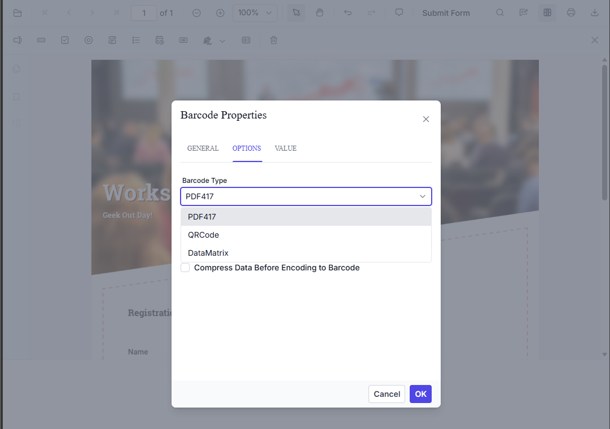

#### Barcode Value Format

The value that is encoded in the barcode can be supplied in three ways.

| Value format | Description |
|---|---|
| `TabDelimited` | Carries the values in the barcode separated by a tab character, so the values appear at a tab space distance from each other. |
| `XML` | Stores the values pairwise in an XML structure. |
| `CustomValue` | Stores the value as a string, and any string can be assigned to it. |

N> Complete support for executing custom scripts is not available. Instead, the PDF Viewer parses the final value assigned to the barcode field in the PDF document.

#### Static Barcode Value

The barcode value can be set to a fixed value from the **Value** tab of the Barcode Properties dialog.

Select **Custom Value** in the **Encode** dropdown, and then enter the text to be encoded in the **Custom Value** text box.

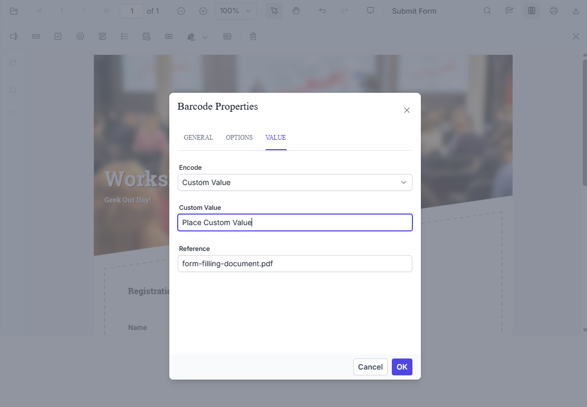

#### Dynamic Barcode Value

The barcode value can also be calculated from the other form fields that are present in the PDF document.

In the Form Designer, open the **Value** tab of the Barcode Properties dialog and use the **Select Field for Calculation** option to bind one or more fields to the barcode field.

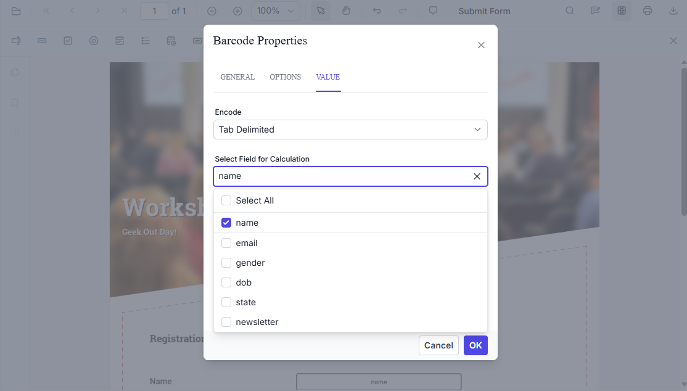

When a value is entered in a bound field, the barcode value is updated automatically.

N> By default, the barcode stores the field name along with its value. To store only the field values, clear the **Include Field Names** option. This option is available only for the `TabDelimited` format and does not apply to the `XML` format, which always stores data as name-value pairs.

#### Barcode Caption

By default, the name of the loaded PDF document is displayed below the generated barcode field. Use the **caption** property to change this text, either from the UI or programmatically.

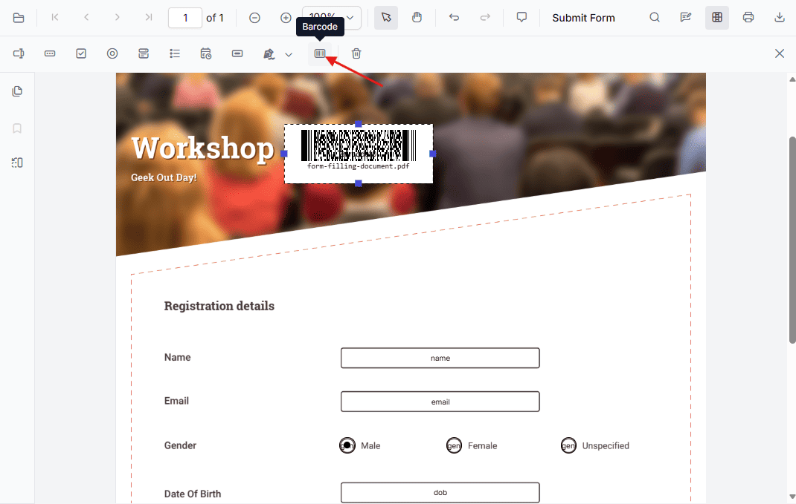

#### Barcode Error Correction Level

The error correction level determines how much damage the generated barcode can tolerate before it can no longer be read. The available levels depend on the selected symbology.

| Symbology | Supported values |
|---|---|
| `PDF417` | `Level0` to `Level8` |
| `QRCode` | `Low`, `Medium`, `Quartile`, `High` |
| `DataMatrix` | Not applicable, since Data Matrix does not use this setting. |

The default error correction level is `Level5`.

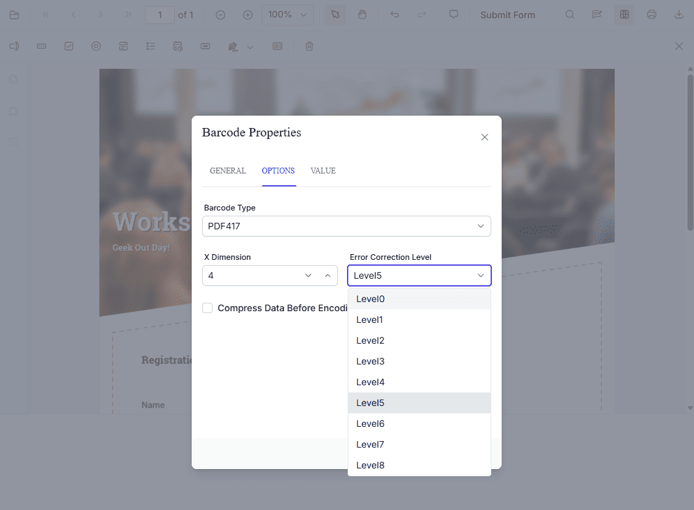

**Add via UI**: Open the Form Designer toolbar, select **Barcode**, and click on a PDF page to place the field. Select the placed field to review or change its general properties, such as its name, value, visibility, and whether it is read-only or required.

**Add Programmatically (API)**



import { Component, ViewChild } from '@angular/core';
import {
  ToolbarService,
  MagnificationService,
  NavigationService,
  AnnotationService,
  TextSelectionService,
  TextSearchService,
  FormFieldsService,
  FormDesignerService,
  PdfViewerModule,
  PdfViewerComponent,
} from '@syncfusion/ej2-angular-pdfviewer';

@Component({
  selector: 'app-root',
  standalone: true,
  imports: [PdfViewerModule],
  template: `
    

      <ejs-pdfviewer #pdfViewer id="pdfViewer" (documentLoad)="onDocumentLoad()"
        [resourceUrl]="resourceUrl"
        [documentPath]="document"
        style="height: 640px; display: block;">
      </ejs-pdfviewer>
    

  `,
  providers: [
    ToolbarService,
    MagnificationService,
    NavigationService,
    AnnotationService,
    TextSelectionService,
    TextSearchService,
    FormFieldsService,
    FormDesignerService,
  ],
})
export class AppComponent {
  public document: string = 'https://cdn.syncfusion.com/content/pdf/form-filling-document.pdf';
  public resourceUrl: string = 'https://cdn.syncfusion.com/ej2/31.1.23/dist/ej2-pdfviewer-lib';

  @ViewChild('pdfViewer') public pdfviewer!: PdfViewerComponent;

  onDocumentLoad(): void {
    // Add a barcode field with the default PDF417 symbology
    this.pdfviewer.formDesignerModule.addFormField('Barcode', {
      name: 'ProductBarcode',
      bounds: { X: 146, Y: 300, Width: 180, Height: 100 },
      pageNumber: 1,
      value: 'SYNCFUSION-001',
      caption: 'Product Barcode',
      symbology: 'PDF417',
      valueFormat: 'TabDelimited',
      errorCorrectionLevel: 'Level5',
      isRequired: false,
      isPrint: true,
      visibility: 'visible',
      tooltip: 'Scan to view the product details',
    } as any);
  }
}



## Add fields dynamically with setFormFieldMode

Use [`setFormFieldMode()`](https://ej2.syncfusion.com/angular/documentation/api/pdfviewer/formdesigner#setformfieldmode) to switch the designer into a specific field mode and let users add fields on the fly.

### Edit Form Fields in Angular PDF Viewer
You can edit form fields using the UI or API.

#### Edit Using the UI
- Right click a field → **Properties** to update settings. (Image here)
- Drag to move; use handles to resize.
- Use the toolbar to toggle field mode or add new fields.

#### Edit Programmatically



import { Component, ViewChild } from '@angular/core';
import {
  ToolbarService,
  MagnificationService,
  NavigationService,
  AnnotationService,
  TextSelectionService,
  TextSearchService,
  FormFieldsService,
  FormDesignerService,
  PdfViewerModule,
  PdfViewerComponent,
} from '@syncfusion/ej2-angular-pdfviewer';

@Component({
  selector: 'app-root',
  standalone: true,
  imports: [PdfViewerModule],
  template: `
    

      <button (click)="editTextbox()">EditTextBox</button>
      <button (click)="addPasswordField()">Add Form Field</button>

      <ejs-pdfviewer #pdfViewer id="pdfViewer"
        [resourceUrl]="resourceUrl"
        [documentPath]="document"
        style="height: 640px; display: block;">
      </ejs-pdfviewer>
    

  `,
  providers: [
    ToolbarService,
    MagnificationService,
    NavigationService,
    AnnotationService,
    TextSelectionService,
    TextSearchService,
    FormFieldsService,
    FormDesignerService,
  ],
})
export class AppComponent {
  public document: string = 'https://cdn.syncfusion.com/content/pdf/form-filling-document.pdf';
  public resourceUrl: string = 'https://cdn.syncfusion.com/ej2/31.1.23/dist/ej2-pdfviewer-lib';

  @ViewChild('pdfViewer') public pdfviewer!: PdfViewerComponent;

  editTextbox(): void {
    const fields = this.pdfviewer.retrieveFormFields();
    const field = fields.find((f: any) => f.name === 'First Name') || fields[0];
    if (field) {
      this.pdfviewer.formDesignerModule.updateFormField(field, {
        value: 'John',
        fontFamily: 'Courier',
        fontSize: 12,
        fontStyle: 'None' as any,
        color: 'black',
        backgroundColor: 'white',
        borderColor: 'black',
        thickness: 2,
        alignment: 'Left',
        maxLength: 50
      } as any);
    }
  }

  addPasswordField(): void {
    this.pdfviewer.formDesignerModule.setFormFieldMode('Password');
  }
}



N> [View Sample on GitHub](https://github.com/SyncfusionExamples/angular-pdf-viewer-examples/tree/master/Form%20fields).

## Troubleshooting

- If fields do not appear, verify [`resourceUrl`](https://ej2.syncfusion.com/angular/documentation/api/pdfviewer#resourceurl) matches the EJ2 PDF Viewer library version and that the document loads correctly.
- If using WASM or additional services, confirm those resources are reachable from the environment.

## Related topics

- [Form Designer overview](../overview)
- [Form Designer Toolbar](../../toolbar-customization/form-designer-toolbar)
- [Modify form fields](./modify-form-fields)
- [Style form fields](./customize-form-fields)
- [Remove form fields](./remove-form-fields)
- [Group form fields](../group-form-fields)
- [Form validation](../form-validation)
- [Form Fields API](../form-fields-api)