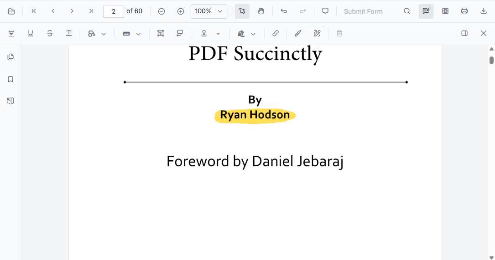
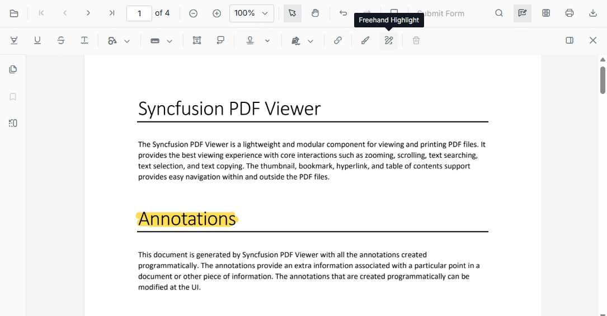

# Freehand Highlight Annotation in ASP.NET Core PDF Viewer

Freehand Highlight annotations let users emphasize content in a PDF by drawing freehand strokes over the document. Unlike a regular **Ink** annotation, which is drawn on a layer above the page content, a Freehand Highlight stroke is rendered on the highlight blend layer. This allows the underlying page content to remain visible and readable through the highlighted region, ensuring the marked text can still be read while highlighted.

The feature is available in the annotation toolbar of the ASP.NET Core PDF Viewer, and freehand highlights can also be added and deleted programmatically.

N> Freehand Highlight annotations are stored as Ink annotations with the `enableInkHighlight` flag set to `true`. This keeps the stroke data compatible with the Ink annotation APIs while rendering it with the highlight blend effect.

## Enable Freehand Highlight in the Viewer

In the ASP.NET Core PDF Viewer, annotation modules such as Ink and Freehand Highlight are enabled by default.




    <ejs-pdfviewer id="pdfviewer"
                   style="height:650px"
                   documentPath="https://cdn.syncfusion.com/content/pdf/pdf-succinctly.pdf"
                   resourceUrl="https://cdn.syncfusion.com/ej2/31.2.2/dist/ej2-pdfviewer-lib">
    </ejs-pdfviewer>




## Add Freehand Highlight Annotation

### Add Freehand Highlight Using the Toolbar

1. Open the **Annotation Toolbar**.
2. Click the **Freehand Highlight** icon, which appears next to the **Ink** tool.
3. Draw a freehand stroke over the text that should be highlighted.
4. Release the mouse or pointer to complete the annotation.

The stroke is drawn with the highlight blend effect, so the text underneath the stroke remains visible.

N> The Freehand Highlight tool uses the highlight color configured in the `highlightSettings` property, so changing the highlight color also changes the color of the freehand strokes.

### Add Freehand Highlight Programmatically

Use the [`addAnnotation`](https://ej2.syncfusion.com/javascript/documentation/api/pdfviewer/index-default#addannotation) API with the `'Ink'` type and set `enableInkHighlight` to `true` to create a freehand highlight at a specific location.







The following properties are used in the above example:

| Property | Description |
| --- | --- |
| `offset` | Specifies the top-left position of the annotation on the PDF page. |
| `pageNumber` | Specifies the page on which the annotation is added. |
| `width` | Specifies the width of the annotation. |
| `height` | Specifies the height of the annotation. |
| `enableInkHighlight` | Renders the stroke on the highlight blend layer so the underlying content stays visible. |
| `path` | Specifies the stroke geometry as an array of move (`M`) and line (`L`) commands. |

N> When `enableInkHighlight` is set to `true`, the annotation is created with the Freehand Highlight defaults (thickness `12`, opacity `1`, and the subject `Freehand Highlight`).

### Delete Freehand Highlight Programmatically

Use the [`deleteAnnotationById`](https://ej2.syncfusion.com/javascript/documentation/api/pdfviewer/index-default#deleteannotationbyid) API to remove a freehand highlight by its annotation ID.







N> A freehand highlight can also be deleted from the UI using the **Delete** button in the annotation toolbar or the **Delete** option in the context menu. For the complete list of deletion workflows, see [**Delete Annotation**](../delete-annotation).

## Enable and Disable Freehand Highlight

Use the [`enableFreehandHighlight`](https://ej2.syncfusion.com/javascript/documentation/api/pdfviewer/index-default#enablefreehandhighlight) property to enable or disable the Freehand Highlight tool in the annotation toolbar.







The property can also be set while initializing the viewer using the tag helper attribute.




    <ejs-pdfviewer id="pdfviewer"
                   style="height:650px"
                   documentPath="https://cdn.syncfusion.com/content/pdf/pdf-succinctly.pdf"
                   resourceUrl="https://cdn.syncfusion.com/ej2/31.2.2/dist/ej2-pdfviewer-lib"
                   enableFreehandHighlight="true">
    </ejs-pdfviewer>




N> The Freehand Highlight tool is enabled by default. Setting `enableFreehandHighlight` to `false` disables the toolbar item and restricts the creation of new freehand highlight annotations. Annotations that are already present in the document remain unaffected.

## Customize Freehand Highlight Appearance

The **Edit Stroke Color**, **Edit Thickness**, and **Edit Opacity** tools in the annotation toolbar change the appearance of the selected freehand highlight. For the Ink annotation appearance options, see [**Ink Annotation**](./ink-annotation).

## Handle Freehand Highlight Events

The PDF viewer provides annotation life-cycle events that notify when annotations are added, modified, selected, or removed.
For the full list of available events and their descriptions, see [**Annotation Events**](../annotation-event).

## Export and Import

Freehand Highlight annotations can be exported or imported along with the other annotations.
For the supported formats and steps, see [**Export and Import annotations**](../export-import/export-annotation).

## Key Notes

- Freehand Highlight strokes are rendered on the highlight blend layer, so the underlying text stays visible and readable.
- The tool is available in the annotation toolbar next to the Ink tool, and it can also be enabled or disabled with the `enableFreehandHighlight` property.
- Freehand highlights are Ink annotations with the `enableInkHighlight` flag set to `true`, so they can be added and deleted with the standard Ink annotation APIs.

N> [View Sample in GitHub](https://github.com/SyncfusionExamples/asp-core-pdf-viewer-examples/tree/master/How%20to/Freehand%20Highlight%20Annotation/PDFViewerSample).

## See Also

- [Ink Annotation](./ink-annotation)
- [Highlight Annotation](./highlight-annotation)
- [Annotation Toolbar](../../toolbar-customization/annotation-toolbar)
- [Create and Modify Annotation](../create-modify-annotation)
- [Customize Annotation](../customize-annotation)
- [Delete Annotation](../delete-annotation)
- [Annotation Events](../annotation-event)
- [Export and Import annotations](../export-import/export-annotation)
