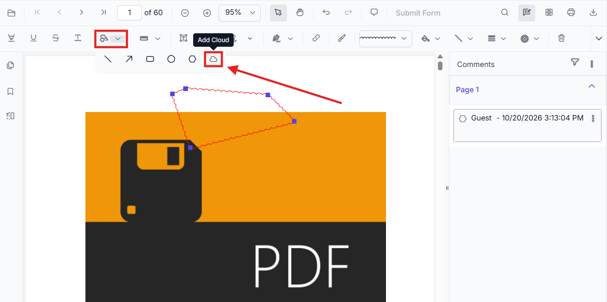
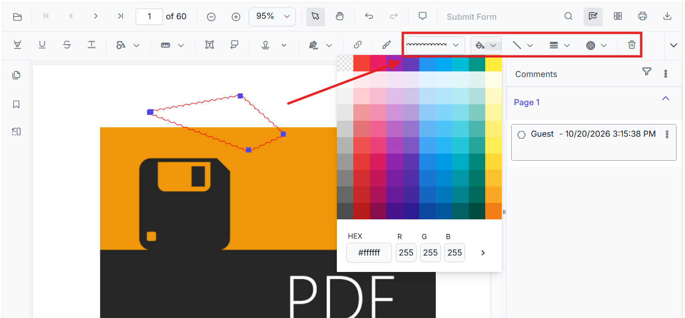
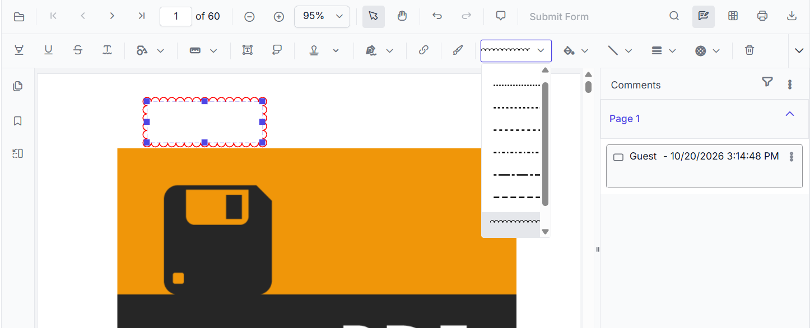

# Cloud Annotation in ASP.NET MVC PDF Viewer

Cloud annotations render a cloud-shaped border around a marked region, drawing clear visual emphasis on content that matters during a review. They are commonly used in document review and markup scenarios to highlight text, figures, or areas of a contract that require approval, clarification, or follow-up.

Unlike the other shape annotations, which use straight, circular, or polygonal outlines, a Cloud annotation is drawn with a scalloped cloud border. It is available in the **Shape Annotation** dropdown of the annotation toolbar, so it can be created the same way as Rectangle, Circle, or Polygon annotations, and it can be moved, resized, restyled, deleted, commented on, saved, and exported like any other annotation.

N> Cloud annotations are exposed as a separate annotation type in the UI and API, but they are maintained internally as Polygon annotations with a cloud border style.

## Enable Cloud Annotation in the Viewer

In the ASP.NET MVC PDF Viewer, annotation modules such as Cloud annotation are enabled by default.




    @Html.EJS().PdfViewer("pdfviewer").DocumentPath("https://cdn.syncfusion.com/content/pdf/pdf-succinctly.pdf").Render()




    @Html.EJS().PdfViewer("pdfviewer").ServiceUrl(VirtualPathUtility.ToAbsolute("~/PdfViewer/")).DocumentPath("https://cdn.syncfusion.com/content/pdf/pdf-succinctly.pdf").Render()




## Add Cloud Annotation

### Add Cloud Annotation Using the Toolbar

1. Open the **Annotation Toolbar**.
2. Expand the **Shape Annotation** dropdown.
3. Select **Cloud Annotation**.
4. Draw the cloud annotation on the PDF page.
5. Release the mouse or pointer to complete the annotation.

N> When in Pan mode, selecting a shape tool automatically switches the viewer to selection mode for smooth interaction.

### Add Cloud Annotation Programmatically

Use the **addAnnotation()** method to draw a cloud annotation at a specific location by specifying the **vertexPoints** of the cloud shape.




<button onclick="addCloudAnnotation()">add Cloud Annotation programmatically</button>

    @Html.EJS().PdfViewer("pdfviewer").DocumentPath("https://cdn.syncfusion.com/content/pdf/pdf-succinctly.pdf").Render()




<button onclick="addCloudAnnotation()">add Cloud Annotation programmatically</button>

    @Html.EJS().PdfViewer("pdfviewer").ServiceUrl(VirtualPathUtility.ToAbsolute("~/PdfViewer/")).DocumentPath("https://cdn.syncfusion.com/content/pdf/pdf-succinctly.pdf").Render()




The following properties are used in the above example:

| Property | Description |
| --- | --- |
| `offset` | Specifies the top-left position of the annotation on the PDF page. |
| `pageNumber` | Specifies the page on which the annotation is added. |
| `vertexPoints` | Specifies the points that define the cloud shape. The first and last points must be the same to close the shape. |

## Modify Cloud Annotation

### Select and Edit a Cloud Annotation

1. Select an existing Cloud annotation on the PDF page.
2. Drag the annotation to move it to a different position on the page.
3. Drag the selection handles to resize the annotation.
4. Use the annotation properties toolbar to edit the cloud shape appearance.

## Customize Cloud Annotation Appearance

Select a Cloud annotation and use the annotation properties toolbar to customize its appearance. The following appearance settings are supported:

- **Border color** – changes the cloud border color.
- **Fill color** – changes the color inside the cloud shape.
- **Opacity** – adjusts the transparency of the annotation.
- **Thickness** – adjusts the cloud border thickness.
- **Border Style** – changes the annotation border style.
- **Cloud Intensity** – controls the appearance of the cloud border.

Use the color picker in the annotation toolbar to change the cloud annotation's border or fill color.

Use the border-style dropdown to choose the cloud annotation's outline style.

N> The cloud intensity value determines how prominently the cloud border is rendered around the shape.

### Configure Default Cloud Annotation Settings

Configure the default cloud appearance (fill color, stroke color, opacity, border style, and cloud intensity) using **CloudSettings**.




    @Html.EJS().PdfViewer("pdfviewer").DocumentPath("https://cdn.syncfusion.com/content/pdf/pdf-succinctly.pdf").CloudSettings(new Syncfusion.EJ2.PdfViewer.PdfViewerCloudSettings { FillColor = "#9c2592", Opacity = 1, StrokeColor = "#ff0000", Author = "Cloud", BorderStyle = Syncfusion.EJ2.PdfViewer.PdfViewerBorderStyle.Cloud, CloudIntensity = 2 }).Render()




    @Html.EJS().PdfViewer("pdfviewer").ServiceUrl(VirtualPathUtility.ToAbsolute("~/PdfViewer/")).DocumentPath("https://cdn.syncfusion.com/content/pdf/pdf-succinctly.pdf").CloudSettings(new Syncfusion.EJ2.PdfViewer.PdfViewerCloudSettings { FillColor = "#9c2592", Opacity = 1, StrokeColor = "#ff0000", Author = "Cloud", BorderStyle = Syncfusion.EJ2.PdfViewer.PdfViewerBorderStyle.Cloud, CloudIntensity = 2 }).Render()




The following properties are supported in `CloudSettings`:

| Property | Description |
| --- | --- |
| `Opacity` | Specifies the opacity applied to the cloud annotation. |
| `StrokeColor` | Specifies the border color of the cloud annotation. |
| `FillColor` | Specifies the fill color inside the cloud shape. |
| `Author` | Specifies the author of the cloud annotation. |
| `BorderStyle` | Specifies the border style of the cloud annotation. |
| `CloudIntensity` | Specifies the appearance of the cloud border. |

## Delete Cloud Annotation

The PDF Viewer supports deleting existing annotations through the UI and API.
See [**Delete Annotation**](./delete-annotation) for full behavior and workflows.

## Comments

Use the [**Comments panel**](./comments) to add, view, and reply to threaded discussions linked to cloud annotations. It provides a dedicated interface for collaboration and review within the PDF Viewer.

## Handle Cloud Annotation Events

The PDF viewer provides annotation life-cycle events that notify when Cloud annotations are added, modified, selected, or removed.
For the full list of available events and their descriptions, see [**Annotation Events**](./annotation-event).

## Export and Import

The PDF Viewer supports exporting and importing annotations. For details on supported formats and workflows, see [**Export and Import annotations**](./export-import-annotation).

N> Cloud annotation appearance settings persist when the PDF is saved, when annotations are exported and imported, and when the document is reloaded.

## Key Notes

- Cloud annotations are available through the **Shape Annotation** toolbar dropdown.
- Cloud annotations are drawn with a cloud-style border rendering.
- Cloud annotations can be created through both UI interaction and API methods.
- Cloud annotation appearance settings persist during save, import, export, and reload operations.

## See Also
- [Polygon Annotation](./shape-annotation)
- [Rectangle Annotation](./shape-annotation)
- [Circle Annotation](./shape-annotation)
- [Annotation Toolbar](../toolbar-customization/annotation-toolbar)
- [Customize Context Menu](../context-menu/custom-context-menu)
- [Comments Panel](./comments)
- [Annotation Events](./annotation-event)
- [Export and Import annotations](./export-import-annotation)
- [Delete Annotations](./delete-annotation)