# Modify Form Fields in ASP.NET MVC PDF Viewer
You can modify form fields using the **UI** or **API**.

## Modify PDF Form Field Properties using the UI
- Right click a field → **Properties** to update settings.
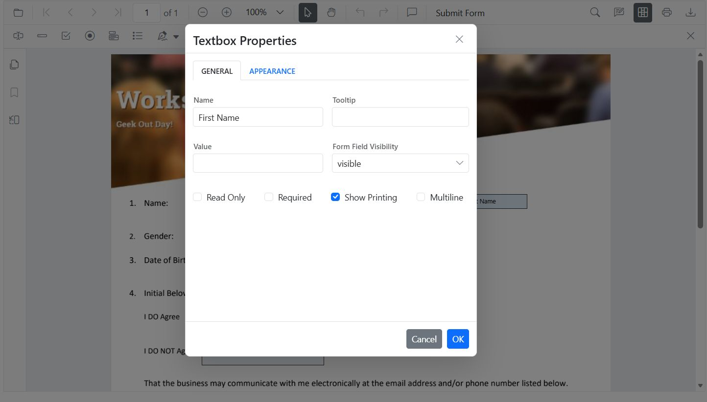
- Drag to move; use handles to resize.
- Use the toolbar to toggle field mode or add new fields.

## Modify PDF Form Field Properties programmatically
Use [updateFormField()](https://help.syncfusion.com/cr/aspnetmvc-js2/syncfusion.ej2.pdfviewer.pdfviewer.html#updateFormField) to change behavior/data (including position and size):




    

        <button id="modifyTextbox">Apply Textbox Changes</button>
    

    

        @Html.EJS().PdfViewer("pdfviewer").DocumentPath("https://cdn.syncfusion.com/content/pdf/form-filling-document.pdf").Render()
    

    




## Modify PDF Form Field Properties by Field type

### Textbox
- UI: Update value, font, size, colors, border thickness, alignment, max length, multiline.

- API: [updateFormField()](https://help.syncfusion.com/cr/aspnetmvc-js2/syncfusion.ej2.pdfviewer.pdfviewer.html#updateFormField) for value, typography, alignment, colors, borders.




    

        <button id="modifyTextbox">Apply Textbox Changes</button>
    

    

        @Html.EJS().PdfViewer("pdfviewer").DocumentPath("https://cdn.syncfusion.com/content/pdf/form-filling-document.pdf").Render()
    

    




### Password

- UI: Tooltip, required, max length, font, appearance.
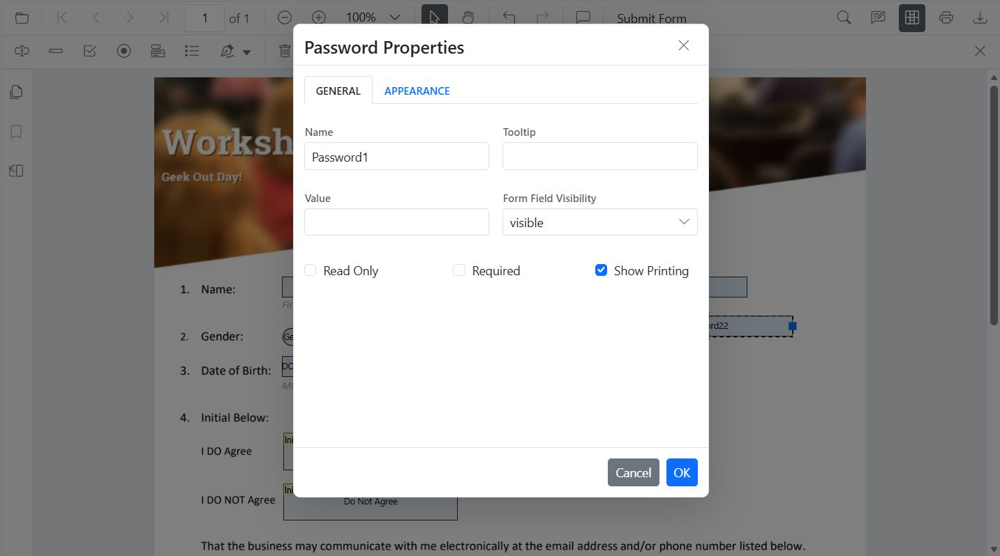
- API: [updateFormField()](https://help.syncfusion.com/cr/aspnetmvc-js2/syncfusion.ej2.pdfviewer.pdfviewer.html#updateFormField) for tooltip, validation flags, typography, colors, alignment, borders.




    

        <button id="modifyPasswordBox">Edit PasswordBox</button>
    

    

        @Html.EJS().PdfViewer("pdfviewer").DocumentPath("https://cdn.syncfusion.com/content/pdf/form-filling-document.pdf").Render()
    

    




### CheckBox
- UI: Toggle checked state.
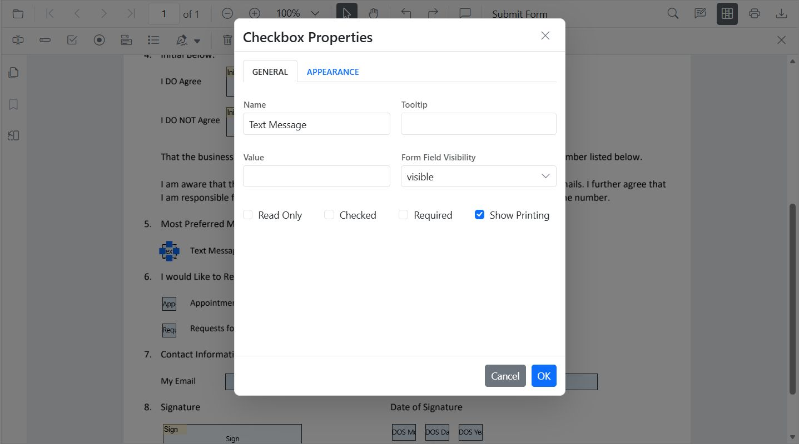
- API: [updateFormField()](https://help.syncfusion.com/cr/aspnetmvc-js2/syncfusion.ej2.pdfviewer.pdfviewer.html#updateFormField) for isChecked, tooltip, colors, borders.




    

        <button id="modifyCheckbox">Modify CheckBox</button>
    

    

        @Html.EJS().PdfViewer("pdfviewer").DocumentPath("https://cdn.syncfusion.com/content/pdf/form-filling-document.pdf").Render()
    

    




### RadioButton
- UI: Set selected item in a group (same Name).
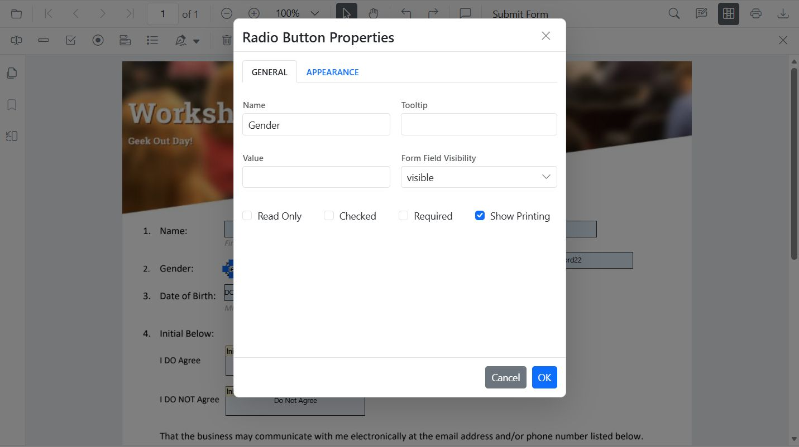
- API: [updateFormField()](https://help.syncfusion.com/cr/aspnetmvc-js2/syncfusion.ej2.pdfviewer.pdfviewer.html#updateFormField) to set selected value and border appearance.




    

        <button id="editRadio">Modify RadioButton</button>
    

    

        @Html.EJS().PdfViewer("pdfviewer").DocumentPath("https://cdn.syncfusion.com/content/pdf/form-filling-document.pdf").Render()
    

    




### ListBox
- UI: Add/remove items, set selection, adjust fonts/colors.
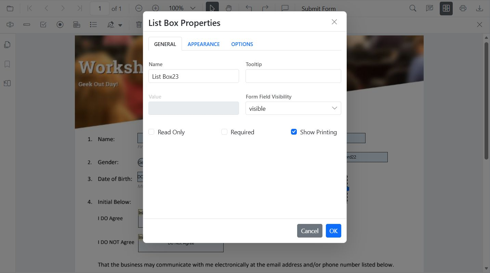
- API: [updateFormField()](https://help.syncfusion.com/cr/aspnetmvc-js2/syncfusion.ej2.pdfviewer.pdfviewer.html#updateFormField) for items, selection, borders.




    

        <button id="editListBox">Edit ListBox</button>
    

    

        @Html.EJS().PdfViewer("pdfviewer").DocumentPath("https://cdn.syncfusion.com/content/pdf/form-filling-document.pdf").Render()
    

    




### DropDown
- UI: Add/remove items, default value, appearance.
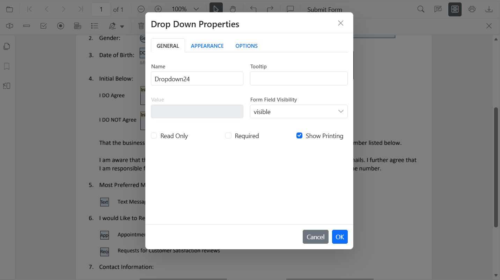
- API: [updateFormField()](https://help.syncfusion.com/cr/aspnetmvc-js2/syncfusion.ej2.pdfviewer.pdfviewer.html#updateFormField) for items, value, borders.




    

        <button id="editDropDown">Edit DropDown</button>
    

    

        @Html.EJS().PdfViewer("pdfviewer").DocumentPath("https://cdn.syncfusion.com/content/pdf/form-filling-document.pdf").Render()
    

    




### Signature Field
- UI: Tooltip, thickness, indicator text, required/visibility.
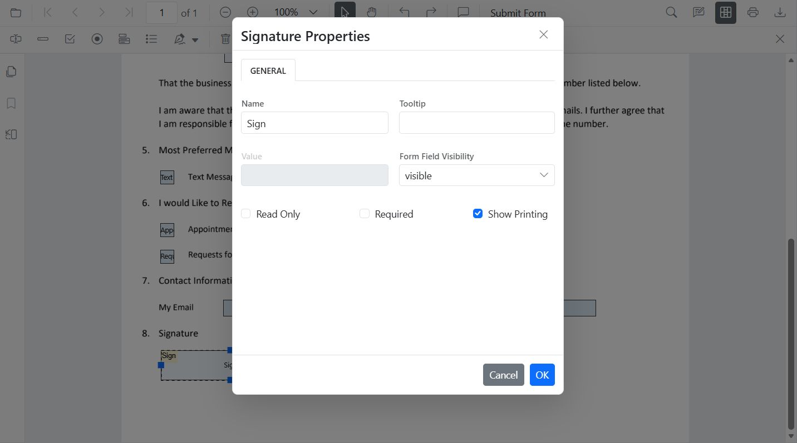
- API: [updateFormField()](https://help.syncfusion.com/cr/aspnetmvc-js2/syncfusion.ej2.pdfviewer.pdfviewer.html#updateFormField) for tooltip, required, colors, borders.




    

        <button id="editSignature">Edit Signature</button>
    

    

        @Html.EJS().PdfViewer("pdfviewer").DocumentPath("https://cdn.syncfusion.com/content/pdf/form-filling-document.pdf").Render()
    

    




### Initial Field
- UI: Tooltip, indicator text, thickness, required/visibility.
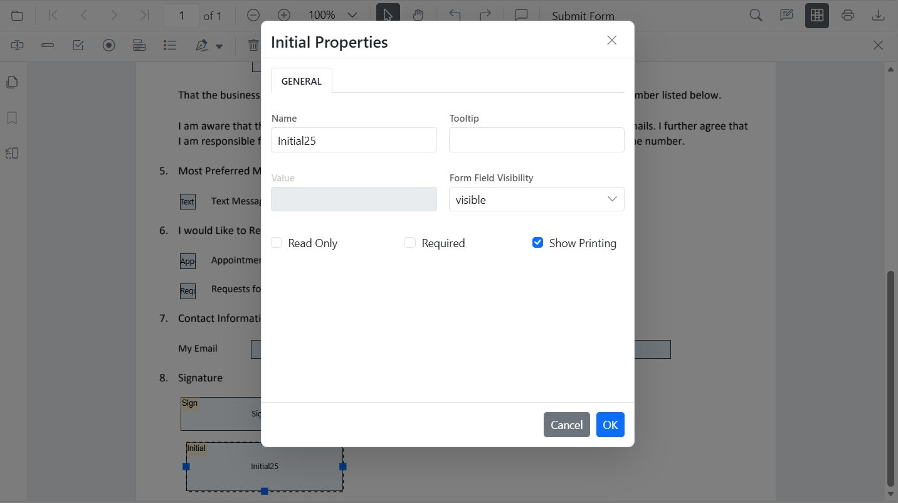
- API: [updateFormField()](https://help.syncfusion.com/cr/aspnetmvc-js2/syncfusion.ej2.pdfviewer.pdfviewer.html#updateFormField) for tooltip, required, colors, borders.




    

        <button id="editInitial">Edit Initial</button>
    

    

        @Html.EJS().PdfViewer("pdfviewer").DocumentPath("https://cdn.syncfusion.com/content/pdf/form-filling-document.pdf").Render()
    

    




### DateTime Picker

Select a DateTime Picker field in Form Designer to review or change its settings. The toolbar includes the DateTime Picker tool, and the page displays date and time fields.

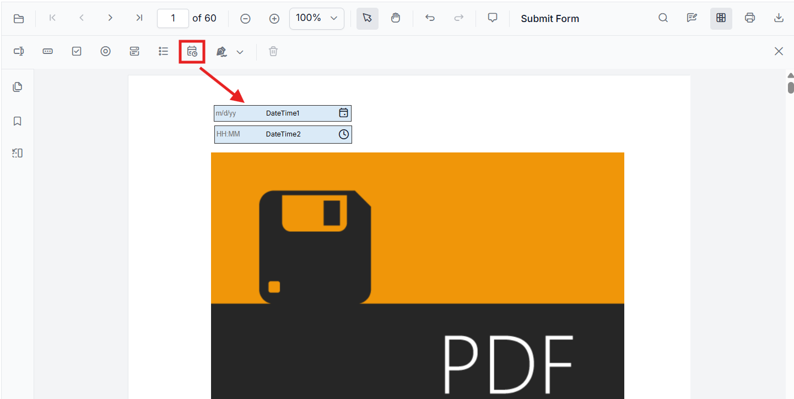

Date and time fields can also be used to enter values directly or choose a value from the picker:

- For a date field, type a date or open the calendar picker.

  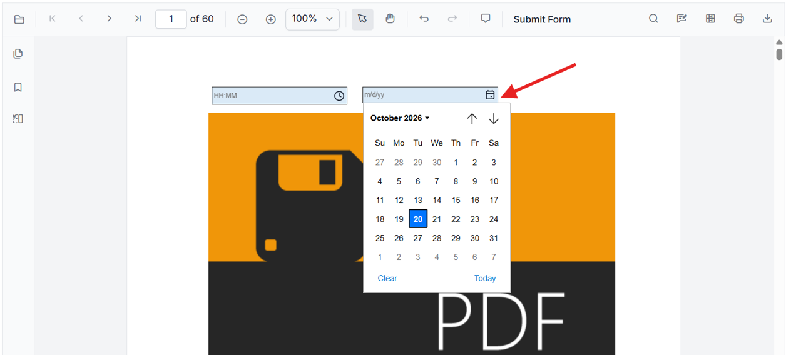

- For a time field, type a time or open the time picker.

  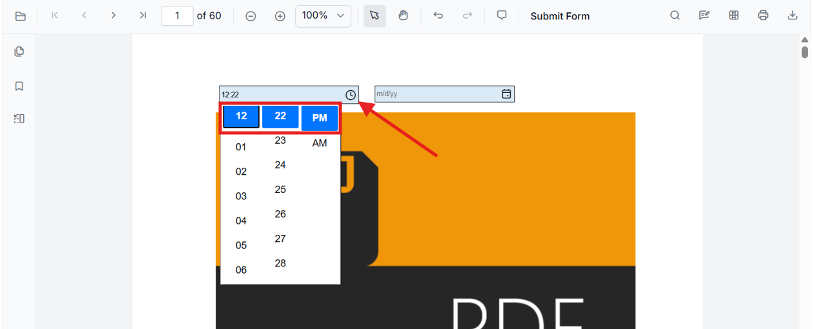

Use the field's **General** properties to review or edit its name, value, tooltip, visibility, read-only and required settings, and print visibility.

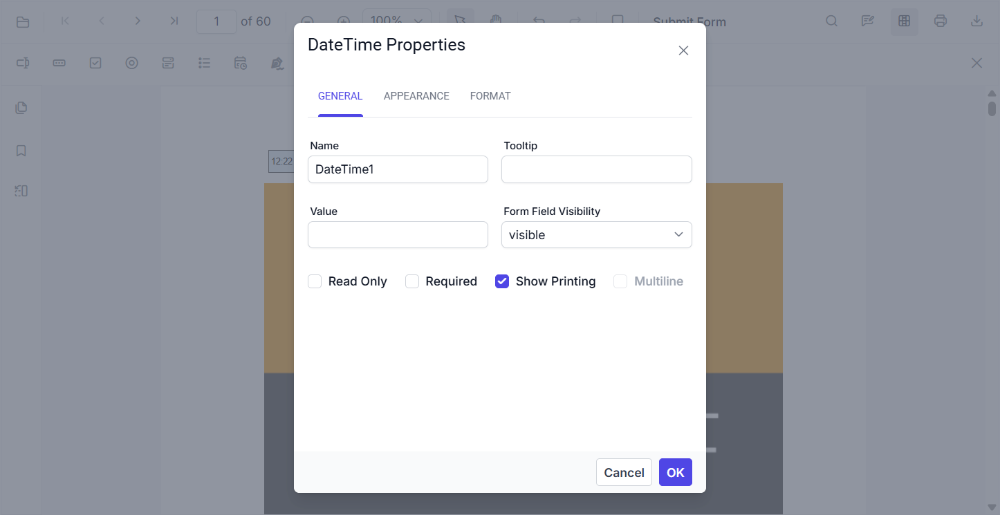

The **Appearance** properties include font, colors, border, and alignment.

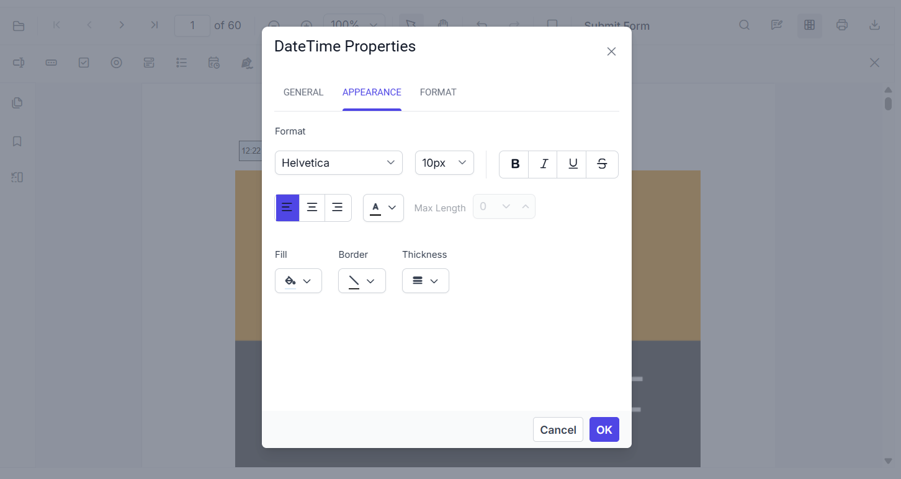

Use the **Format** tab to change the field type (Date or Time), select a display format, and review the preview.

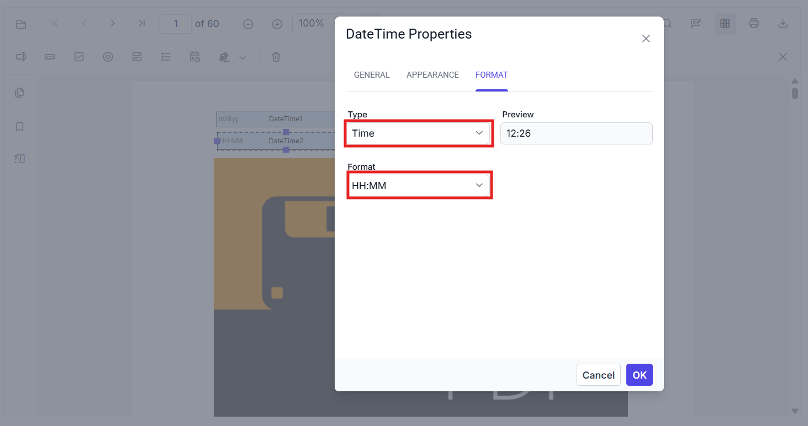

- API: [updateFormField()](https://help.syncfusion.com/cr/aspnetmvc-js2/syncfusion.ej2.pdfviewer.pdfviewer.html#updateFormField) for value, format script, typography, colors, borders.

[View Sample on GitHub](https://github.com/SyncfusionExamples/mvc-pdf-viewer-examples)

### Button

Select a Button field in Form Designer to review or change its settings. The toolbar includes the Button tool, and the page displays the button field.

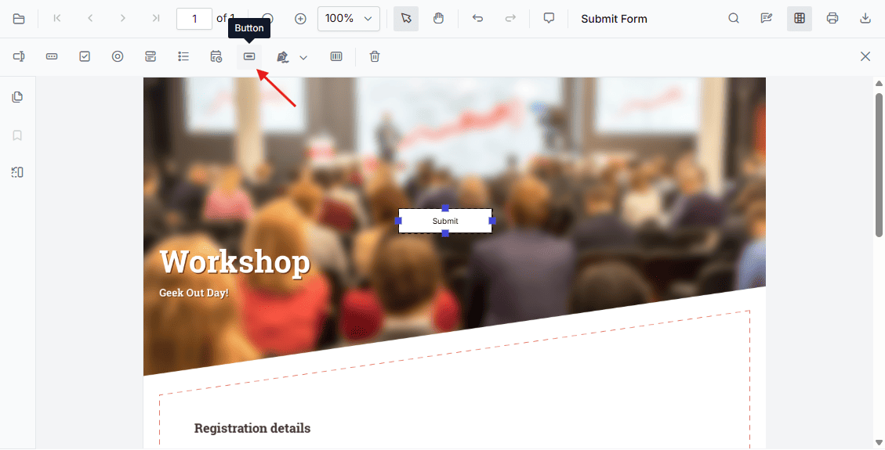

Use the field's **General** properties to review or edit its name, value, tooltip, visibility, read-only and required settings, and print visibility.

The **Appearance** properties include font, colors, border, and alignment of the button caption.

#### Button Actions

Use the **Actions** tab to associate an action with the button field. The action is executed when the corresponding event occurs.

| Action | Description |
|---|---|
| `mouseUp` | Executes the action when the mouse button is released over the button field. |
| `mouseDown` | Executes the action when the mouse button is pressed over the button field. |
| `mouseEnter` | Executes the action when the pointer enters the button field area. |
| `mouseLeave` | Executes the action when the pointer leaves the button field area. |
| `gotFocus` | Executes the action when the button field receives focus. |
| `lostFocus` | Executes the action when the button field loses focus. |

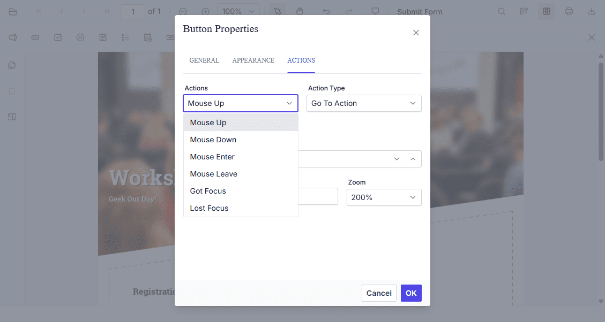

The **Go To Action** navigates the viewer to a specific page, position, and zoom level in the document when the action is triggered.

| Property | Description |
|---|---|
| `destinationPageNumber` | The page number to navigate to. |
| `destinationLocation` | The position (`x` and `y`) within the destination page. |
| `zoomValue` | The zoom level applied when navigating to the destination. A value of `0` retains the current zoom level. |

- API: [`updateFormField()`](https://ej2.syncfusion.com/documentation/api/pdfviewer/formdesigner#updateformfield) for the button text, value, tooltip, alignment, typography, colors, borders, and actions.




    <button id="editButton">Edit Button</button>

    @Html.EJS().PdfViewer("pdfviewer").DocumentPath("https://cdn.syncfusion.com/content/pdf/form-filling-document.pdf").DocumentLoad("documentLoad").Render()




[View Sample on GitHub](https://github.com/SyncfusionExamples/mvc-pdf-viewer-examples/tree/master/Forms/Button%20field)

### Barcode

Select a Barcode field in Form Designer to review or change its settings. The toolbar includes the Barcode tool, and the page displays the generated barcode.

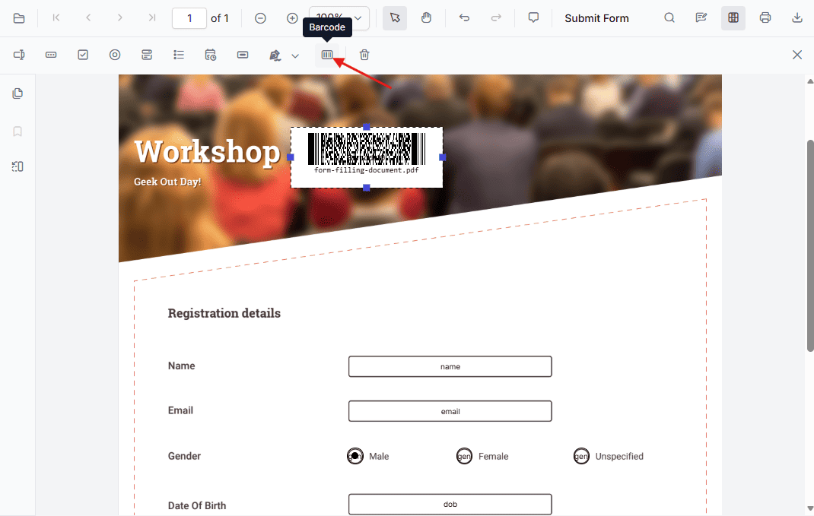

Use the field's **General** properties to review or edit its name, value, caption, tooltip, visibility, read-only and required settings, and print visibility.

The **Options** properties include the barcode type, X dimension, error correction level, and the option to compress the data before encoding it to the barcode.

#### Symbology

The barcode type is referred to as the **symbology**. The following symbologies are supported, and **PDF417** is used by default.

| Symbology | Description |
|---|---|
| `PDF417` | A stacked, linear barcode that supports alphanumeric data. This is the default symbology. |
| `QRCode` | A two-dimensional matrix barcode that supports numeric, alphanumeric, and binary data. |
| `DataMatrix` | A two-dimensional matrix barcode that is used to encode a small amount of data in a compact area. |

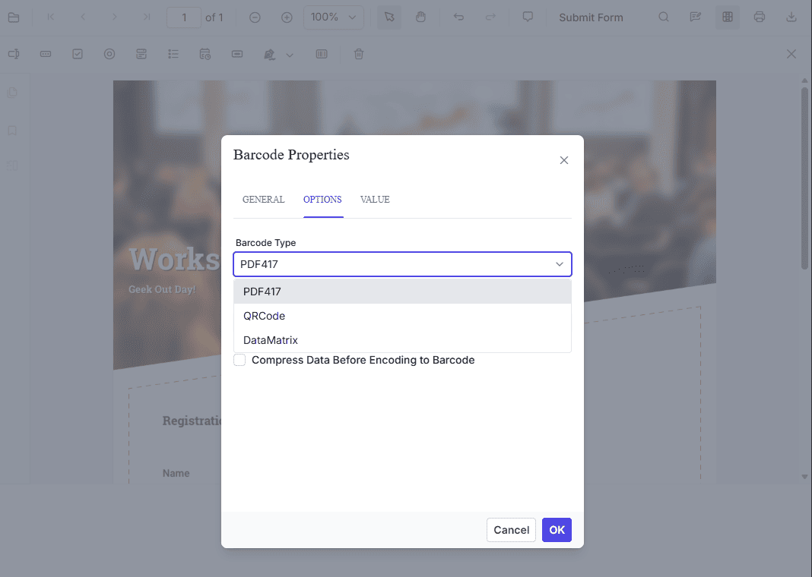

#### Value Format

The value that is encoded in the barcode can be supplied in three ways.

| Value format | Description |
|---|---|
| `TabDelimited` | Carries the values in the barcode separated by a tab character, so the values appear at a tab space distance from each other. |
| `XML` | Stores the values pairwise in an XML structure. |
| `CustomValue` | Stores the value as a string, and any string can be assigned to it. |

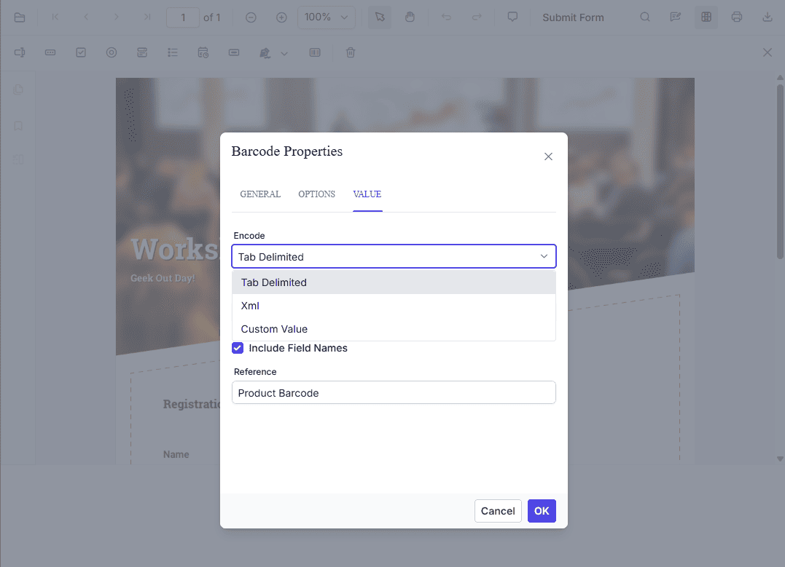

N> Complete support for executing custom scripts is not available. Instead, the PDF Viewer parses the final value assigned to the barcode field in the PDF document.

#### Static Barcode Value

The barcode value can be set to a fixed value from the **Value** tab of the Barcode Properties dialog.

Select **Custom Value** in the **Encode** dropdown, and then enter the text to be encoded in the **Custom Value** text box.

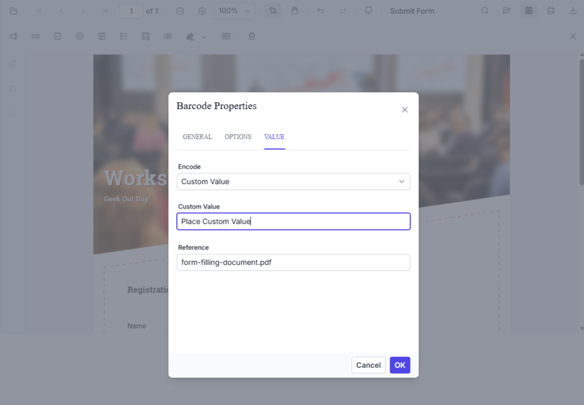

#### Dynamic Barcode Value

The barcode value can also be calculated from the other form fields that are present in the PDF document.

In the Form Designer, open the **Value** tab of the Barcode Properties dialog and use the **Select Field for Calculation** option to bind one or more fields to the barcode field.

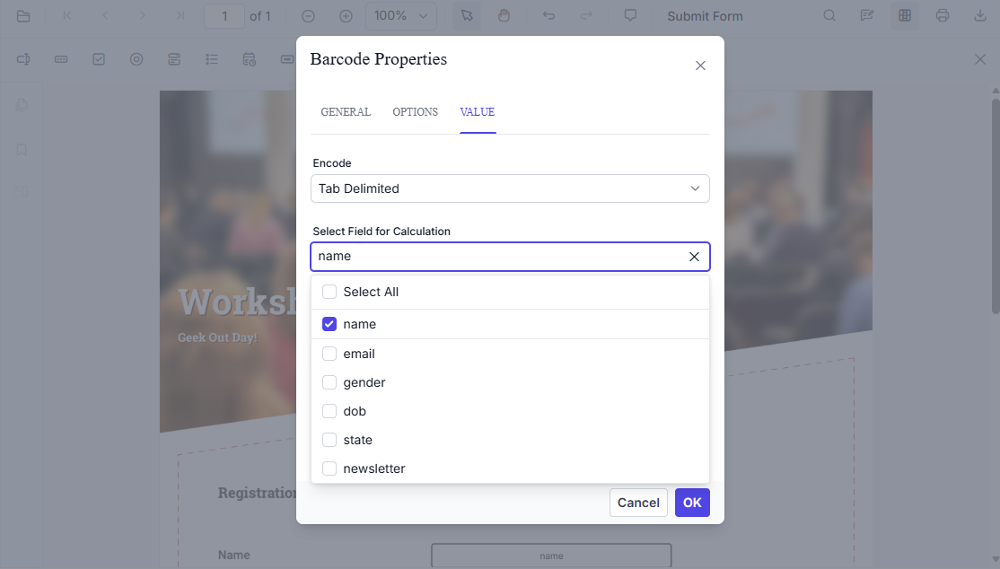

When a value is entered in a bound field, the barcode value is updated automatically.

N> By default, the barcode stores the field name along with its value. To store only the field values, clear the **Include Field Names** option. This option is available only for the `TabDelimited` format and does not apply to the `XML` format, which always stores data as name-value pairs.

#### Barcode Caption

By default, the name of the loaded PDF document is displayed below the generated barcode field. Use the **caption** property to change this text, either from the UI or programmatically.

#### Error Correction Level

The error correction level determines how much damage the generated barcode can tolerate before it can no longer be read. The available levels depend on the selected symbology.

| Symbology | Supported values |
|---|---|
| `PDF417` | `Level0` to `Level8` |
| `QRCode` | `Low`, `Medium`, `Quartile`, `High` |
| `DataMatrix` | Not applicable, since Data Matrix does not use this setting. |

The default error correction level is `Level5`.

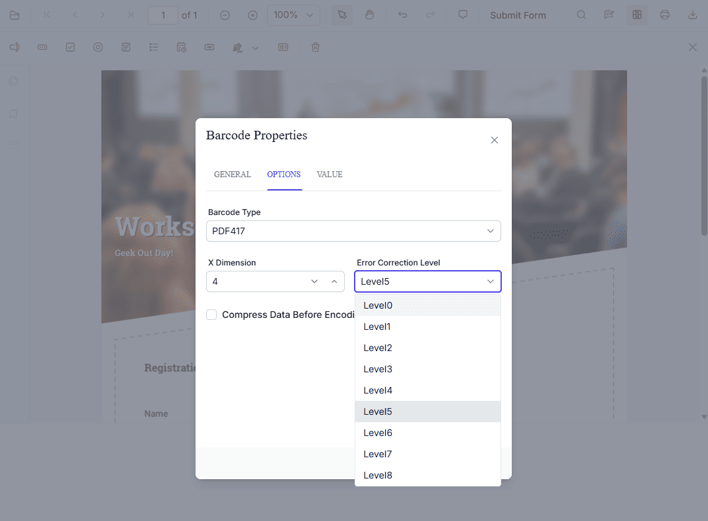

- API: [updateFormField()](https://help.syncfusion.com/cr/aspnetmvc-js2/syncfusion.ej2.pdfviewer.pdfviewer.html#updateFormField) for caption, symbology, value format, and error correction level.




    




[View Sample on GitHub](https://github.com/SyncfusionExamples/mvc-pdf-viewer-examples/tree/master/Forms/Barcode%20field)

## See also

- [Form Designer overview](../overview)
- [Form Designer Toolbar](../../toolbar-customization/form-designer-toolbar)
- [Create form fields](./create-form-fields)
- [Remove form fields](./remove-form-fields)
- [Customize form fields](./customize-form-fields)
- [Group form fields](../group-form-fields)
- [Form validation](../form-validation)
- [Form fields API](../form-fields-api)