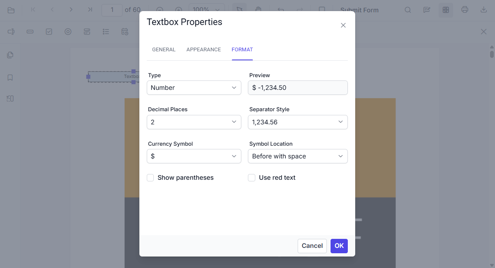
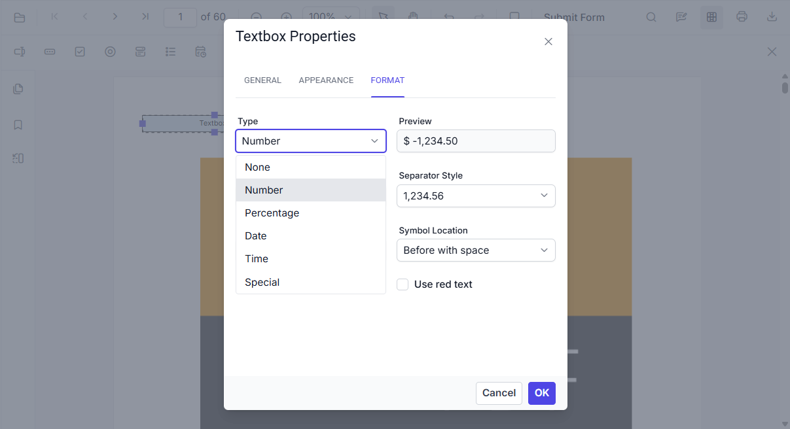
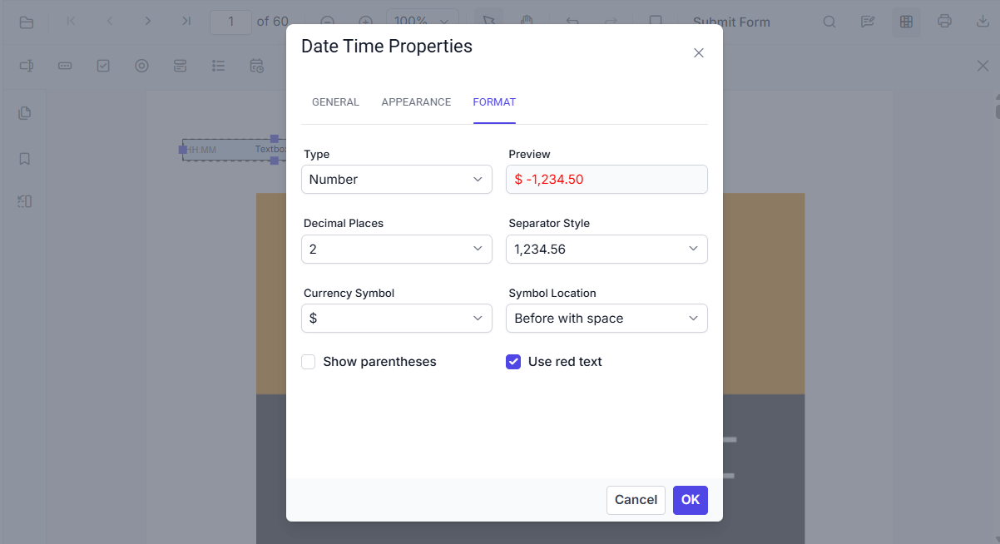
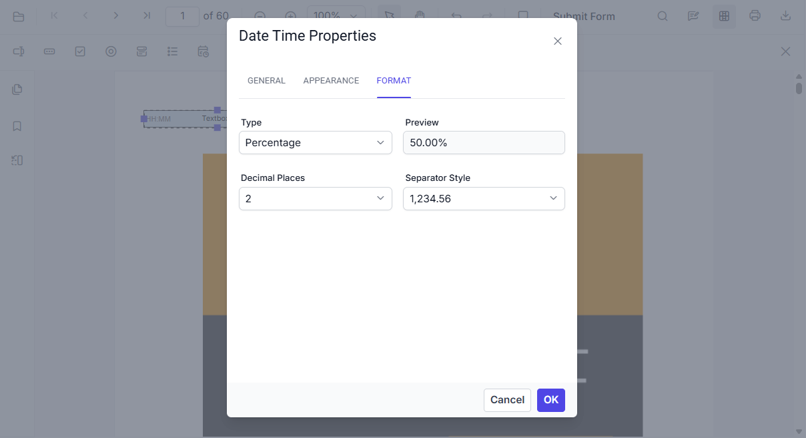
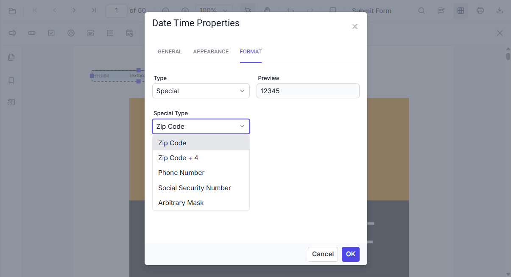
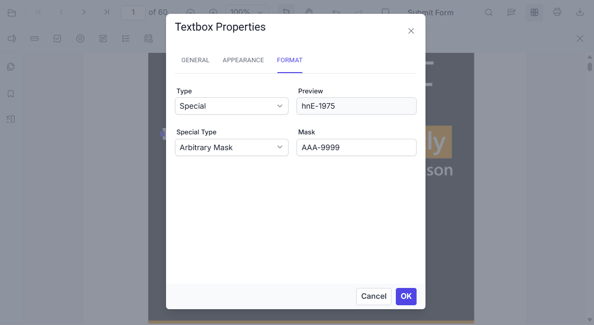

# JavaScript Actions in ASP.NET MVC PDF Viewer

The Syncfusion ASP.NET MVC PDF Viewer supports Adobe AcroForm text field format actions. Number, Percentage, Special, and Arbitrary Mask formatting behaviors can be applied to PDF form fields so that values are formatted and validated as users type and when a field loses focus.

The feature introduces a typed JavaScript action model for format actions, a `keyPressed` event for handling text field input, and support for parsing and applying Adobe Form Helper scripts. Only supported Adobe helper functions are parsed and executed.

## Key features

- Support for Adobe AcroForm text field format actions.
- A typed JavaScript action model for PDF form fields.
- A `keyPressed` event for validating and masking user input while typing.
- Automatic parsing and application of supported Adobe Form Helper scripts.
- Import, render, edit, and export of forms that contain supported AcroForm format actions.
- A dedicated **Format** tab in Form Designer mode for text box fields, used to specify the format dynamically.

## Configure format from the Format tab

In Form Designer mode, selecting a text box field opens the **Textbox Properties** dialog. The **Format** tab is available for text box fields only. Use it to choose a format type and configure the related options. The preview updates as the options change.



The **Type** drop-down lists the available format types:



| Type | Description |
| --- | --- |
| None | No formatting is applied. The field remains a text box. |
| Number | Formats the value as a number, with optional decimal places, separator style, currency symbol, and negative-value styling. |
| Percentage | Formats the committed value as a percentage. |
| Date | Changes the text box into a [DateTime picker](./forms/manage-form-fields/create-form-fields#datetime-picker) in date mode. The field then uses the DateTime picker calendar and format settings instead of a JavaScript format action. |
| Time | Changes the text box into a [DateTime picker](./forms/manage-form-fields/create-form-fields#datetime-picker) in time mode. The field then uses the DateTime picker time list and format settings instead of a JavaScript format action. |
| Special | Applies a predefined mask, such as ZIP code, ZIP+4, phone number, or Social Security Number, or a custom arbitrary mask. |

N> Choosing **Date** or **Time** in the Format tab converts the text box into a DateTime picker. Custom scripts are not currently handled in the PDF Viewer.

## Supported format actions

### Number format

Number formatting supports decimal precision, separator style, negative-number styling, and an optional currency symbol.

#### Supported scripts

```js
AFNumber_Keystroke(decimals, separator, negative, 0, currency, prepend)
AFNumber_Format(decimals, separator, negative, 0, currency, prepend)
```

#### Parameters

| Parameter | Description |
| --- | --- |
| `decimals` | Number of digits displayed after the decimal separator. |
| `separator` | Numeric separator style. |
| `negative` | Negative number formatting style. |
| `0` | Reserved parameter. Must always be `0`. |
| `currency` | Currency symbol or unit. Use an empty string when no symbol is required. |
| `prepend` | Determines whether the currency appears before (`true`) or after (`false`) the value. |

#### Separator styles

| Value | Example |
| --- | --- |
| 0 | 1,234.56 |
| 1 | 1234.56 |
| 2 | 1.234,56 |
| 3 | 1234,56 |

#### Negative number styles

| Value | Display |
| --- | --- |
| 0 | -1234.56 (black) |
| 1 | -1234.56 (red) |
| 2 | (1234.56) (black) |
| 3 | (1234.56) (red) |

The **Show parentheses** and **Use red text** options in the Format tab map to these negative styles. Currency symbol and symbol location map to the `currency` and `prepend` parameters.

#### Example

```js
AFNumber_Format(2, 0, 0, 0, "$", true)
```

Displays:

```
$1,234.56
```



### Percentage format

Percentage formatting supports decimal precision and separator style. The committed value is scaled once when it is formatted. Focusing or blurring the field again does not scale the value a second time.

#### Supported scripts

```js
AFPercent_Keystroke(decimals, separator)
AFPercent_Format(decimals, separator)
```

#### Parameters

| Parameter | Description |
| --- | --- |
| `decimals` | Number of decimal places. |
| `separator` | Numeric separator style. Uses the same values as the number format. |

#### Example

```js
AFPercent_Format(2, 0)
```

Input:

```
0.5
```

Output:

```
50.00%
```

N> Percentage formatting scales the committed value only once. Additional focus or blur operations do not reapply scaling.



### Special format

Special formatting applies a predefined mask for common data types.

#### Supported scripts

```js
AFSpecial_Keystroke(type)
AFSpecial_Format(type)
```

#### Supported types

| Type | Format | Example |
| --- | --- | --- |
| 0 | ZIP Code | 12345 |
| 1 | ZIP+4 | 12345-6789 |
| 2 | Phone Number | (123) 456-7890 |
| 3 | Social Security Number | 123-45-6789 |

#### Examples

ZIP Code:

```js
AFSpecial_Format(0)
```

Phone Number:

```js
AFSpecial_Format(2)
```

Social Security Number:

```js
AFSpecial_Format(3)
```

N> Phone numbers support both 7-digit (`456-7890`) and 10-digit (`(123) 456-7890`) formats. Existing punctuation is normalized before the mask is applied again.



### Arbitrary mask format

An arbitrary mask validates and formats input with a custom pattern. `AFSpecial_KeystrokeEx` does not have a corresponding format action. The viewer reconstructs the display from the configured mask while rendering the field.

#### Supported script

```js
AFSpecial_KeystrokeEx("mask")
```

#### Mask tokens

| Token | Description |
| --- | --- |
| `9` | Numeric digit (0-9). |
| `A` | Alphabetic character (A-Z, a-z). |
| `O` | Alphanumeric character. |
| `X` | Any printable character. |

#### Examples

License number:

```js
AFSpecial_KeystrokeEx("AAA-9999")
```

Input:

```
ABC1234
```

Output:

```
ABC-1234
```

Product code:

```js
AFSpecial_KeystrokeEx("AA-999-AA")
```

Input:

```
AB123CD
```

Output:

```
AB-123-CD
```

N> `AFSpecial_KeystrokeEx` does not provide a corresponding format action. The viewer reconstructs the display format from the configured mask during rendering.



## Add form fields with format actions

Inject the `FormFields` and `FormDesigner` modules, then pass an `actions` object when adding a text box. The following example adds Number, Percentage, Special, and Arbitrary Mask fields.



<div>
    <button type="button" onclick="addFormatFields()">Add Format Fields</button>
    <div style="height:500px;width:100%;">
        @Html.EJS().PdfViewer("pdfviewer").DocumentPath("https://cdn.syncfusion.com/content/pdf/pdf-succinctly.pdf").Render()
    </div>
</div>
<script>
    function addFormatFields() {
        var viewer = document.getElementById('pdfviewer').ej2_instances[0];
        viewer.formDesignerModule.addFormField('Textbox', {
            name: 'NumberField',
            bounds: { X: 146, Y: 200, Width: 200, Height: 24 },
            pageNumber: 1,
            actions: {
                format: {
                    script: 'AFNumber_Format(2, 0, 0, 0, "$", true)'
                }
            }
        });
        viewer.formDesignerModule.addFormField('Textbox', {
            name: 'PercentField',
            bounds: { X: 146, Y: 300, Width: 200, Height: 24 },
            pageNumber: 1,
            actions: {
                format: {
                    script: 'AFPercent_Format(2, 0)'
                }
            }
        });
        viewer.formDesignerModule.addFormField('Textbox', {
            name: 'SpecialField',
            bounds: { X: 146, Y: 400, Width: 200, Height: 24 },
            pageNumber: 1,
            actions: {
                format: {
                    script: 'AFSpecial_Format(0)'
                }
            }
        });
        viewer.formDesignerModule.addFormField('Textbox', {
            name: 'MaskField',
            bounds: { X: 146, Y: 500, Width: 200, Height: 24 },
            pageNumber: 1,
            actions: {
                keyPressed: {
                    script: 'AFSpecial_KeystrokeEx("AAA-9999")'
                }
            }
        });
    }
</script>



## Supported action properties

```js
actions: {
  keyPressed: {
    script: '...'
  },
  format: {
    script: '...'
  }
}
```

| Property | Description |
| --- | --- |
| `keyPressed` | Invoked during user input validation and masking. |
| `format` | Invoked when formatting the committed field value. |

## Security considerations

To keep document security intact:

- Only supported Adobe Form Helper functions are executed.
- Custom scripts are not currently handled in the PDF Viewer.
- Script parameters are parsed and validated before execution.

This provides Acrobat-compatible text field formatting for the supported helper functions without running arbitrary JavaScript from the document.

## See also

- [Form Designer](./forms/form-designer)
- [Create form fields](./forms/manage-form-fields/create-form-fields)
- [Form field events](./forms/form-field-events)
- [Form validation](./forms/form-validation)

N> [View Sample in GitHub](https://github.com/SyncfusionExamples/mvc-pdf-viewer-examples/tree/master/JavaScript%20Actions).
