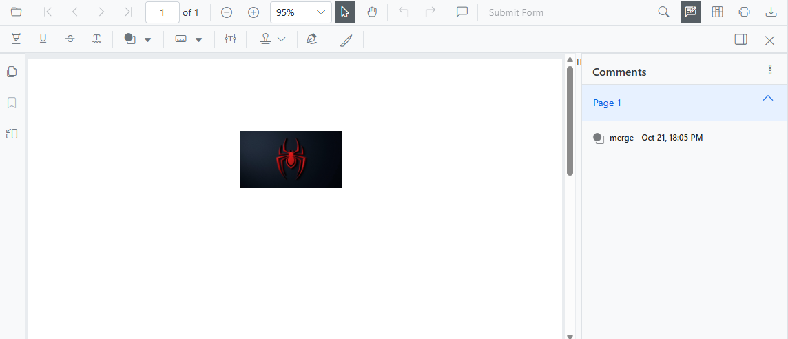

# Appearance-Based Annotation Rendering in Blazor PDF Viewer

Appearance-based annotation rendering enables the Blazor PDF Viewer to display the annotations of the loaded PDF using the appearance that is already embedded in the document. Instead of rebuilding each annotation from its individual properties, the viewer uses the appearance stored in the PDF, so that every annotation is shown exactly as its author intended.

This is especially useful for annotations that carry custom graphics, which cannot be reproduced from the annotation properties alone. Enable this behavior by setting the [`ShowAnnotationAppearance`](https://help.syncfusion.com/cr/blazor/Syncfusion.Blazor.SfPdfViewer.PdfViewerBase.html#Syncfusion_Blazor_SfPdfViewer_PdfViewerBase_ShowAnnotationAppearance) property to `true`.

## Why appearance-based rendering is required

A PDF annotation can optionally include a custom appearance. This appearance holds the pre-rendered graphics of the annotation, such as a rubber stamp with a company logo, a highlighted region drawn with a specific transparency gradient, or a free text annotation whose text was drawn using an embedded font.

When such an annotation is opened in a viewer that ignores the custom appearance, the viewer falls back to generating the annotation from its basic properties. As a result, the custom graphics are lost, the styling differs from the original document, and the annotation appears differently across viewers and platforms.

By rendering the embedded appearance, the Blazor PDF Viewer preserves the original visual representation of the annotation and keeps the output consistent with the source PDF in every viewer and on every platform.

## Enable appearance-based annotation rendering

Set the [`ShowAnnotationAppearance`](https://help.syncfusion.com/cr/blazor/Syncfusion.Blazor.SfPdfViewer.PdfViewerBase.html#Syncfusion_Blazor_SfPdfViewer_PdfViewerBase_ShowAnnotationAppearance) property to `true` on the `SfPdfViewer2` component to display the annotations of the loaded document with their embedded appearance.

```cshtml

@using Syncfusion.Blazor.SfPdfViewer

<SfPdfViewer2 DocumentPath="wwwroot/annotation_apperance.pdf"
              Height="100%"
              Width="100%"
              @* Render the annotation with appearance *@
              ShowAnnotationAppearance="true">
</SfPdfViewer2>

```



When the property is enabled, every annotation in the loaded document that contains an appearance is displayed with that appearance. The remaining annotations continue to be displayed from their annotation properties, so that the document is shown without any missing content.

## Custom appearance (AP) entry

The custom appearance of an annotation is stored in the `/AP` entry of the PDF annotation. An annotation that carries this entry contains graphics that are defined only inside the appearance. For example, a rubber stamp annotation may embed a company logo, a border, and a signature line that are drawn with custom graphics and that are not described by any of the annotation properties.

When [`ShowAnnotationAppearance`](https://help.syncfusion.com/cr/blazor/Syncfusion.Blazor.SfPdfViewer.PdfViewerBase.html#Syncfusion_Blazor_SfPdfViewer_PdfViewerBase_ShowAnnotationAppearance) is set to `true`, the viewer displays that custom appearance, and the annotation is shown with the logo, border, and signature line exactly as they were authored.

N> [View Sample in GitHub](https://github.com/SyncfusionExamples/blazor-pdf-viewer-examples/tree/master/Annotations/Annotation%20Apperance/AnnotationAppearance).

## See also

* [Annotation Overview](overview)
* [Create and Modify Annotations](create-modify-annotation)
* [Customize Annotations](customize-annotation)
* [Flatten Annotations](flatten-annotation)
* [Import and Export Annotations](import-export-annotation)
* [Annotation Events](events)
