# Modify Form Fields in JavaScript (ES5) PDF Viewer
Form fields can be modified using the UI or API.

## Modify PDF form field properties using the UI
- Right-click a field → **Properties** to update settings.
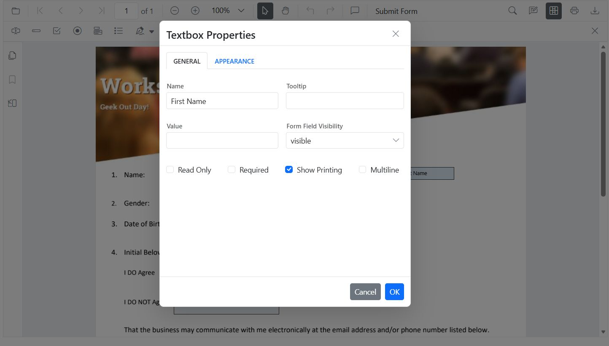
- Drag to move; use handles to resize.
- Use the toolbar to toggle field mode or add new fields.

## Modify PDF form field properties programmatically
Use [`updateFormField()`](https://ej2.syncfusion.com/javascript/documentation/api/pdfviewer/index-default#updateformfields) to change behavior or data (including position and size):

```html
<button id="modifyTextbox">Apply Textbox Changes</button>
```
```js
document.getElementById('modifyTextbox').addEventListener('click', function () {
  // Retrieve form fields collection
  var fields = pdfviewer.retrieveFormFields();
  // Find the textbox field by name (Here field name is First Name)
  var field = (fields || []).find(function (f) { return f && f.name === 'First Name'; }) || (fields || [])[0]; // Update Name accordingly
  if (field) {
    // Update textbox field styling and value
    pdfviewer.formDesignerModule.updateFormField(field, {
      value: 'John',
      fontFamily: 'Courier',
      fontSize: 12,
      fontStyle: null,
      color: 'black',
      backgroundColor: 'white',
      borderColor: 'black',
      thickness: 2,
      alignment: 'Left',
      maxLength: 50
    });
  }
});
```

## Modify PDF form field properties by field type

### Textbox
- UI: Update value, font, size, colors, border thickness, alignment, max length, multiline.

- API: [`updateFormField()`](https://ej2.syncfusion.com/documentation/api/pdfviewer/index-default#updateformfields) for value, typography, alignment, colors, borders.

```html
<button id="modifyTextbox">Apply Textbox Changes</button>
```
```js
document.getElementById('modifyTextbox').addEventListener('click', function () {
  // Retrieve form fields collection
  var fields = pdfviewer.retrieveFormFields();
  // Find the textbox field by name (Here field name is First Name)
  var field = (fields || []).find(function (f) { return f && f.name === 'First Name'; }) || (fields || [])[0]; //Update Name accordingly
  if (field) {
    // Update textbox field styling and value
    pdfviewer.formDesignerModule.updateFormField(field, {
      value: 'John',
      fontFamily: 'Courier',
      fontSize: 12,
      fontStyle: null,
      color: 'black',
      backgroundColor: 'white',
      borderColor: 'black',
      thickness: 2,
      alignment: 'Left',
      maxLength: 50
    });
  }
});
```

### Password

- UI: Tooltip, required, max length, font, appearance.
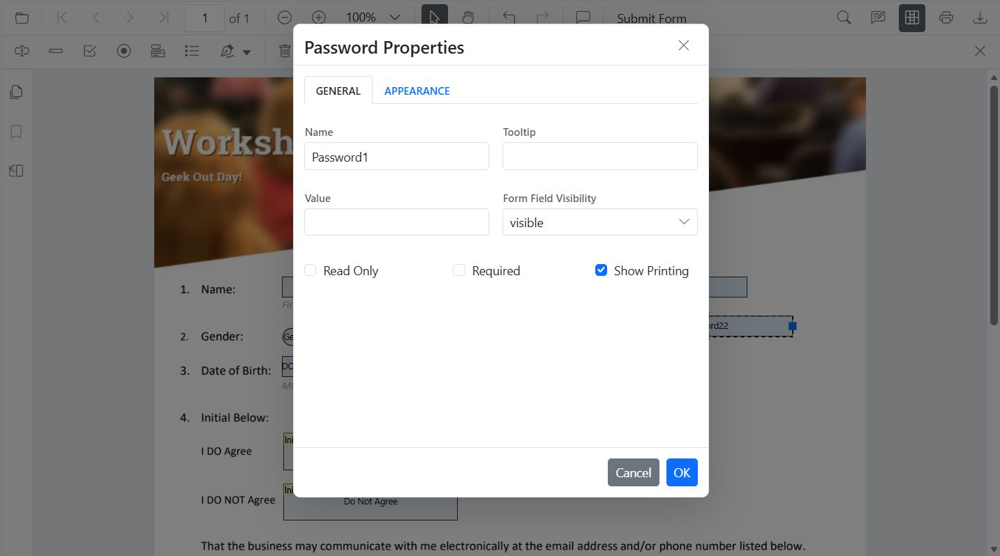
- API: [`updateFormField()`](https://ej2.syncfusion.com/documentation/api/pdfviewer/index-default#updateformfields) for tooltip, validation flags, typography, colors, alignment, borders.
```html
 <button id="modifyPasswordBox">Edit PasswordBox</button>
```
```js
document.getElementById('modifyPasswordBox').addEventListener('click', function () {
  // Retrieve form fields collection
  var fields = pdfviewer.retrieveFormFields();
  // Find the password field by name (Here field name is Password)
  var field = (fields || []).find(function (f) { return f && f.name === 'Password'; });
  if (field) {
    // Update password field properties
    pdfviewer.formDesignerModule.updateFormField(field, {
      tooltip: 'Enter your password',
      isReadOnly: false,
      isRequired: true,
      isPrint: true,
      fontFamily: 'Courier',
      fontSize: 10,
      color: 'black',
      borderColor: 'black',
      backgroundColor: 'white',
      alignment: 'Left',
      maxLength: 20,
      thickness: 1
    });
  }
});
```

### CheckBox
- UI: Toggle checked state.
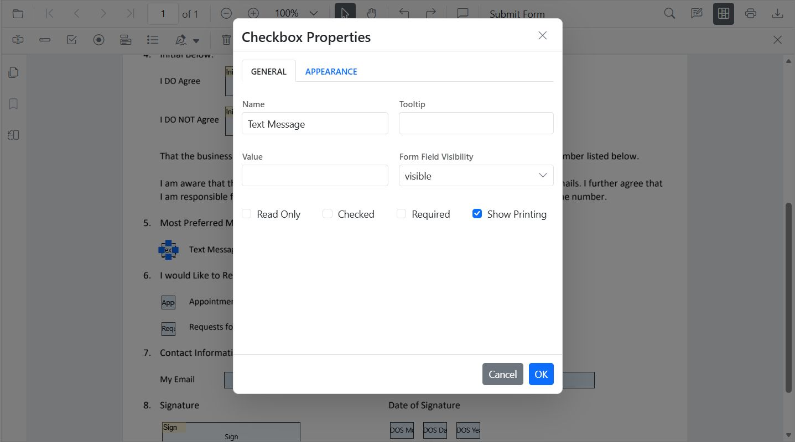
- API: [`updateFormField()`](https://ej2.syncfusion.com/documentation/api/pdfviewer/index-default#updateformfields) for isChecked, tooltip, colors, borders.
```html
<button id="modifyCheckbox">Modify CheckBox</button>
```
```js
document.getElementById('modifyCheckbox').addEventListener('click', function () {
  // Retrieve form fields collection
  var fields = pdfviewer.retrieveFormFields();
  // Find the checkbox field by name (Here field name is Subscribe)
  var cb = (fields || []).find(function (f) { return f && f.name === 'Subscribe'; });
  if (cb) {
    // Update checkbox field properties and state
    pdfviewer.formDesignerModule.updateFormField(cb, {
      isChecked: true,
      backgroundColor: 'white',
      borderColor: 'black',
      thickness: 2,
      tooltip: 'Subscribe to newsletter'
    });
  }
});
```

### RadioButton
- UI: Set selected item in a group (same Name).
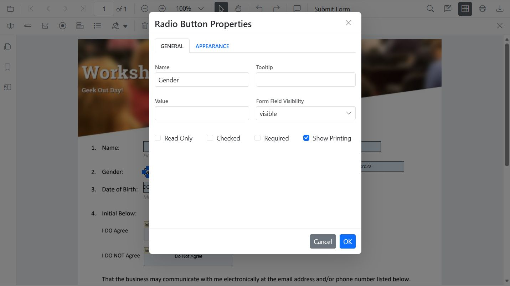
- API: [`updateFormField()`](https://ej2.syncfusion.com/documentation/api/pdfviewer/index-default#updateformfields) to set selected value and border appearance.
```html
<button id="editRadio">Modify RadioButton</button>
```
```js
document.getElementById('editRadio').addEventListener('click', function () {
  // Retrieve form fields collection
  var fields = pdfviewer.retrieveFormFields();
  // Filter the radio button group by name (Here group name is Gender)
  var genderRadios = (fields || []).filter(function (f) { return f && f.name === 'Gender'; });
  if (genderRadios[1]) {
    // Update radio button selection and appearance
    pdfviewer.formDesignerModule.updateFormField(genderRadios[0], { isSelected: false });
    pdfviewer.formDesignerModule.updateFormField(genderRadios[1], { isSelected: true, thickness: 2, borderColor: 'black' });
  }
});
```

### ListBox
- UI: Add/remove items, set selection, adjust fonts/colors.
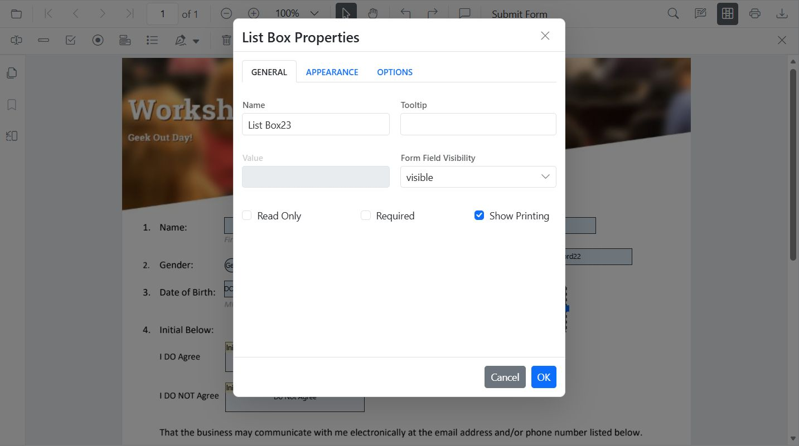
- API: [`updateFormField()`](https://ej2.syncfusion.com/documentation/api/pdfviewer/index-default#updateformfields) for items, selection, borders.
```html
<button id="editListBox">Edit ListBox</button>
```
```js
document.getElementById('editListBox').addEventListener('click', function () {
  // Retrieve form fields collection
  var fields = pdfviewer.retrieveFormFields();
  // Find the listbox field by name (Here field name is States)
  var lb = (fields || []).find(function (f) { return f && f.name === 'States'; });
  if (lb) {
    // Update listbox options, selection, and appearance
    var option = [
      { itemName: 'Alabama', itemValue: 'AL' },
      { itemName: 'Alaska', itemValue: 'AK' },
      { itemName: 'Arizona', itemValue: 'AZ' }
    ];
    pdfviewer.formDesignerModule.updateFormField(lb, {
      fontFamily: 'Courier',
      fontSize: 5,
      color: 'black',
      backgroundColor: 'white',
      tooltip: 'listbox',
      options: option
    });
  }
});

```

### DropDown
- UI: Add/remove items, default value, appearance.
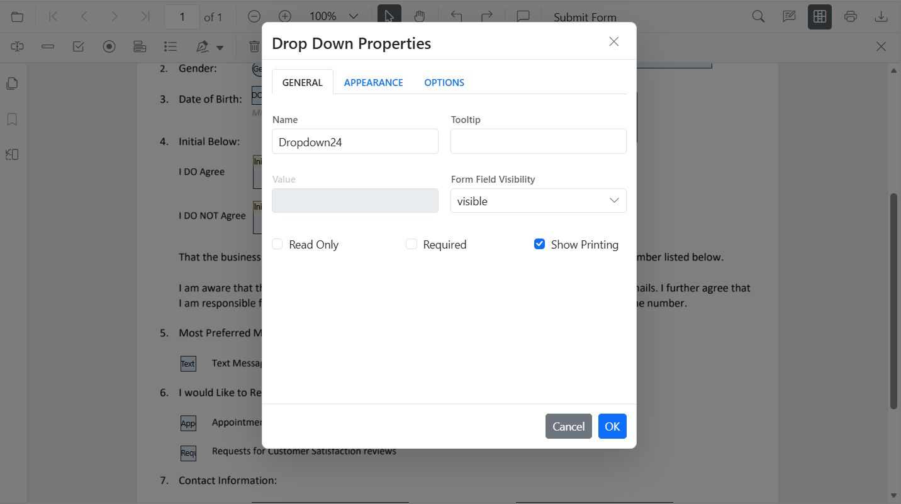
- API: [`updateFormField()`](https://ej2.syncfusion.com/documentation/api/pdfviewer/index-default#updateformfields) for items, value, borders.
```html
<button id="editDropDown">Edit DropDown</button>
```
```js
document.getElementById('editDropDown').addEventListener('click', function () {
  // Retrieve form fields collection
  var fields = pdfviewer.retrieveFormFields();
  // Find the dropdown field by name (Here field name is Country)
  var dd = (fields || []).find(function (f) { return f && f.name === 'Country'; });
  if (dd) {
    // Update dropdown items, value, and appearance
    pdfviewer.formDesignerModule.updateFormField(dd, {
      options: [
        { itemName: 'USA', itemValue: 'US' },
        { itemName: 'Canada', itemValue: 'CA' },
        { itemName: 'Mexico', itemValue: 'MX' }
      ],
      value: 'US',
      fontFamily: 'Courier',
      fontSize: 10,
      color: 'black',
      borderColor: 'black',
      backgroundColor: 'white'
    });
  }
});
```

### Signature Field
- UI: Tooltip, thickness, indicator text, required/visibility.
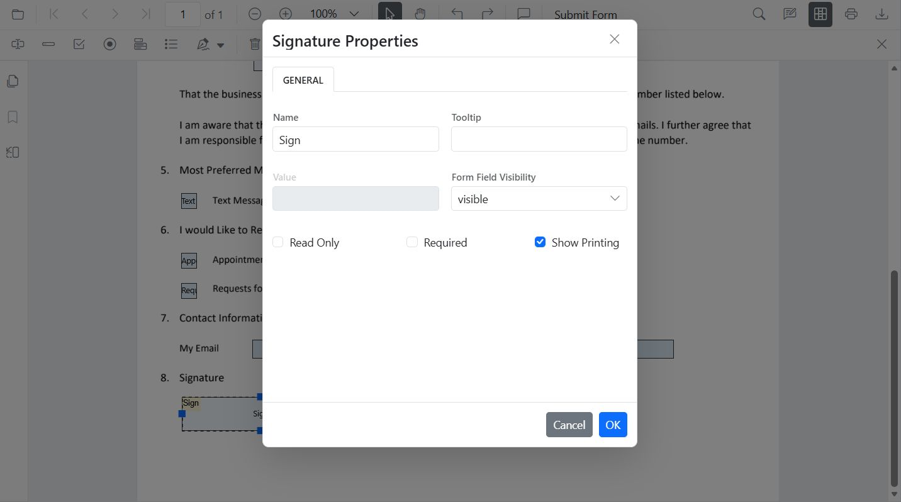
- API: [`updateFormField()`](https://ej2.syncfusion.com/documentation/api/pdfviewer/index-default#updateformfields) for tooltip, required, colors, borders.
```html
<button id="editSignature">Edit Signature</button>
```
```js
document.getElementById('editSignature').addEventListener('click', function () {
  // Retrieve form fields collection
  var fields = pdfviewer.retrieveFormFields();
  // Find the signature field by name (Here field name is Sign)
  var sig = (fields || []).find(function (f) { return f && f.name === 'Sign'; });
  if (sig) {
    // Update signature field properties
    pdfviewer.formDesignerModule.updateFormField(sig, {
      tooltip: 'Please sign here',
      thickness: 3,
      isRequired: true,
      isPrint: true,
      backgroundColor: 'white',
      borderColor: 'black'
    });
  }
});
```

### Initial Field
- UI: Tooltip, indicator text, thickness, required/visibility.
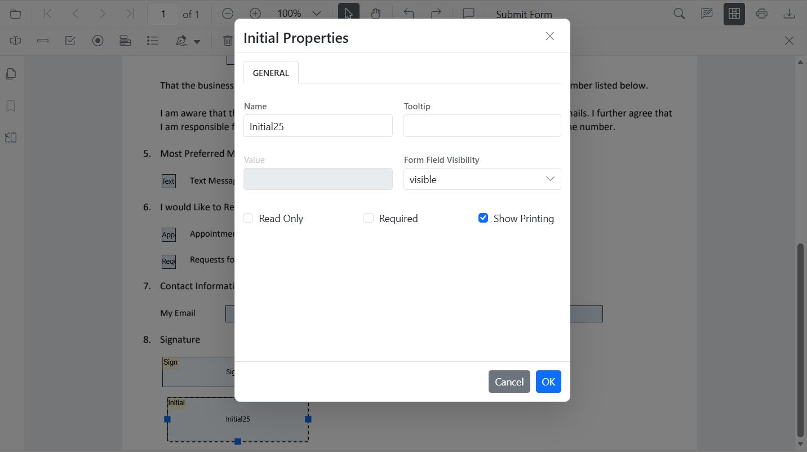
- API: [`updateFormField()`](https://ej2.syncfusion.com/documentation/api/pdfviewer/index-default#updateformfields) for tooltip, required, colors, borders.
```html
<button id="editInitial">Edit Initial</button>
```
```js
document.getElementById('editInitial').addEventListener('click', function () {
  // Retrieve form fields collection
  var fields = pdfviewer.retrieveFormFields();
  // Find the initial field by name (Here field name is Initial)
  var init = (fields || []).find(function (f) { return f && f.name === 'Initial'; });
  if (init) {
    // Update initial field properties
    pdfviewer.formDesignerModule.updateFormField(init, {
      tooltip: 'Add your initials',
      thickness: 2,
      isRequired: true,
      isPrint: true,
      backgroundColor: 'white',
      borderColor: 'black'
    });
  }
});
```

### DateTime Picker

Select a DateTime Picker field in Form Designer to review or change its settings. The toolbar includes the DateTime Picker tool, and the page displays date and time fields.

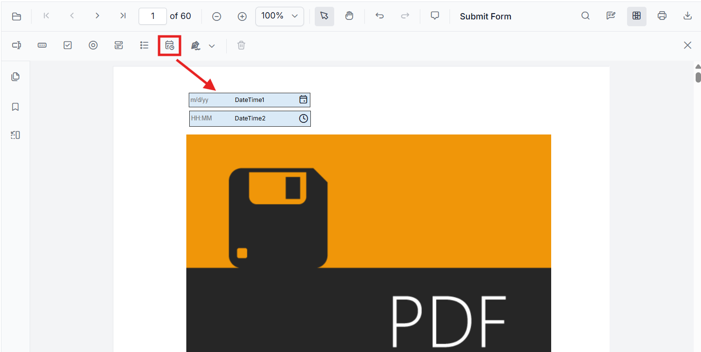

Date and time fields can also be used to enter values directly or choose a value from the picker:

- For a date field, type a date or open the calendar picker.

  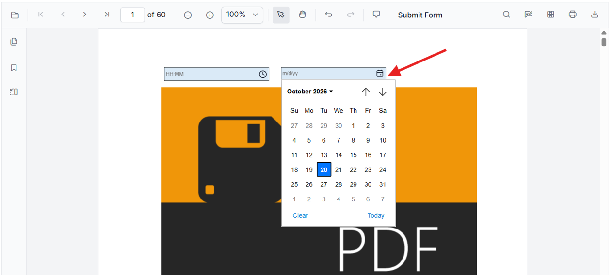

- For a time field, type a time or open the time picker.

  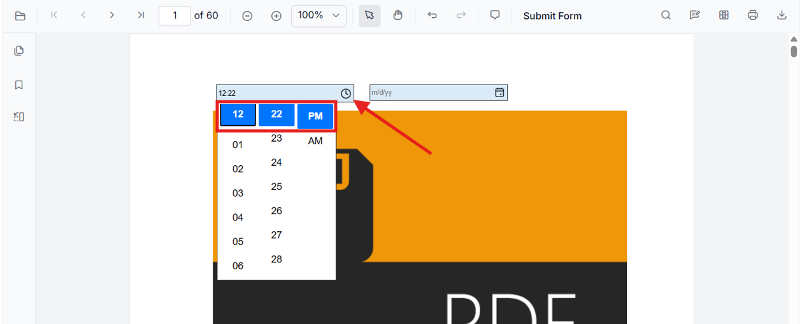

Use the field's **General** properties to review or edit its name, value, tooltip, visibility, read-only and required settings, and print visibility.

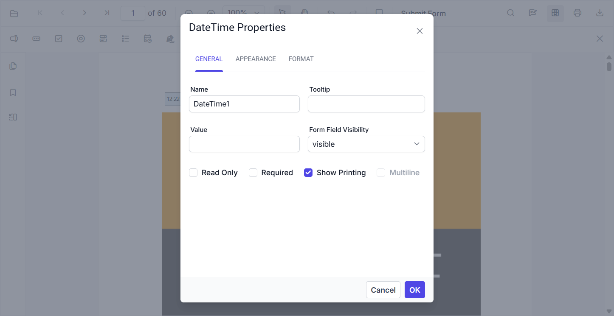

The **Appearance** properties include font, colors, border, and alignment.

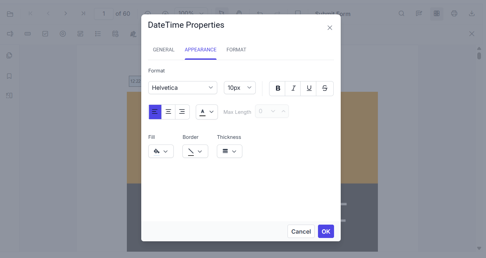

Use the **Format** tab to change the field type (Date or Time), select a display format, and review the preview.

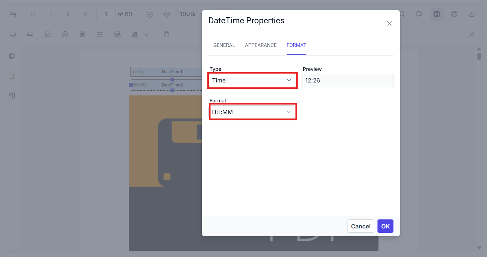

- API: [`updateFormField()`](https://ej2.syncfusion.com/documentation/api/pdfviewer/index-default#updateformfields) for value, format script, typography, colors, borders.

[View Sample on GitHub](https://github.com/SyncfusionExamples/javascript-pdf-viewer-examples)

### Barcode

Select a Barcode field in Form Designer to review or change its settings. The toolbar includes the Barcode tool, and the page displays the generated barcode.

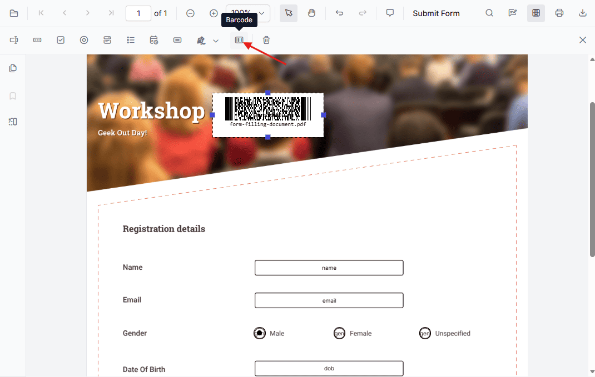

Use the field's **General** properties to review or edit its name, value, caption, tooltip, visibility, read-only and required settings, and print visibility.

The **Options** properties include the barcode type, X dimension, error correction level, and the option to compress the data before encoding it to the barcode.

#### Symbology

The barcode type is referred to as the **symbology**. The following symbologies are supported, and **PDF417** is used by default.

| Symbology | Description |
|---|---|
| `PDF417` | A stacked, linear barcode that supports alphanumeric data. This is the default symbology. |
| `QRCode` | A two-dimensional matrix barcode that supports numeric, alphanumeric, and binary data. |
| `DataMatrix` | A two-dimensional matrix barcode that is used to encode a small amount of data in a compact area. |

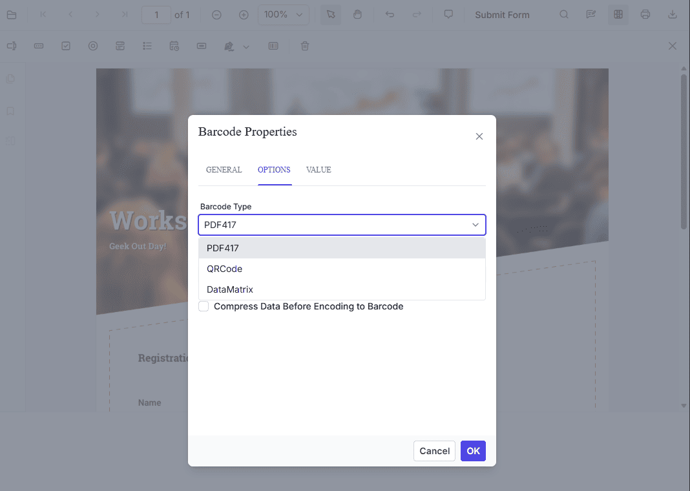

#### Value Format

The value that is encoded in the barcode can be supplied in three ways.

| Value format | Description |
|---|---|
| `TabDelimited` | Carries the values in the barcode separated by a tab character, so the values appear at a tab space distance from each other. |
| `XML` | Stores the values pairwise in an XML structure. |
| `CustomValue` | Stores the value as a string, and any string can be assigned to it. |

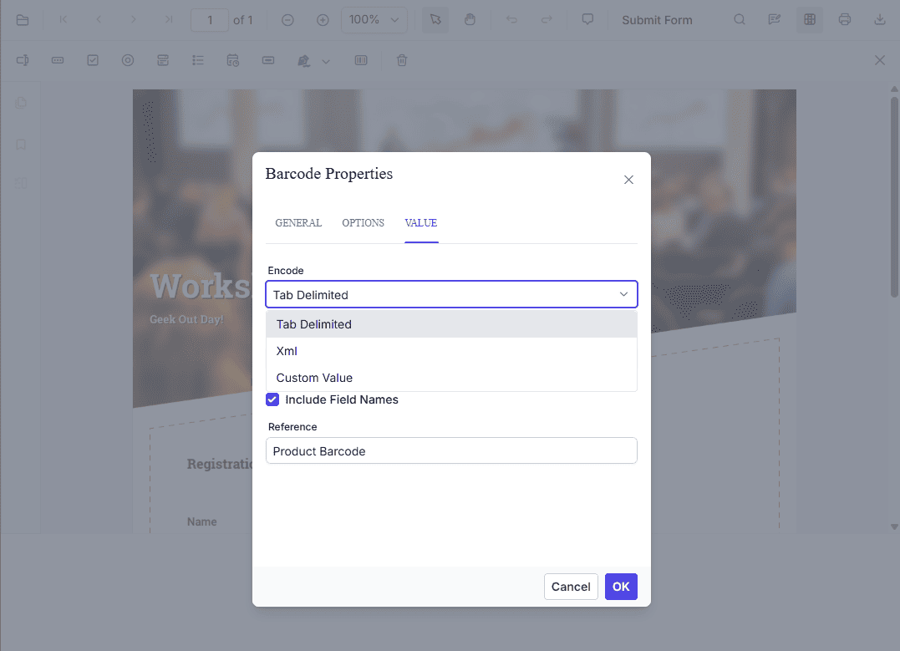

N> Complete support for executing custom scripts is not available. Instead, the PDF Viewer parses the final value assigned to the barcode field in the PDF document.

#### Static Barcode Value

The barcode value can be set to a fixed value from the **Value** tab of the Barcode Properties dialog.

Select **Custom Value** in the **Encode** dropdown, and then enter the text to be encoded in the **Custom Value** text box.

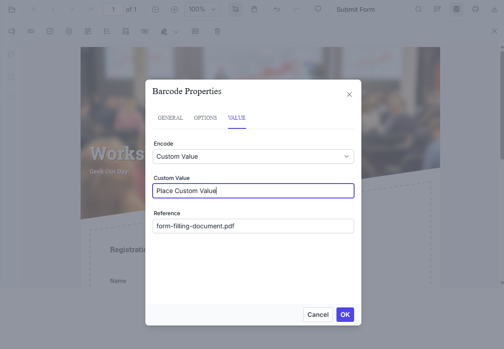

#### Dynamic Barcode Value

The barcode value can also be calculated from the other form fields that are present in the PDF document.

In the Form Designer, open the **Value** tab of the Barcode Properties dialog and use the **Select Field for Calculation** option to bind one or more fields to the barcode field.

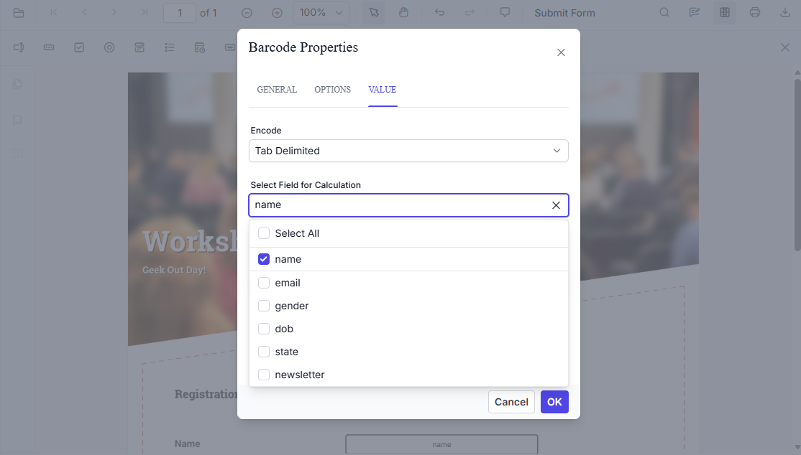

When a value is entered in a bound field, the barcode value is updated automatically.

N> By default, the barcode stores the field name along with its value. To store only the field values, clear the **Include Field Names** option. This option is available only for the `TabDelimited` format and does not apply to the `XML` format, which always stores data as name-value pairs.

#### Caption

By default, the name of the loaded PDF document is displayed below the generated barcode field. Use the **caption** property to change this text, either from the UI or programmatically.

#### Error Correction Level

The error correction level determines how much damage the generated barcode can tolerate before it can no longer be read. The available levels depend on the selected symbology.

| Symbology | Supported values |
|---|---|
| `PDF417` | `Level0` to `Level8` |
| `QRCode` | `Low`, `Medium`, `Quartile`, `High` |
| `DataMatrix` | Not applicable, since Data Matrix does not use this setting. |

The default error correction level is `Level5`.

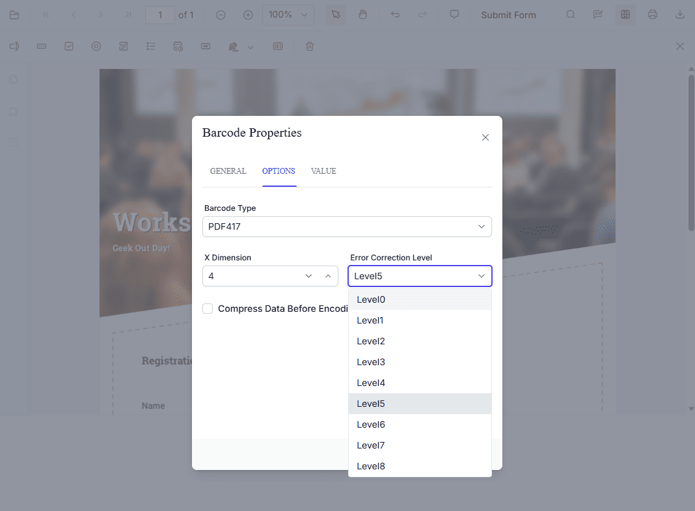

- API: [updateFormField()](https://ej2.syncfusion.com/documentation/api/pdfviewer/index-default#updateformfields) for caption, symbology, value format, and error correction level.

```js
// Update the caption, symbology, value format and error correction level of a barcode field
var fields = pdfviewer.formFieldCollections;
var barcode = fields.filter(function (field) {
  return field.type === 'Barcode';
})[0];

if (barcode) {
  pdfviewer.formDesignerModule.updateFormField(barcode, {
    caption: 'Updated Barcode Caption',
    symbology: 'QRCode',
    valueFormat: 'CustomValue',
    errorCorrectionLevel: 'High'
  });
}
```

[View Sample on GitHub](https://github.com/SyncfusionExamples/javascript-pdf-viewer-examples/tree/master/Form%20Fields/Barcode%20field)

## See also

- [Form Designer overview](../overview)
- [Form Designer Toolbar](../../toolbar-customization/form-designer-toolbar)
- [Create form fields](./create-form-fields)
- [Remove form fields](./remove-form-fields)
- [Style form fields](./customize-form-fields)
- [Group form fields](../group-form-fields)
- [Form validation](../form-validation)
- [Form fields API](../form-fields-api)