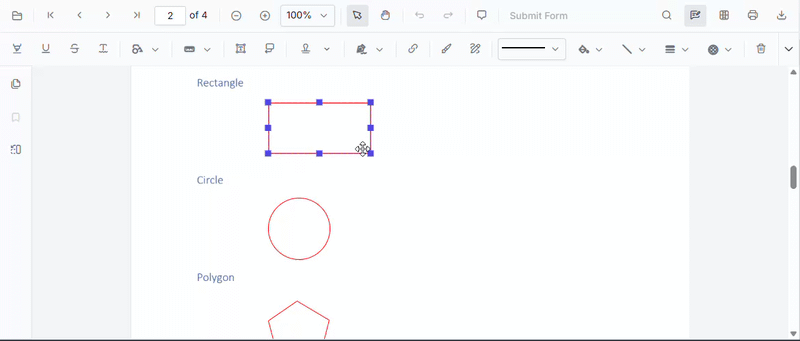
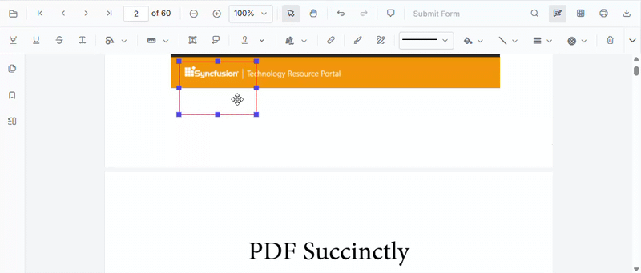

# Resize and Move Annotations in TypeScript PDF Viewer

Annotations can be resized and moved after they are added to a document. The PDF Viewer supports these operations both from the built-in UI and programmatically through the [`editAnnotation`](https://ej2.syncfusion.com/javascript/documentation/api/pdfviewer/annotation#editannotation) API.

## Resize annotations

### Resize via UI

1. Add an annotation to the page, or select an existing annotation.
2. When the annotation is selected, resize handles appear on its corners and edges.
3. Drag a handle to change the width and height of the annotation.

### Resize programmatically

The size of an annotation is defined by its `bounds`. To resize an annotation programmatically, update the `width` and `height` of the respective annotation `bounds` and call the `editAnnotation` API to apply the change dynamically.



const resizeAnnotation = () => {
  //get recently added annotation
  const annotation =
    viewer.annotationCollection[viewer.annotationCollection.length - 1];
  //programmatically resize the annotation
  annotation.bounds.width += 100;
  annotation.bounds.height += 100;
  viewer.annotation.editAnnotation(annotation);
};



## Move annotations

### Move via UI

1. Select an annotation.
2. Drag the annotation to reposition it within the same page, or drag it to a different page in the document.

### Move programmatically

To move an annotation programmatically, update the relevant property of the annotation and call the `editAnnotation` API.

- To move an annotation to a **different page**, update the `pageNumber` property of the annotation.
- To move an annotation **within the same page**, update the `left` and `top` values (or `x` and `y`, depending on the bounds object structure) of the annotation's `bounds` object.



const moveAnnotation = () => {
  //get recently added annotation
  const annotation =
    viewer.annotationCollection[viewer.annotationCollection.length - 1];
  //programmatically change page number of annotation
  annotation.pageNumber += 1;
  viewer.annotation.editAnnotation(annotation);
};



To move an annotation to a new position on the same page, update the `bounds` of the annotation instead.



const moveAnnotationInPage = () => {
  //get recently added annotation
  const annotation =
    viewer.annotationCollection[viewer.annotationCollection.length - 1];
  // Update the annotation's coordinates (using left/top or x/y depending on the bounds object)
  annotation.bounds.left += 50;
  annotation.bounds.top += 50;
  viewer.annotation.editAnnotation(annotation);
};



## Sample

The following sample shows both the resize and move operations with a single viewer instance.



import {
  PdfViewer,
  Toolbar,
  Magnification,
  Navigation,
  LinkAnnotation,
  ThumbnailView,
  BookmarkView,
  TextSelection,
  TextSearch,
  Print,
  Annotation,
  FormFields,
  FormDesigner,
  PageOrganizer
} from '@syncfusion/ej2-pdfviewer';

PdfViewer.Inject(
  Toolbar,
  Magnification,
  Navigation,
  LinkAnnotation,
  ThumbnailView,
  BookmarkView,
  TextSelection,
  TextSearch,
  Print,
  Annotation,
  FormFields,
  FormDesigner,
  PageOrganizer
);

// Create viewer
const viewer = new PdfViewer({
  documentPath: 'https://cdn.syncfusion.com/content/pdf/pdf-succinctly.pdf',
  // Standalone resources
  resourceUrl: 'https://cdn.syncfusion.com/ej2/31.1.23/dist/ej2-pdfviewer-lib'
});
viewer.appendTo('#PdfViewer');

document.getElementById('move')?.addEventListener('click', () => {
  //get recently added annotation
  const annotation = viewer.annotationCollection[viewer.annotationCollection.length - 1];
  //programmatically change page number of annotation
  annotation.pageNumber += 1;
  viewer.annotation.editAnnotation(annotation);
});

document.getElementById('resize')?.addEventListener('click', () => {
  //get recently added annotation
  const annotation = viewer.annotationCollection[viewer.annotationCollection.length - 1];
  //programmatically resize the annotation
  annotation.bounds.width += 100;
  annotation.bounds.height += 100;
  viewer.annotation.editAnnotation(annotation);
});



  <button id="move">Move annotation</button>
  <button id="resize">Resize annotation</button>




N> The `editAnnotation` API requires an existing annotation. Add an annotation to the document before calling the resize or move methods.

## See also

- [Annotation Overview](../overview)
- [Annotation Types](../annotations/annotation-types/area-annotation)
- [Annotation Toolbar](../toolbar-customization/annotation-toolbar)
- [Create and Modify Annotation](../annotations/create-modify-annotation)
- [Customize Annotation](../annotations/customize-annotation)
- [Remove Annotation](../annotations/delete-annotation)
- [Handwritten Signature](../annotations/signature-annotation)
- [Export and Import Annotation](../annotations/export-import/export-annotation)
- [Annotation Permission](../annotations/annotation-permission)
- [Annotation in Mobile View](../annotations/annotations-in-mobile-view)
- [Annotation Events](../annotations/annotation-event)
- [Annotation API](../annotations/annotations-api)
