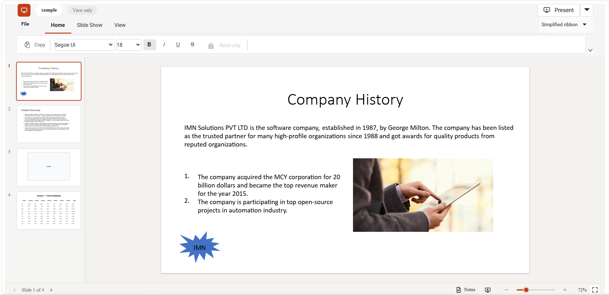

# Getting Started with JavaScript PPTX Editor

[JavaScript PPTX Editor](https://www.syncfusion.com/powerpoint-editor-sdk/javascript-powerpoint-editor) enables you to view and print PowerPoint presentations in web applications. This section guides you through the steps to get started and create a PPTX Editor in a JavaScript (ES5) application.

## Prerequisites

* [Browser Compatibility](https://ej2.syncfusion.com/javascript/documentation/browser)

## Create a JavaScript application

Create a folder named `pptxeditor-app` with `index.html` and `index.js` files with the default structure. Your application structure should look like this:

```text
pptxeditor-app/
├── index.html
└── index.js
```

## Add PPTX Editor resources

Add the required PPTX Editor style and script references to the `index.html` file using one of the following methods:





To use local scripts and styles for the PPTX Editor, follow these steps:

1. Download and install the [PPTX Editor SDK](https://www.syncfusion.com/account/manage-trials/start-trials).

2. Create a `resources` folder in your application (for example, `pptxeditor-app/resources`).

3. From the installed SDK location, copy the required packages from the following folder into the `resources` folder:

```text
<Install path>/Syncfusion/Essential Studio/PPTX Editor SDK/{VERSION}/Web (Essential JS 2)/JavaScript
```

N> Replace `{VERSION}` in the path above with the installed PPTX Editor SDK version (for example, `34.1.29`). Use the same version segment in the CDN URLs in the next tab to keep the local and CDN resources in sync.

4. After copying the files, add the PPTX Editor and its dependent control style and script references at the end of the **\<head\>** section in the `index.html` file.



<!-- PPTX Editor dependent theme -->
<link href="resources/ej2-base/styles/tailwind3.css" rel="stylesheet" type="text/css" />
<link href="resources/ej2-buttons/styles/tailwind3.css" rel="stylesheet" type="text/css" />
<link href="resources/ej2-inputs/styles/tailwind3.css" rel="stylesheet" type="text/css" />
<link href="resources/ej2-popups/styles/tailwind3.css" rel="stylesheet" type="text/css" />
<link href="resources/ej2-lists/styles/tailwind3.css" rel="stylesheet" type="text/css" />
<link href="resources/ej2-navigations/styles/tailwind3.css" rel="stylesheet" type="text/css" />
<link href="resources/ej2-splitbuttons/styles/tailwind3.css" rel="stylesheet" type="text/css" />
<link href="resources/ej2-dropdowns/styles/tailwind3.css" rel="stylesheet" type="text/css" />
<!-- PPTX Editor theme -->
<link href="resources/ej2-pptxeditor/styles/tailwind3.css" rel="stylesheet" type="text/css" />
<!-- PPTX Editor dependent scripts -->
<script src="resources/ej2-base/dist/global/ej2-base.min.js" type="text/javascript"></script>
<script src="resources/ej2-data/dist/global/ej2-data.min.js" type="text/javascript"></script>
<script src="resources/ej2-buttons/dist/global/ej2-buttons.min.js" type="text/javascript"></script>
<script src="resources/ej2-popups/dist/global/ej2-popups.min.js" type="text/javascript"></script>
<script src="resources/ej2-splitbuttons/dist/global/ej2-splitbuttons.min.js" type="text/javascript"></script>
<script src="resources/ej2-inputs/dist/global/ej2-inputs.min.js" type="text/javascript"></script>
<script src="resources/ej2-lists/dist/global/ej2-lists.min.js" type="text/javascript"></script>
<script src="resources/ej2-navigations/dist/global/ej2-navigations.min.js" type="text/javascript"></script>
<script src="resources/ej2-dropdowns/dist/global/ej2-dropdowns.min.js" type="text/javascript"></script>
<script src="resources/ej2-charts/dist/global/ej2-charts.min.js" type="text/javascript"></script>
<!-- PPTX Editor script -->
<script src="resources/ej2-pptxeditor/dist/global/ej2-pptxeditor.min.js" type="text/javascript"></script>








Reference the scripts and styles directly from the CDN and add at the end of the **\<head\>** section in the `index.html` file.

```text
Script: https://cdn.syncfusion.com/ej2/{VERSION}/{PACKAGE_NAME}/dist/global/{PACKAGE_NAME}.min.js
Style: https://cdn.syncfusion.com/ej2/{VERSION}/{PACKAGE_NAME}/styles/{THEME_NAME}.css
```




<!-- PPTX Editor dependent theme -->
<link href="https://cdn.syncfusion.com/ej2/34.1.29/ej2-base/styles/tailwind3.css" rel="stylesheet" type="text/css" />
<link href="https://cdn.syncfusion.com/ej2/34.1.29/ej2-buttons/styles/tailwind3.css" rel="stylesheet" type="text/css" />
<link href="https://cdn.syncfusion.com/ej2/34.1.29/ej2-inputs/styles/tailwind3.css" rel="stylesheet" type="text/css" />
<link href="https://cdn.syncfusion.com/ej2/34.1.29/ej2-popups/styles/tailwind3.css" rel="stylesheet" type="text/css" />
<link href="https://cdn.syncfusion.com/ej2/34.1.29/ej2-lists/styles/tailwind3.css" rel="stylesheet" type="text/css" />
<link href="https://cdn.syncfusion.com/ej2/34.1.29/ej2-navigations/styles/tailwind3.css" rel="stylesheet" type="text/css" />
<link href="https://cdn.syncfusion.com/ej2/34.1.29/ej2-splitbuttons/styles/tailwind3.css" rel="stylesheet" type="text/css" />
<link href="https://cdn.syncfusion.com/ej2/34.1.29/ej2-dropdowns/styles/tailwind3.css" rel="stylesheet" type="text/css" />
<!-- PPTX Editor theme -->
<link href="https://cdn.syncfusion.com/ej2/34.1.29/ej2-pptxeditor/styles/tailwind3.css" rel="stylesheet" type="text/css" />
<!-- PPTX Editor dependent scripts -->
<script src="https://cdn.syncfusion.com/ej2/34.1.29/ej2-base/dist/global/ej2-base.min.js" type="text/javascript"></script>
<script src="https://cdn.syncfusion.com/ej2/34.1.29/ej2-data/dist/global/ej2-data.min.js" type="text/javascript"></script>
<script src="https://cdn.syncfusion.com/ej2/34.1.29/ej2-buttons/dist/global/ej2-buttons.min.js" type="text/javascript"></script>
<script src="https://cdn.syncfusion.com/ej2/34.1.29/ej2-popups/dist/global/ej2-popups.min.js" type="text/javascript"></script>
<script src="https://cdn.syncfusion.com/ej2/34.1.29/ej2-splitbuttons/dist/global/ej2-splitbuttons.min.js" type="text/javascript"></script>
<script src="https://cdn.syncfusion.com/ej2/34.1.29/ej2-inputs/dist/global/ej2-inputs.min.js" type="text/javascript"></script>
<script src="https://cdn.syncfusion.com/ej2/34.1.29/ej2-lists/dist/global/ej2-lists.min.js" type="text/javascript"></script>
<script src="https://cdn.syncfusion.com/ej2/34.1.29/ej2-navigations/dist/global/ej2-navigations.min.js" type="text/javascript"></script>
<script src="https://cdn.syncfusion.com/ej2/34.1.29/ej2-dropdowns/dist/global/ej2-dropdowns.min.js" type="text/javascript"></script>
<script src="https://cdn.syncfusion.com/ej2/34.1.29/ej2-charts/dist/global/ej2-charts.min.js" type="text/javascript"></script>
<!-- PPTX Editor script -->
<script src="https://cdn.syncfusion.com/ej2/34.1.29/ej2-pptxeditor/dist/global/ej2-pptxeditor.min.js" type="text/javascript"></script>








N> This example uses the `Tailwind 3` theme. To use a different built-in theme, replace the `tailwind3.css` references with the corresponding theme stylesheets. Refer to the [Themes documentation](https://ej2.syncfusion.com/documentation/appearance/theme) for information about the available themes and the different ways to include theme styles in a JavaScript application. To generate customized resources, refer to the [CRG](https://ej2.syncfusion.com/javascript/documentation/common/custom-resource-generator) documentation.

## Register a Syncfusion License Key

Before initializing the JavaScript (ES5) PPTX Editor control, generate a Syncfusion license key and register it in your application.

- [Generate a Syncfusion License Key](https://help.syncfusion.com/document-processing/licensing/how-to-generate)
- [Register a Syncfusion License Key in JavaScript ES5](https://help.syncfusion.com/document-processing/licensing/how-to-register-in-an-application#javascript-es5)

## Initialize the PPTX Editor

Add a container element for the PPTX Editor in the `index.html` file and then initialize the control in the `<script>` tag.




<!DOCTYPE html>
<html xmlns="http://www.w3.org/1999/xhtml">
<head>
    <title>Syncfusion JavaScript PPTX Editor</title>
    <!-- Add your style references here -->
</head>
<body>
    <!-- Element that renders the PPTX Editor -->
    <div id='PptxEditor'></div>
    <script src="index.js" type="text/javascript"></script>
</body>
</html>




// Inject the required modules
ej.pptxeditor.PptxEditor.Inject(
    ej.pptxeditor.Toolbar,
    ej.pptxeditor.ThumbnailView,
    ej.pptxeditor.Magnification,
    ej.pptxeditor.Navigation,
    ej.pptxeditor.Print,
    ej.pptxeditor.SlideShow
);

// Initialize PPTX Editor component
var editor = new ej.pptxeditor.PptxEditor({});

// Render the PPTX Editor
editor.appendTo('#PptxEditor');

// Open a local presentation file in the PPTX Editor
fetch('./sample.pptx')
    .then((response) => response.blob())
    .then((blob) => editor.openFromBlob(blob, 'sample.pptx'));




## Run the application

Open the `index.html` file in a web browser. The JavaScript (ES5) PPTX Editor is rendered with a toolbar, thumbnail pane, and a slide area, as shown below.

