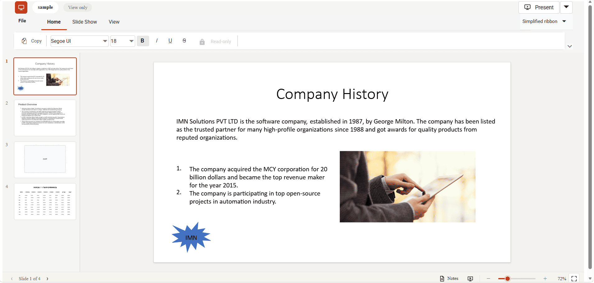

# About Syncfusion React PPTX Editor Control

The [React PPTX Editor](https://www.syncfusion.com/powerpoint-editor-sdk/react-powerpoint-editor) is a feature-rich, user-interactive component that enables viewing, editing, and printing PowerPoint presentations with a familiar Microsoft PowerPoint-like interface.

## Key Features

* View the PPTX documents with the basic elements and formatting below,
  * Textbox and Placeholders
  * Basic Auto shapes
  * Images
  * Table
  * Chart
  * Basic Paragraph and Text Formatting
  * Hyperlinks
  * Different languages of text
* Basic viewer ribbon interface.
* Slide navigation through touch, keyboard, and mouse.
* Zoom support.
* Slideshow mode.
* Slide notes.
* Presenter view.
* Print support.