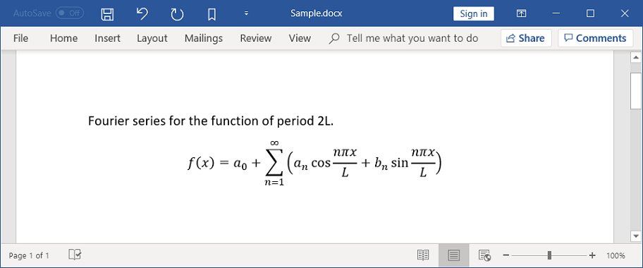
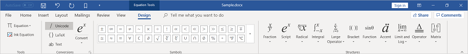
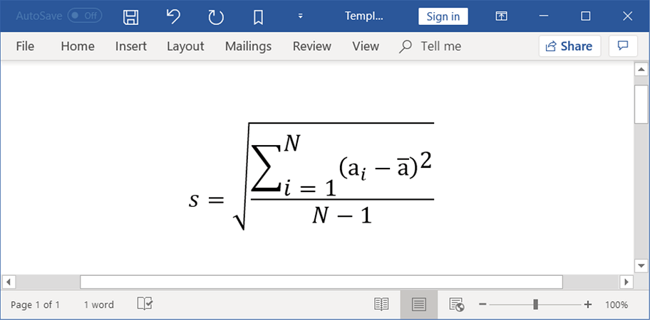
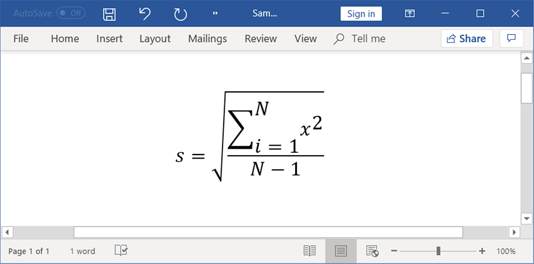

# Mathematical Equation in Word document in JavaScript Word Library

Equations in a Word document are combinations of mathematical symbols or text. For example, you can create a Fourier series equation in a Word document.

The JavaScript Word Library offers two ways to create and modify equations in a Word document.

* Using Math DOM.
* Using LaTeX.

## Types of equation

The following different structures of equation can be created by using the JavaScript Word Library.

* Accent
* Bar
* Box
* Border box
* Delimiter
* Equation array
* Fraction
* Function
* Group character
* Limit
* Matrix
* N-Array
* Radical
* Phantom
* SubSuperscript
* Left SubSuperscript
* Right SubSuperscript

### Accent

You can add an accent mark to the equation. The following code example shows how to add an accent mark to the equation.




import { WordDocument, MathFunctionType, TextRange, OfficeMathAccent, OfficeMathRunElement } from '@syncfusion/ej2-docx';

let document = WordDocument.create();
let paragraph = document.lastParagraph;
let math = paragraph.appendMath();
//Appends a new mathematical equation to the paragraph
let officeMath = math.mathParagraph.maths.add();
//Adds an accent equation
let mathAccent = officeMath.functions.add(MathFunctionType.Accent) as OfficeMathAccent;
//Sets the accent character
mathAccent.accentCharacter = "̆";
//Adds the run element for accent
let officeMathRunElement = mathAccent.equation.functions.add(MathFunctionType.RunElement) as OfficeMathRunElement;
officeMathRunElement.item = new TextRange(document);
let textRange = officeMathRunElement.item as TextRange;
//Sets text for accent equation
textRange.text = "a";
//Applies character formatting for text range
textRange.characterFormat.bold = true;
textRange.characterFormat.italic = true;
// Save document.
document.save('Accent.docx');




let document = ej.docx.WordDocument.create();
let paragraph = document.lastParagraph;
let math = paragraph.appendMath();
//Appends a new mathematical equation to the paragraph
let officeMath = math.mathParagraph.maths.add();
//Adds an accent equation
let mathAccent = officeMath.functions.add(ej.docx.MathFunctionType.Accent);
//Sets the accent character
mathAccent.accentCharacter = "̆";
//Adds the run element for accent
let officeMathRunElement = mathAccent.equation.functions.add(ej.docx.MathFunctionType.RunElement);
officeMathRunElement.item = new ej.docx.TextRange(document);
let textRange = officeMathRunElement.item;
//Sets text for accent equation
textRange.text = "a";
//Applies character formatting for text range
textRange.characterFormat.bold = true;
textRange.characterFormat.italic = true;
// Save document.
document.save('Accent.docx');




### Bar

You can add a bar (which adds a horizontal line on top or bottom) to the equation. The following code example shows how to add a bar to the equation.




import { WordDocument, MathFunctionType, TextRange, OfficeMathBar, OfficeMathRunElement } from '@syncfusion/ej2-docx';

// Creates a new Word document
let document = WordDocument.create();
// Appends a new mathematical equation to the paragraph
let math = document.lastParagraph.appendMath();
// Adds a new math
let officeMath = math.mathParagraph.maths.add();
// Adds a bar equation
let mathBar = officeMath.functions.add(MathFunctionType.Bar) as OfficeMathBar;
// Sets the bar top
mathBar.barTop = true;
// Adds the run element for bar
let officeMathRunElement = mathBar.equation.functions.add(MathFunctionType.RunElement) as OfficeMathRunElement;
officeMathRunElement.item = new TextRange(document);
// Sets text for bar equation
(officeMathRunElement.item as TextRange).text = 'a';
// Save document
document.save('Bar.docx');




// Creates a new Word document
let document = ej.docx.WordDocument.create();
// Appends a new mathematical equation to the paragraph
let math = document.lastParagraph.appendMath();
// Adds a new math
let officeMath = math.mathParagraph.maths.add();
// Adds a bar equation
let mathBar = officeMath.functions.add(ej.docx.MathFunctionType.Bar);
// Sets the bar top
mathBar.barTop = true;
// Adds the run element for bar
let officeMathRunElement = mathBar.equation.functions.add(ej.docx.MathFunctionType.RunElement);
officeMathRunElement.item = new ej.docx.TextRange(document);
// Sets text for bar equation
(officeMathRunElement.item).text = 'a';
// Save document
document.save('Bar.docx');




### Box

You can add a box to the equation. The following code example shows how to add a box to the equation.




import { WordDocument, MathFunctionType, TextRange, OfficeMathBox, OfficeMathRunElement } from '@syncfusion/ej2-docx';

// Creates a new Word document 
let document = WordDocument.create(); 

// Appends a new mathematical equation to the paragraph 
let math = document.lastParagraph.appendMath(); 

// Adds a new math 
let officeMath = math.mathParagraph.maths.add(); 

// Adds a box equation 
let mathBox = officeMath.functions.add(MathFunctionType.Box, 0) as OfficeMathBox; 

// Adds the run element for math 
let officeMathRunElement = officeMath.functions.add(MathFunctionType.RunElement, 0) as OfficeMathRunElement; 
officeMathRunElement.item = new TextRange(document); 
(officeMathRunElement.item as TextRange).text = 'a+b'; 

// Enables the flag to behave the box and its contents as a single operator 
mathBox.operatorEmulator = true; 

// Enables the flag to act box as the mathematical differential 
mathBox.enableDifferential = true; 

// Adds a break in box equation 
mathBox.break = officeMath.breaks.add(); 

// Adds the run element for box 
officeMathRunElement = mathBox.equation.functions.add(MathFunctionType.RunElement, 0) as OfficeMathRunElement; 
officeMathRunElement.item = new TextRange(document); 
(officeMathRunElement.item as TextRange).text = '=='; 

// Adds the run element for box 
officeMathRunElement = mathBox.equation.functions.add(MathFunctionType.RunElement, 1) as OfficeMathRunElement; 
officeMathRunElement.item = new TextRange(document); 
(officeMathRunElement.item as TextRange).text = 'adx';

// Save document
document.save('Box.docx');




// Creates a new Word document 
let document = ej.docx.WordDocument.create(); 
// Appends a new mathematical equation to the paragraph 
let math = document.lastParagraph.appendMath(); 
// Adds a new math 
let officeMath = math.mathParagraph.maths.add(); 
// Adds a box equation 
let mathBox = officeMath.functions.add(ej.docx.MathFunctionType.Box, 0); 
// Adds the run element for math 
let officeMathRunElement = officeMath.functions.add(ej.docx.MathFunctionType.RunElement, 0); 
officeMathRunElement.item = new ej.docx.TextRange(document); 
(officeMathRunElement.item).text = 'a+b'; 
// Enables the flag to behave the box and its contents single operator 
mathBox.operatorEmulator = true; 
// Enables the flag to act box mathematical differential 
mathBox.enableDifferential = true; 
// Adds a break in box equation 
mathBox.break = officeMath.breaks.add(); 
// Adds the run element for box 
officeMathRunElement = mathBox.equation.functions.add(ej.docx.MathFunctionType.RunElement, 0); 
officeMathRunElement.item = new ej.docx.TextRange(document); 
(officeMathRunElement.item).text = '=='; 
// Adds the run element for box 
officeMathRunElement = mathBox.equation.functions.add(ej.docx.MathFunctionType.RunElement, 1); 
officeMathRunElement.item = new ej.docx.TextRange(document); 
(officeMathRunElement.item).text = 'adx';
// Save document
document.save('Box.docx');




### Border box

You can add a box with the borders on four sides and strikethrough on horizontal, vertical, and diagonal directions to the equation. The following code example shows how to add a border box to the equation.




import { WordDocument, MathFunctionType, TextRange, OfficeMathBorderBox, OfficeMathRunElement } from '@syncfusion/ej2-docx';

// Creates a new Word document
let document = WordDocument.create();
// Appends a new mathematical equation to the paragraph
let math = document.lastParagraph.appendMath();
// Adds a new math
let officeMath = math.mathParagraph.maths.add();
// Adds a border box equation
let mathBorderBox = officeMath.functions.add(MathFunctionType.BorderBox) as OfficeMathBorderBox;
// Sets the diagonal strikethrough from lower left to upper right
mathBorderBox.strikeDiagonalUp = true;
// Sets the diagonal strikethrough from upper left to lower right
mathBorderBox.strikeDiagonalDown = true;
// Sets the horizontal strikethrough
mathBorderBox.strikeHorizontal = true;
// Sets the vertical strikethrough
mathBorderBox.strikeVertical = true;
// Hides the bottom border
mathBorderBox.hideBottom = true;
// Hides the left border
mathBorderBox.hideLeft = true;
// Shows the right border
mathBorderBox.hideRight = false;
// Shows the top border
mathBorderBox.hideTop = false;
// Adds the run element for border box
let officeMathRunElement = mathBorderBox.equation.functions.add(MathFunctionType.RunElement) as OfficeMathRunElement;
officeMathRunElement.item = new TextRange(document);
// Sets text for border box equation
(officeMathRunElement.item as TextRange).text = 'a+b-c';
// Save document
document.save('BorderBox.docx');




// Creates a new Word document
let document = ej.docx.WordDocument.create();
// Appends a new mathematical equation to the paragraph
let math = document.lastParagraph.appendMath();
// Adds a new math
let officeMath = math.mathParagraph.maths.add();
// Adds a border box equation
let mathBorderBox = officeMath.functions.add(ej.docx.MathFunctionType.BorderBox);
// Sets the diagonal strikethrough from lower left to upper right
mathBorderBox.strikeDiagonalUp = true;
// Sets the diagonal strikethrough from upper left to lower right
mathBorderBox.strikeDiagonalDown = true;
// Sets the horizontal strikethrough
mathBorderBox.strikeHorizontal = true;
// Sets the vertical strikethrough
mathBorderBox.strikeVertical = true;
// Hides the bottom border
mathBorderBox.hideBottom = true;
// Hides the left border
mathBorderBox.hideLeft = true;
// Shows the right border
mathBorderBox.hideRight = false;
// Shows the top border
mathBorderBox.hideTop = false;
// Adds the run element for border box
let officeMathRunElement = mathBorderBox.equation.functions.add(ej.docx.MathFunctionType.RunElement);
officeMathRunElement.item = new ej.docx.TextRange(document);
// Sets text for border box equation
(officeMathRunElement.item).text = 'a+b-c';
// Save document
document.save('BorderBox.docx');




### Delimiter

You can add a delimiter (parenthesis, square brackets, and other characters) to the equation. The following code example shows how to add a delimiter to the equation.




import { WordDocument, MathFunctionType, TextRange, MathDelimiterShapeType, OfficeMathDelimiter, OfficeMathRunElement } from '@syncfusion/ej2-docx';

// Creates a new Word document
let document = WordDocument.create();
// Appends a new mathematical equation to the paragraph
let math = document.lastParagraph.appendMath();
// Adds a new math
let officeMath = math.mathParagraph.maths.add();
// Adds a delimiter equation
let mathDelimiter = officeMath.functions.add(MathFunctionType.Delimiter) as OfficeMathDelimiter;
// Sets the begin character
mathDelimiter.beginCharacter = '[';
// Sets the end character
mathDelimiter.endCharacter = ']';
// Enables the flag to grow delimiter characters to full height of the arguments
mathDelimiter.isGrow = true;
// Sets the appearance of delimiters
mathDelimiter.delimiterShape = MathDelimiterShapeType.Match;
// Adds the run element for delimiter
let officeMathRunElement = mathDelimiter.equations.add().functions.add(MathFunctionType.RunElement) as OfficeMathRunElement;
officeMathRunElement.item = new TextRange(document);
// Sets text for delimiter equation
(officeMathRunElement.item as TextRange).text = 'a+b';
// Save document
document.save('Delimiter.docx');




// Creates a new Word document
let document = ej.docx.WordDocument.create();
// Appends a new mathematical equation to the paragraph
let math = document.lastParagraph.appendMath();
// Adds a new math
let officeMath = math.mathParagraph.maths.add();
// Adds a delimiter equation
let mathDelimiter = officeMath.functions.add(ej.docx.MathFunctionType.Delimiter);
// Sets the begin character
mathDelimiter.beginCharacter = '[';
// Sets the end character
mathDelimiter.endCharacter = ']';
// Enables the flag to grow delimiter characters to full height of the arguments
mathDelimiter.isGrow = true;
// Sets the appearance of delimiters
mathDelimiter.delimiterShape = ej.docx.MathDelimiterShapeType.Match;
// Adds the run element for delimiter
let officeMathRunElement = mathDelimiter.equations.add().functions.add(ej.docx.MathFunctionType.RunElement);
officeMathRunElement.item = new ej.docx.TextRange(document);
// Sets text for delimiter equation
(officeMathRunElement.item).text = 'a+b';
// Save document
document.save('Delimiter.docx');




### Equation array

You can create a one dimensional array of equations in Word document. The following code example shows how to create an array of equations.




import { WordDocument, MathFunctionType, TextRange, MathVerticalAlignment, SpacingRule, OfficeMathEquationArray, OfficeMathRunElement } from '@syncfusion/ej2-docx';

// Creates a new Word document
let document = WordDocument.create();
// Appends a new mathematical equation to the paragraph
let math = document.lastParagraph.appendMath();
// Adds a new math
let officeMath = math.mathParagraph.maths.add();
// Adds an equation array
let mathEquationArray = officeMath.functions.add(MathFunctionType.EquationArray) as OfficeMathEquationArray;
// Sets the vertical alignment for equation array
mathEquationArray.verticalAlignment = MathVerticalAlignment.Center;
// Enables the flag to distribute the equation array equally within the container
mathEquationArray.expandEquationContainer = true;
// Enables the flag to expand the equations in an equation array to the maximum width
mathEquationArray.expandEquationContent = true;
// Sets the row spacing rule
mathEquationArray.rowSpacingRule = SpacingRule.Multiple;
// Adds the first equation
let officeMathRunElement = mathEquationArray.equations.add().functions.add(MathFunctionType.RunElement) as OfficeMathRunElement;
officeMathRunElement.item = new TextRange(document);
(officeMathRunElement.item as TextRange).text = 'x+y+z=0';
// Adds the second equation
officeMathRunElement = mathEquationArray.equations.add().functions.add(MathFunctionType.RunElement) as OfficeMathRunElement;
officeMathRunElement.item = new TextRange(document);
(officeMathRunElement.item as TextRange).text = 'x+y-z=1';
// Save document
document.save('EquationArray.docx');




// Creates a new Word document
let document = ej.docx.WordDocument.create();
// Appends a new mathematical equation to the paragraph
let math = document.lastParagraph.appendMath();
// Adds a new math
let officeMath = math.mathParagraph.maths.add();
// Adds an equation array
let mathEquationArray = officeMath.functions.add(ej.docx.MathFunctionType.EquationArray);
// Sets the vertical alignment for equation array
mathEquationArray.verticalAlignment = ej.docx.MathVerticalAlignment.Center;
// Enables the flag to distribute the equation array equally within the container
mathEquationArray.expandEquationContainer = true;
// Enables the flag to expand the equations in an equation array to the maximum width
mathEquationArray.expandEquationContent = true;
// Sets the row spacing rule
mathEquationArray.rowSpacingRule = ej.docx.SpacingRule.Multiple;
// Adds the first equation
let officeMathRunElement = mathEquationArray.equations.add().functions.add(ej.docx.MathFunctionType.RunElement);
officeMathRunElement.item = new ej.docx.TextRange(document);
(officeMathRunElement.item).text = 'x+y+z=0';
// Adds the second equation
officeMathRunElement = mathEquationArray.equations.add().functions.add(ej.docx.MathFunctionType.RunElement);
officeMathRunElement.item = new ej.docx.TextRange(document);
(officeMathRunElement.item).text = 'x+y-z=1';
// Save document
document.save('EquationArray.docx');




### Fraction

You can create a fraction equation with a numerator and denominator in Word document. The following code example shows how to create a fraction equation.




import { WordDocument, MathFunctionType, TextRange, MathFractionType, OfficeMathFraction, OfficeMathRunElement } from '@syncfusion/ej2-docx';

// Creates a new Word document
let document = WordDocument.create();
// Appends a new mathematical equation to the paragraph
let math = document.lastParagraph.appendMath();
// Adds a new math
let officeMath = math.mathParagraph.maths.add();
// Adds a fraction equation
let mathFraction = officeMath.functions.add(MathFunctionType.Fraction) as OfficeMathFraction;
// Sets the numerator for fraction
let officeMathRunElement = mathFraction.numerator.functions.add(MathFunctionType.RunElement) as OfficeMathRunElement;
officeMathRunElement.item = new TextRange(document);
(officeMathRunElement.item as TextRange).text = 'a';
// Sets the denominator for fraction
officeMathRunElement = mathFraction.denominator.functions.add(MathFunctionType.RunElement) as OfficeMathRunElement;
officeMathRunElement.item = new TextRange(document);
(officeMathRunElement.item as TextRange).text = 'b';
// Sets the fraction type
mathFraction.fractionType = MathFractionType.NormalFractionBar;
// Save document
document.save('Fraction.docx');




// Creates a new Word document
let document = ej.docx.WordDocument.create();
// Appends a new mathematical equation to the paragraph
let math = document.lastParagraph.appendMath();
// Adds a new math
let officeMath = math.mathParagraph.maths.add();
// Adds a fraction equation
let mathFraction = officeMath.functions.add(ej.docx.MathFunctionType.Fraction);
// Sets the numerator for fraction
let officeMathRunElement = mathFraction.numerator.functions.add(ej.docx.MathFunctionType.RunElement);
officeMathRunElement.item = new ej.docx.TextRange(document);
(officeMathRunElement.item).text = 'a';
// Sets the denominator for fraction
officeMathRunElement = mathFraction.denominator.functions.add(ej.docx.MathFunctionType.RunElement);
officeMathRunElement.item = new ej.docx.TextRange(document);
(officeMathRunElement.item).text = 'b';
// Sets the fraction type
mathFraction.fractionType = ej.docx.MathFractionType.NormalFractionBar;
// Save document
document.save('Fraction.docx');




### Function

You can create trigonometric functions in a Word document. The following code example shows how to create a function.




import { WordDocument, MathFunctionType, TextRange, OfficeMathFunction, OfficeMathRunElement } from '@syncfusion/ej2-docx';

// Creates a new Word document
let document = WordDocument.create();
// Appends a new mathematical equation to the paragraph
let math = document.lastParagraph.appendMath();
// Adds a new math
let officeMath = math.mathParagraph.maths.add();
// Adds a function
let mathFunction = officeMath.functions.add(MathFunctionType.Function) as OfficeMathFunction;
// Sets the function name
let officeMathRunElement = mathFunction.functionName.functions.add(MathFunctionType.RunElement) as OfficeMathRunElement;
officeMathRunElement.item = new TextRange(document);
(officeMathRunElement.item as TextRange).text = 'sin';
// Adds the run element for function
officeMathRunElement = mathFunction.equation.functions.add(MathFunctionType.RunElement) as OfficeMathRunElement;
officeMathRunElement.item = new TextRange(document);
(officeMathRunElement.item as TextRange).text = '90';
// Save document
document.save('Function.docx');




// Creates a new Word document
let document = ej.docx.WordDocument.create();
// Appends a new mathematical equation to the paragraph
let math = document.lastParagraph.appendMath();
// Adds a new math
let officeMath = math.mathParagraph.maths.add();
// Adds a function
let mathFunction = officeMath.functions.add(ej.docx.MathFunctionType.Function);
// Sets the function name
let officeMathRunElement = mathFunction.functionName.functions.add(ej.docx.MathFunctionType.RunElement);
officeMathRunElement.item = new ej.docx.TextRange(document);
(officeMathRunElement.item).text = 'sin';
// Adds the run element for function
officeMathRunElement = mathFunction.equation.functions.add(ej.docx.MathFunctionType.RunElement);
officeMathRunElement.item = new ej.docx.TextRange(document);
(officeMathRunElement.item).text = '90';
// Save document
document.save('Function.docx');




### Group character

You can group mathematical equations by adding a grouping character at above or below to the corresponding equations. The following code example shows how to create an equation with grouping character.




import { WordDocument, MathFunctionType, TextRange, OfficeMathGroupCharacter, OfficeMathRunElement } from '@syncfusion/ej2-docx';

// Creates a new Word document
let document = WordDocument.create();
// Appends a new mathematical equation to the paragraph
let math = document.lastParagraph.appendMath();
// Adds a new math
let officeMath = math.mathParagraph.maths.add();
// Adds a group character equation
let officeMathGroupCharacter = officeMath.functions.add(MathFunctionType.GroupCharacter) as OfficeMathGroupCharacter;
// Sets the group character
officeMathGroupCharacter.groupCharacter = '⏞';
// Enables the flag to align group character at top
officeMathGroupCharacter.hasAlignTop = true;
// Enables the flag to align the text and group character
officeMathGroupCharacter.hasCharacterTop = true;
// Adds the run element for group character
let officeMathRunElement = officeMathGroupCharacter.equation.functions.add(MathFunctionType.RunElement) as OfficeMathRunElement;
officeMathRunElement.item = new TextRange(document);
// Sets text for group character equation
(officeMathRunElement.item as TextRange).text = 'a-b';
// Save document
document.save('GroupCharacter.docx');




// Creates a new Word document
let document = ej.docx.WordDocument.create();
// Appends a new mathematical equation to the paragraph
let math = document.lastParagraph.appendMath();
// Adds a new math
let officeMath = math.mathParagraph.maths.add();
// Adds a group character equation
let officeMathGroupCharacter = officeMath.functions.add(ej.docx.MathFunctionType.GroupCharacter);
// Sets the group character
officeMathGroupCharacter.groupCharacter = '⏞';
// Enables the flag to align group character at top
officeMathGroupCharacter.hasAlignTop = true;
// Enables the flag to align the text and group character
officeMathGroupCharacter.hasCharacterTop = true;
// Adds the run element for group character
let officeMathRunElement = officeMathGroupCharacter.equation.functions.add(ej.docx.MathFunctionType.RunElement);
officeMathRunElement.item = new ej.docx.TextRange(document);
// Sets text for group character equation
(officeMathRunElement.item).text = 'a-b';
// Save document
document.save('GroupCharacter.docx');




### Limit

You can add upper limit or lower limit to the mathematical equation. The following code example shows how to create limit equation.




import { WordDocument, MathFunctionType, TextRange, MathLimitType, OfficeMathFunction, OfficeMathLimit, OfficeMathRunElement } from '@syncfusion/ej2-docx';

// Creates a new Word document
let document = WordDocument.create();
// Appends a new mathematical equation to the paragraph
let math = document.lastParagraph.appendMath();
// Adds a new math
let officeMath = math.mathParagraph.maths.add();
// Adds a function to the math
let mathFunction = officeMath.functions.add(MathFunctionType.Function) as OfficeMathFunction;
// Adds a mathematical limit equation
let mathLimit = mathFunction.functionName.functions.add(MathFunctionType.Limit) as OfficeMathLimit;
// Adds the run element for limit equation
let officeMathRunElement = mathLimit.equation.functions.add(MathFunctionType.RunElement) as OfficeMathRunElement;
officeMathRunElement.item = new TextRange(document);
// Sets text for limit equation
(officeMathRunElement.item as TextRange).text = 'lim';
// Sets the type of the limit
mathLimit.limitType = MathLimitType.LowerLimit;
// Adds the limit value
let limitRunElement = mathLimit.limit.functions.add(MathFunctionType.RunElement) as OfficeMathRunElement;
limitRunElement.item = new TextRange(document);
// Sets the limit value
(limitRunElement.item as TextRange).text = 'n=0';
// Adds the base equation
officeMathRunElement = mathFunction.equation.functions.add(MathFunctionType.RunElement) as OfficeMathRunElement;
officeMathRunElement.item = new TextRange(document);
// Sets text for base of the specified equation
(officeMathRunElement.item as TextRange).text = 'x';
// Save document
document.save('Limit.docx');




// Creates a new Word document
let document = ej.docx.WordDocument.create();
// Appends a new mathematical equation to the paragraph
let math = document.lastParagraph.appendMath();
// Adds a new math
let officeMath = math.mathParagraph.maths.add();
// Adds a function to the math
let mathFunction = officeMath.functions.add(ej.docx.MathFunctionType.Function);
// Adds a mathematical limit equation
let mathLimit = mathFunction.functionName.functions.add(ej.docx.MathFunctionType.Limit);
// Adds the run element for limit equation
let officeMathRunElement = mathLimit.equation.functions.add(ej.docx.MathFunctionType.RunElement);
officeMathRunElement.item = new ej.docx.TextRange(document);
// Sets text for limit equation
(officeMathRunElement.item).text = 'lim';
// Sets the type of the limit
mathLimit.limitType = ej.docx.MathLimitType.LowerLimit;
// Adds the limit value
let limitRunElement = mathLimit.limit.functions.add(ej.docx.MathFunctionType.RunElement);
limitRunElement.item = new ej.docx.TextRange(document);
// Sets the limit value
(limitRunElement.item).text = 'n=0';
// Adds the base equation
officeMathRunElement = mathFunction.equation.functions.add(ej.docx.MathFunctionType.RunElement);
officeMathRunElement.item = new ej.docx.TextRange(document);
// Sets text for base of the specified equation
(officeMathRunElement.item).text = 'x';
// Save document
document.save('Limit.docx');




### Matrix

You can create a matrix equation in a Word document. The following code example shows how to create a matrix equation.




import { WordDocument, MathFunctionType, TextRange, MathVerticalAlignment, MathHorizontalAlignment, SpacingRule, OfficeMathMatrix, OfficeMathRunElement } from '@syncfusion/ej2-docx';

// Creates a new Word document
let document = WordDocument.create();
// Appends a new mathematical equation to the paragraph
let math = document.lastParagraph.appendMath();
// Adds a new math
let officeMath = math.mathParagraph.maths.add();
// Adds matrix equation
let mathMatrix = officeMath.functions.add(MathFunctionType.Matrix) as OfficeMathMatrix;
// Sets vertical alignment for matrix
mathMatrix.verticalAlignment = MathVerticalAlignment.Center;
// Sets width for matrix columns
mathMatrix.columnWidth = 1;
// Sets column spacing rule
mathMatrix.columnSpacingRule = SpacingRule.OneAndHalf;
// Sets column spacing value
mathMatrix.columnSpacing = 3;
// Enables the flag to hide place holders
mathMatrix.hidePlaceHolders = true;
// Sets row spacing rule
mathMatrix.rowSpacingRule = SpacingRule.Double;
// Sets row spacing value
mathMatrix.rowSpacing = 2;
// Adds a new column
mathMatrix.columns.add();
// Adds a new row
mathMatrix.rows.add();
// Sets horizontal alignment for column
mathMatrix.columns.getItem(0).horizontalAlignment = MathHorizontalAlignment.Left;
// Gets an argument in first cell in first row
officeMath = mathMatrix.rows.getItem(0).arguments.getItem(0);
// Sets text for argument in first cell in first row
let officeMathRunElement = officeMath.functions.add(MathFunctionType.RunElement) as OfficeMathRunElement;
officeMathRunElement.item = new TextRange(document);
(officeMathRunElement.item as TextRange).text = '1';
// Adds a new column
mathMatrix.columns.add();
// Adds a new row
mathMatrix.rows.add();
// Gets an argument in second cell in first row
officeMath = mathMatrix.rows.getItem(0).arguments.getItem(1);
officeMathRunElement = officeMath.functions.add(MathFunctionType.RunElement) as OfficeMathRunElement;
officeMathRunElement.item = new TextRange(document);
(officeMathRunElement.item as TextRange).text = '2';
// Gets an argument in first cell in second row
officeMath = mathMatrix.rows.getItem(1).arguments.getItem(0);
officeMathRunElement = officeMath.functions.add(MathFunctionType.RunElement) as OfficeMathRunElement;
officeMathRunElement.item = new TextRange(document);
(officeMathRunElement.item as TextRange).text = '3';
// Gets an argument in second cell in second row
officeMath = mathMatrix.rows.getItem(1).arguments.getItem(1);
officeMathRunElement = officeMath.functions.add(MathFunctionType.RunElement) as OfficeMathRunElement;
officeMathRunElement.item = new TextRange(document);
(officeMathRunElement.item as TextRange).text = '4';
// Save document
document.save('Matrix.docx');




// Creates a new Word document
let document = ej.docx.WordDocument.create();
// Appends a new mathematical equation to the paragraph
let math = document.lastParagraph.appendMath();
// Adds a new math
let officeMath = math.mathParagraph.maths.add();
// Adds matrix equation
let mathMatrix = officeMath.functions.add(ej.docx.MathFunctionType.Matrix);
// Sets vertical alignment for matrix
mathMatrix.verticalAlignment = ej.docx.MathVerticalAlignment.Center;
// Sets width for matrix columns
mathMatrix.columnWidth = 1;
// Sets column spacing rule
mathMatrix.columnSpacingRule = ej.docx.SpacingRule.OneAndHalf;
// Sets column spacing value
mathMatrix.columnSpacing = 3;
// Enables the flag to hide place holders
mathMatrix.hidePlaceHolders = true;
// Sets row spacing rule
mathMatrix.rowSpacingRule = ej.docx.SpacingRule.Double;
// Sets row spacing value
mathMatrix.rowSpacing = 2;
// Adds a new column
mathMatrix.columns.add();
// Adds a new row
mathMatrix.rows.add();
// Sets horizontal alignment for column
mathMatrix.columns.getItem(0).horizontalAlignment = ej.docx.MathHorizontalAlignment.Left;
// Gets an argument in first cell in first row
officeMath = mathMatrix.rows.getItem(0).arguments.getItem(0);
// Sets text for argument in first cell in first row
let officeMathRunElement = officeMath.functions.add(ej.docx.MathFunctionType.RunElement);
officeMathRunElement.item = new ej.docx.TextRange(document);
(officeMathRunElement.item).text = '1';
// Adds a new column
mathMatrix.columns.add();
// Adds a new row
mathMatrix.rows.add();
// Gets an argument in second cell in first row
officeMath = mathMatrix.rows.getItem(0).arguments.getItem(1);
officeMathRunElement = officeMath.functions.add(ej.docx.MathFunctionType.RunElement);
officeMathRunElement.item = new ej.docx.TextRange(document);
(officeMathRunElement.item).text = '2';
// Gets an argument in first cell in second row
officeMath = mathMatrix.rows.getItem(1).arguments.getItem(0);
officeMathRunElement = officeMath.functions.add(ej.docx.MathFunctionType.RunElement);
officeMathRunElement.item = new ej.docx.TextRange(document);
(officeMathRunElement.item).text = '3';
// Gets an argument in second cell in second row
officeMath = mathMatrix.rows.getItem(1).arguments.getItem(1);
officeMathRunElement = officeMath.functions.add(ej.docx.MathFunctionType.RunElement);
officeMathRunElement.item = new ej.docx.TextRange(document);
(officeMathRunElement.item).text = '4';
// Save document
document.save('Matrix.docx');




### N-Array

You can create an equation with common large operators such as summation, integrals, union, intersection, logical OR, logical AND, products and co-products. The following code example shows how to create a summation with limits.




import { WordDocument, MathFunctionType, TextRange, OfficeMathNArray, OfficeMathRunElement } from '@syncfusion/ej2-docx';

// Creates a new Word document
let document = WordDocument.create();
// Appends a new mathematical equation to the paragraph
let math = document.lastParagraph.appendMath();
// Adds a new math
let officeMath = math.mathParagraph.maths.add();
// Adds an N-Array equation
let officeMathNArray = officeMath.functions.add(MathFunctionType.NArray) as OfficeMathNArray;
// Sets N-Array character
officeMathNArray.nArrayCharacter = '∑';
// Enables the flag to grow N-array character to full height of the arguments
officeMathNArray.hasGrow = false;
// Enables the flag to hide lower limit
officeMathNArray.hideLowerLimit = false;
// Enables the flag to hide upper limit
officeMathNArray.hideUpperLimit = false;
// Enables the flag to set limit position as SubSuperscript
officeMathNArray.subSuperscriptLimit = true;
// Sets subscript
let officeMathRunElement = officeMathNArray.subscript.functions.add(MathFunctionType.RunElement) as OfficeMathRunElement;
officeMathRunElement.item = new TextRange(document);
(officeMathRunElement.item as TextRange).text = 'n=1';
// Sets superscript
officeMathRunElement = officeMathNArray.superscript.functions.add(MathFunctionType.RunElement) as OfficeMathRunElement;
officeMathRunElement.item = new TextRange(document);
(officeMathRunElement.item as TextRange).text = '10';
// Sets equation
officeMathRunElement = officeMathNArray.equation.functions.add(MathFunctionType.RunElement) as OfficeMathRunElement;
officeMathRunElement.item = new TextRange(document);
(officeMathRunElement.item as TextRange).text = 'x';
// Save document
document.save('NArray.docx');




// Creates a new Word document
let document = ej.docx.WordDocument.create();
// Appends a new mathematical equation to the paragraph
let math = document.lastParagraph.appendMath();
// Adds a new math
let officeMath = math.mathParagraph.maths.add();
// Adds an N-Array equation
let officeMathNArray = officeMath.functions.add(ej.docx.MathFunctionType.NArray);
// Sets N-Array character
officeMathNArray.nArrayCharacter = '∑';
// Enables the flag to grow N-array character to full height of the arguments
officeMathNArray.hasGrow = false;
// Enables the flag to hide lower limit
officeMathNArray.hideLowerLimit = false;
// Enables the flag to hide upper limit
officeMathNArray.hideUpperLimit = false;
// Enables the flag to set limit position
officeMathNArray.subSuperscriptLimit = true;
// Sets subscript
let officeMathRunElement = officeMathNArray.subscript.functions.add(ej.docx.MathFunctionType.RunElement);
officeMathRunElement.item = new ej.docx.TextRange(document);
(officeMathRunElement.item).text = 'n=1';
// Sets superscript
officeMathRunElement = officeMathNArray.superscript.functions.add(ej.docx.MathFunctionType.RunElement);
officeMathRunElement.item = new ej.docx.TextRange(document);
(officeMathRunElement.item).text = '10';
// Sets equation
officeMathRunElement = officeMathNArray.equation.functions.add(ej.docx.MathFunctionType.RunElement);
officeMathRunElement.item = new ej.docx.TextRange(document);
(officeMathRunElement.item).text = 'x';
// Save document
document.save('NArray.docx');




### Radical

You can create a radical equation in Word document. The following example shows how to create a radical equation.




import { WordDocument, MathFunctionType, TextRange, OfficeMathRadical, OfficeMathRunElement } from '@syncfusion/ej2-docx';

// Creates a new Word document
let document = WordDocument.create();
// Appends a new mathematical equation to the paragraph
let math = document.lastParagraph.appendMath();
// Adds a new math
let officeMath = math.mathParagraph.maths.add();
// Adds a radical equation
let officeMathRadical = officeMath.functions.add(MathFunctionType.Radical) as OfficeMathRadical;
// Sets false to show degree in radical
officeMathRadical.hideDegree = false;
// Adds a degree for radical equation
let officeMathRunElement = officeMathRadical.degree.functions.add(MathFunctionType.RunElement) as OfficeMathRunElement;
officeMathRunElement.item = new TextRange(document);
(officeMathRunElement.item as TextRange).text = '2';
// Adds an equation for radical
officeMathRunElement = officeMathRadical.equation.functions.add(MathFunctionType.RunElement) as OfficeMathRunElement;
officeMathRunElement.item = new TextRange(document);
(officeMathRunElement.item as TextRange).text = 'x';
// Save document
document.save('Radical.docx');




// Creates a new Word document
let document = ej.docx.WordDocument.create();
// Appends a new mathematical equation to the paragraph
let math = document.lastParagraph.appendMath();
// Adds a new math
let officeMath = math.mathParagraph.maths.add();
// Adds a radical equation
let officeMathRadical = officeMath.functions.add(ej.docx.MathFunctionType.Radical);
// Sets false to show degree in radical
officeMathRadical.hideDegree = false;
// Adds a degree for radical equation
let officeMathRunElement = officeMathRadical.degree.functions.add(ej.docx.MathFunctionType.RunElement);
officeMathRunElement.item = new ej.docx.TextRange(document);
(officeMathRunElement.item).text = '2';
// Adds an equation for radical
officeMathRunElement = officeMathRadical.equation.functions.add(ej.docx.MathFunctionType.RunElement);
officeMathRunElement.item = new ej.docx.TextRange(document);
(officeMathRunElement.item).text = 'x';
// Save document
document.save('Radical.docx');




### Phantom

You can create a phantom equation to add the spacing of the phantom without displaying that base and suppressing part of the glyph from spacing considerations. The following code example shows how to create a phantom equation.




import { WordDocument, MathFunctionType, TextRange, OfficeMathRadical, OfficeMathPhantom, OfficeMathRunElement } from '@syncfusion/ej2-docx';

// Creates a new Word document
let document = WordDocument.create();
// Appends a new mathematical equation to the paragraph
let math = document.lastParagraph.appendMath();
// Adds a new math
let officeMath = math.mathParagraph.maths.add();
// Adds a radical equation
let officeMathRadical = officeMath.functions.add(MathFunctionType.Radical) as OfficeMathRadical;
// Adds degree for radical equation
let officeMathRunElement = officeMathRadical.degree.functions.add(MathFunctionType.RunElement) as OfficeMathRunElement;
officeMathRunElement.item = new TextRange(document);
(officeMathRunElement.item as TextRange).text = '2';
// Adds a phantom equation in radical
let officeMathPhantom = officeMathRadical.equation.functions.add(MathFunctionType.Phantom) as OfficeMathPhantom;
// Enables the flag to show the contents of phantom
officeMathPhantom.show = true;
// Enables the flag to transparent the phantom
officeMathPhantom.transparent = true;
// Enables the flag to ignore the ascent of the phantom contents in spacing
officeMathPhantom.zeroAscent = true;
// Enables the flag to ignore the descent of the phantom contents in spacing
officeMathPhantom.zeroDescent = true;
// Enables the flag to ignore the width of a phantom contents in spacing
officeMathPhantom.zeroWidth = true;
// Adds a run element for math phantom
officeMathRunElement = officeMathPhantom.equation.functions.add(MathFunctionType.RunElement) as OfficeMathRunElement;
officeMathRunElement.item = new TextRange(document);
(officeMathRunElement.item as TextRange).text = 'a-b';
// Save document
document.save('Phantom.docx');




// Creates a new Word document
let document = ej.docx.WordDocument.create();
// Appends a new mathematical equation to the paragraph
let math = document.lastParagraph.appendMath();
// Adds a new math
let officeMath = math.mathParagraph.maths.add();
// Adds a radical equation
let officeMathRadical = officeMath.functions.add(ej.docx.MathFunctionType.Radical);
// Adds degree for radical equation
let officeMathRunElement = officeMathRadical.degree.functions.add(ej.docx.MathFunctionType.RunElement);
officeMathRunElement.item = new ej.docx.TextRange(document);
(officeMathRunElement.item).text = '2';
// Adds a phantom equation in radical
let officeMathPhantom = officeMathRadical.equation.functions.add(ej.docx.MathFunctionType.Phantom);
// Enables the flag to show the contents of phantom
officeMathPhantom.show = true;
// Enables the flag to transparent the phantom
officeMathPhantom.transparent = true;
// Enables the flag to ignore the ascent of the phantom contents in spacing
officeMathPhantom.zeroAscent = true;
// Enables the flag to ignore the descent of the phantom contents in spacing
officeMathPhantom.zeroDescent = true;
// Enables the flag to ignore the width of a phantom contents in spacing
officeMathPhantom.zeroWidth = true;
// Adds a run element for math phantom
officeMathRunElement = officeMathPhantom.equation.functions.add(ej.docx.MathFunctionType.RunElement);
officeMathRunElement.item = new ej.docx.TextRange(document);
(officeMathRunElement.item).text = 'a-b';
// Save document
document.save('Phantom.docx');




### SubSuperscript

You can add a superscript or subscript equation in a Word document. The following code shows how to create a superscript equation.




import { WordDocument, MathFunctionType, TextRange, MathScriptType, OfficeMathScript, OfficeMathRunElement } from '@syncfusion/ej2-docx';

// Creates a new Word document
let document = WordDocument.create();
// Appends a new mathematical equation to the paragraph
let math = document.lastParagraph.appendMath();
// Adds a new math
let officeMath = math.mathParagraph.maths.add();
// Adds a SubSuperscript equation
let officeMathScript = officeMath.functions.add(MathFunctionType.SubSuperscript) as OfficeMathScript;
// Sets the type of the script
officeMathScript.scriptType = MathScriptType.Superscript;
// Adds a run element for script
let officeMathRunElement = officeMathScript.script.functions.add(MathFunctionType.RunElement) as OfficeMathRunElement;
officeMathRunElement.item = new TextRange(document);
let textRange = officeMathRunElement.item as TextRange;
// Sets text for script
textRange.text = '2';
// Adds run element for equation
officeMathRunElement = officeMathScript.equation.functions.add(MathFunctionType.RunElement) as OfficeMathRunElement;
officeMathRunElement.item = new TextRange(document);
// Sets text
(officeMathRunElement.item as TextRange).text = 'x';
// Save document
document.save('SubSuperscript.docx');




// Creates a new Word document
let document = ej.docx.WordDocument.create();
// Appends a new mathematical equation to the paragraph
let math = document.lastParagraph.appendMath();
// Adds a new math
let officeMath = math.mathParagraph.maths.add();
// Adds a SubSuperscript equation
let officeMathScript = officeMath.functions.add(ej.docx.MathFunctionType.SubSuperscript);
// Sets the type of the script
officeMathScript.scriptType = ej.docx.MathScriptType.Superscript;
// Adds a run element for script
let officeMathRunElement = officeMathScript.script.functions.add(ej.docx.MathFunctionType.RunElement);
officeMathRunElement.item = new ej.docx.TextRange(document);
let textRange = officeMathRunElement.item;
// Sets text for script
textRange.text = '2';
// Adds run element for equation
officeMathRunElement = officeMathScript.equation.functions.add(ej.docx.MathFunctionType.RunElement);
officeMathRunElement.item = new ej.docx.TextRange(document);
// Sets text
(officeMathRunElement.item).text = 'x';
// Save document
document.save('SubSuperscript.docx');




### Left SubSuperscript

You can add superscript and subscript on the left side of mathematical equation. The following code example shows how to add superscript and subscript on the left side of the equation.




import { WordDocument, MathFunctionType, TextRange, OfficeMathLeftScript, OfficeMathRunElement } from '@syncfusion/ej2-docx';

// Creates a new Word document
let document = WordDocument.create();
// Appends a new mathematical equation to the paragraph
let math = document.lastParagraph.appendMath();
// Adds a new math
let officeMath = math.mathParagraph.maths.add();
// Adds a left SubSuperscript equation
let officeMathLeftSubScript = officeMath.functions.add(MathFunctionType.LeftSubSuperscript) as OfficeMathLeftScript;
// Adds run element for left subscript
let officeMathRunElement = officeMathLeftSubScript.subscript.functions.add(MathFunctionType.RunElement) as OfficeMathRunElement;
officeMathRunElement.item = new TextRange(document);
// Sets text for subscript
(officeMathRunElement.item as TextRange).text = '1';
// Adds a run element for left superscript
officeMathRunElement = officeMathLeftSubScript.superscript.functions.add(MathFunctionType.RunElement) as OfficeMathRunElement;
officeMathRunElement.item = new TextRange(document);
// Sets text for left superscript
(officeMathRunElement.item as TextRange).text = 'n';
// Adds a run element for equation
officeMathRunElement = officeMathLeftSubScript.equation.functions.add(MathFunctionType.RunElement) as OfficeMathRunElement;
officeMathRunElement.item = new TextRange(document);
// Sets text for equation
(officeMathRunElement.item as TextRange).text = 'Y';
// Save document
document.save('LeftSubSuperscript.docx');




// Creates a new Word document
let document = ej.docx.WordDocument.create();
// Appends a new mathematical equation to the paragraph
let math = document.lastParagraph.appendMath();
// Adds a new math
let officeMath = math.mathParagraph.maths.add();
// Adds a left SubSuperscript equation
let officeMathLeftSubScript = officeMath.functions.add(ej.docx.MathFunctionType.LeftSubSuperscript);
// Adds run element for left subscript
let officeMathRunElement = officeMathLeftSubScript.subscript.functions.add(ej.docx.MathFunctionType.RunElement);
officeMathRunElement.item = new ej.docx.TextRange(document);
// Sets text for subscript
(officeMathRunElement.item).text = '1';
// Adds a run element for left superscript
officeMathRunElement = officeMathLeftSubScript.superscript.functions.add(ej.docx.MathFunctionType.RunElement);
officeMathRunElement.item = new ej.docx.TextRange(document);
// Sets text for left superscript
(officeMathRunElement.item).text = 'n';
// Adds a run element for equation
officeMathRunElement = officeMathLeftSubScript.equation.functions.add(ej.docx.MathFunctionType.RunElement);
officeMathRunElement.item = new ej.docx.TextRange(document);
// Sets text for equation
(officeMathRunElement.item).text = 'Y';
// Save document
document.save('LeftSubSuperscript.docx');




### Right SubSuperscript

You can add superscript and subscript on the right side of mathematical equation. The following code example shows how to add superscript and subscript on the right side of the equation.




import { WordDocument, MathFunctionType, TextRange, OfficeMathRightScript, OfficeMathRunElement } from '@syncfusion/ej2-docx';

// Creates a new Word document
let document = WordDocument.create();
// Appends a new mathematical equation to the paragraph
let math = document.lastParagraph.appendMath();
// Adds a new math
let officeMath = math.mathParagraph.maths.add();
// Adds a right SubSuperscript equation
let officeMathRightScript = officeMath.functions.add(MathFunctionType.RightSubSuperscript) as OfficeMathRightScript;
// Sets false to align subscript and superscript horizontally
officeMathRightScript.isSkipAlign = true;
// Adds run element for right subscript
let officeMathRunElement = officeMathRightScript.subscript.functions.add(MathFunctionType.RunElement) as OfficeMathRunElement;
officeMathRunElement.item = new TextRange(document);
// Sets text for right subscript
(officeMathRunElement.item as TextRange).text = '1';
// Adds run element for right superscript
officeMathRunElement = officeMathRightScript.superscript.functions.add(MathFunctionType.RunElement) as OfficeMathRunElement;
officeMathRunElement.item = new TextRange(document);
// Sets text for right superscript
(officeMathRunElement.item as TextRange).text = 'n';
// Adds run element for equation
officeMathRunElement = officeMathRightScript.equation.functions.add(MathFunctionType.RunElement) as OfficeMathRunElement;
officeMathRunElement.item = new TextRange(document);
// Sets text for equation
(officeMathRunElement.item as TextRange).text = 'Y';
// Save document
document.save('RightSubSuperscript.docx');




// Creates a new Word document
let document = ej.docx.WordDocument.create();
// Appends a new mathematical equation to the paragraph
let math = document.lastParagraph.appendMath();
// Adds a new math
let officeMath = math.mathParagraph.maths.add();
// Adds a right SubSuperscript equation
let officeMathRightScript = officeMath.functions.add(ej.docx.MathFunctionType.RightSubSuperscript);
// Sets false to align subscript and superscript horizontally
officeMathRightScript.isSkipAlign = true;
// Adds run element for right subscript
let officeMathRunElement = officeMathRightScript.subscript.functions.add(ej.docx.MathFunctionType.RunElement);
officeMathRunElement.item = new ej.docx.TextRange(document);
// Sets text for right subscript
(officeMathRunElement.item).text = '1';
// Adds run element for right superscript
officeMathRunElement = officeMathRightScript.superscript.functions.add(ej.docx.MathFunctionType.RunElement);
officeMathRunElement.item = new ej.docx.TextRange(document);
// Sets text for right superscript
(officeMathRunElement.item).text = 'n';
// Adds run element for equation
officeMathRunElement = officeMathRightScript.equation.functions.add(ej.docx.MathFunctionType.RunElement);
officeMathRunElement.item = new ej.docx.TextRange(document);
// Sets text for equation
(officeMathRunElement.item).text = 'Y';
// Save document
document.save('RightSubSuperscript.docx');




## Modify existing equation

You can add or modify the text and formatting of existing mathematical equation in Word document. The following screenshots shows an existing mathematical equation in the input Word document.

The following code example shows how to modify an existing mathematical equation in the Word document.




import { WordDocument, MathFunctionType, TextRange, MathStyleType, OfficeMathDelimiter, OfficeMathFraction, OfficeMathNArray, OfficeMathRadical, OfficeMathScript, OfficeMathRunElement, Math } from '@syncfusion/ej2-docx';

// Load an existing Word document
let document = WordDocument.open(inputBytes);
// Access the paragraph from Word document
let paragraph = document.sections[0].body.paragraphs[0];
// Access the mathematical equation from the paragraph
let math = paragraph.items[0] as Math;
// Access the radical equation
let mathRadical = math.mathParagraph.maths[0].functions[1] as OfficeMathRadical;
// Access the fraction equation in radical
let mathFraction = mathRadical.equation.functions[0] as OfficeMathFraction;
// Access the n-array equation in fraction
let mathNArray = mathFraction.numerator.functions[0] as OfficeMathNArray;
// Access the math script in n-array
let mathScript = mathNArray.equation.functions[0] as OfficeMathScript;
// Access the delimiter in math script
let mathDelimiter = mathScript.equation.functions[0] as OfficeMathDelimiter;
// Removes the delimiter
mathScript.equation.functions.remove(mathDelimiter);
// Modifies the run element in math script
let mathParagraphItem = mathScript.equation.functions.add(MathFunctionType.RunElement) as OfficeMathRunElement;
mathParagraphItem.item = new TextRange(document);
// Sets the text value
(mathParagraphItem.item as TextRange).text = 'x';
// Applies character format to the text
(mathParagraphItem.item as TextRange).characterFormat.italic = true;
(mathParagraphItem.item as TextRange).characterFormat.fontSize = 20;
// Applies math format to the text
mathParagraphItem.mathFormat.style = MathStyleType.Italic;
// Save document
document.save('Result.docx');




// Load an existing Word document
let document = ej.docx.WordDocument.open(inputBytes);
// Access the paragraph from Word document
let paragraph = document.sections[0].body.paragraphs[0];
// Access the mathematical equation from the paragraph
let math = paragraph.items[0];
// Access the radical equation
let mathRadical = math.mathParagraph.maths[0].functions[1];
// Access the fraction equation in radical
let mathFraction = mathRadical.equation.functions[0];
// Access the n-array equation in fraction
let mathNArray = mathFraction.numerator.functions[0];
// Access the math script in n-array
let mathScript = mathNArray.equation.functions[0];
// Access the delimiter in math script
let mathDelimiter = mathScript.equation.functions[0];
// Removes the delimiter
mathScript.equation.functions.remove(mathDelimiter);
// Modifies the run element in math script
let mathParagraphItem = mathScript.equation.functions.add(ej.docx.MathFunctionType.RunElement);
mathParagraphItem.item = new ej.docx.TextRange(document);
// Sets the text value
(mathParagraphItem.item).text = 'x';
// Applies character format to the text
(mathParagraphItem.item).characterFormat.italic = true;
(mathParagraphItem.item).characterFormat.fontSize = 20;
// Applies math format to the text
mathParagraphItem.mathFormat.style = ej.docx.MathStyleType.Italic;
// Save document
document.save('Result.docx');




By executing the above code example, it generates output Word document as follows.
