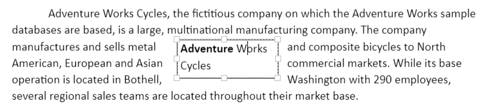

# Shapes in ASP.NET Core DOCX Editor

Shapes are drawing objects that include a text box, rectangles, lines, curves, circles, etc. It can be preset or custom geometry. At present, the DOCX Editor does not support inserting shapes. However, if the document contains a shape while importing, it will be preserved properly.

## Supported shapes

The [ASP.NET Core DOCX Editor](https://www.syncfusion.com/docx-editor-sdk/asp-net-core-docx-editor) has preservation support for Lines, Rectangles, Basic Shapes, Block Arrows, Equation Shapes, Flowchart, and Stars and Banners.


N> When using ASP.NET MVC service, the unsupported shapes will be converted as image and preserved as image.

## Text box shape

A text box is a rectangular area on the document where you can enter text. When you click in a text box, a flashing cursor will display indicating that you can begin typing. It allows you to enter multiple lines of text with all text formatting.



## Insert Text Box

The **Text Box** option is available in the **Insert** tab of the ribbon. It allows users to insert a text box into the document by configuring the required properties through a dedicated dialog.

### Insert Text Box Using the UI

You can insert a text box from either the Ribbon or Toolbar:

1. Click **Text Box** from the **Insert** tab in the **Ribbon** or from the **Toolbar**.
2. The **Insert Text Box** dialog opens.
3. Configure the required text box properties.
4. Click **Insert** to add the text box to the document.

After insertion, the text box is added to the document with the configured settings.


### Insert Text Box Using API

The **DOCX Editor** also provides an API to open the **Insert Text Box** dialog programmatically. This is useful when integrating custom toolbar items, buttons, or application workflows.

Use the following code snippet to open the **Insert Text Box** dialog:

```csharp
container.documentEditor.showDialog('TextBox');
```

When invoked, the same **Insert Text Box** dialog available from the ribbon interface is displayed, allowing users to configure and insert a text box into the document.

## Shape resizer

The DOCX Editor also supports a built-in shape resizer to resize the shapes present in the document. The shape resizer accepts both touch and mouse interactions.


## Text wrapping style

Text wrapping refers to how shapes fit with surrounding text in a document. [Refer to this page](./text-wrapping-style) for more information about text wrapping styles available in Word documents.

## Positioning the shape

The DOCX Editor preserves the position properties of the shape and displays the shape based on the position properties. It does not support modifying the position properties. However, the shape will be automatically moved along with the text edited if it is positioned relative to the line or paragraph.

## Online demo

Explore how to preserve AutoShapes and grouped shapes in Word documents using the ASP.NET Core DOCX Editor in this [live demo](https://document.syncfusion.com/demos/docx-editor/asp-net-core/documenteditor/autoshapes#/tailwind3).
