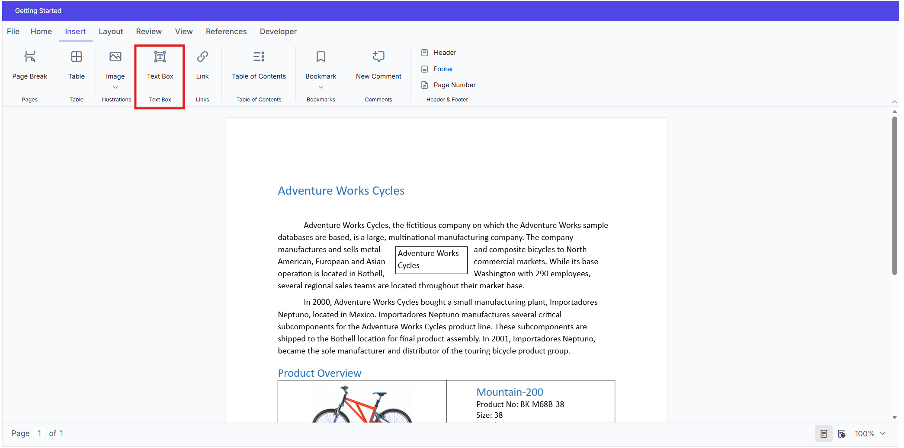
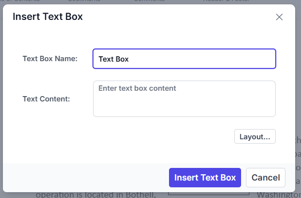

## Insert Text Box

The **Text Box** option is available in the **Insert** tab of the ribbon toolbar. Selecting this option opens the **Insert Text Box** dialog, where users can configure the required text box properties before inserting the text box into the document.



After configuring the desired settings, click **Insert** to add the text box to the document.



## Insert Text Box Using API

The **DOCX Editor** also provides an API to open the **Insert Text Box** dialog programmatically. This is useful when integrating custom toolbar items, buttons, or application workflows.

Use the following code snippet to open the **Insert Text Box** dialog:


```javascript
container.documentEditor.showDialog('TextBox');
```