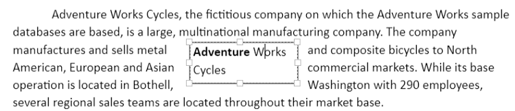
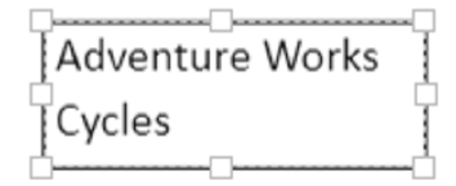

# Shapes in React DOCX Editor

Shapes are drawing objects that include a text box, rectangles, lines, curves, circles, etc. They can have preset or custom geometry.

N> At present, [React DOCX Editor](https://www.syncfusion.com/docx-editor-sdk/react-docx-editor) (Document Editor) does not have support to insert shapes. However, if the document contains a shape while importing, it will be preserved properly.

## Supported shapes

The DocumentEditor has preservation support for Lines, Rectangle, Basic Shapes, Block Arrows, Equation Shapes, Flowchart and Stars and Banners.


N> When using ASP.NET MVC service, the unsupported shapes will be converted to an image and preserved as an image.

## Text box Shape

A text box is a rectangular area on the document where you can enter text. When you click in a text box, a flashing cursor will display indicating that you can begin typing. It allows you to enter multiple lines of text with all text formatting.



## Insert Text Box

The **Text Box** option is available in the **Insert** tab of the ribbon. It allows users to insert a text box into the document by configuring the required properties through a dedicated dialog.

### Insert Text Box Using the UI

1. Navigate to the **Insert** tab in the ribbon.
2. Click **Text Box**.
3. The **Insert Text Box** dialog opens.
4. Configure the required text box properties.
5. Click **Insert** to add the text box to the document.

After insertion, the text box is added to the document with the configured settings.


### Insert Text Box Using API

The **DOCX Editor** also provides an API to open the **Insert Text Box** dialog programmatically. This is useful when integrating custom toolbar items, buttons, or application workflows.

Use the following code snippet to open the **Insert Text Box** dialog:

```typescript
documenteditor.documentEditor.showDialog('TextBox');
```

When invoked, the same **Insert Text Box** dialog available from the ribbon interface is displayed, allowing users to configure and insert a text box into the document.

## Shape Resizer

The DOCX Editor also supports a built-in shape resizer to resize the shapes present in the document. The shape resizer accepts both touch and mouse interactions.



## Text wrapping style

Text wrapping refers to how shapes fit with surrounding text in a document. Please [refer to this page](./text-wrapping-style) for more information about text wrapping styles available in Word documents.

## Positioning the shape

DOCX Editor preserves the position properties of the shape and displays the shape based on position properties. It does not support modifying the position properties. However, the shape will be automatically moved along with the edited text if it is positioned relative to the line or paragraph.

## Online Demo

Explore how to preserve AutoShapes and grouped shapes in Word documents using the React DOCX Editor in this live demo [here](https://document.syncfusion.com/demos/docx-editor/react/#/tailwind3/document-editor/autoshapes).

